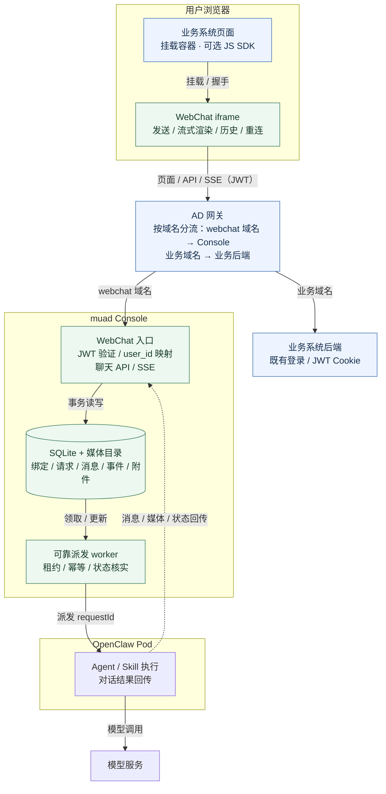
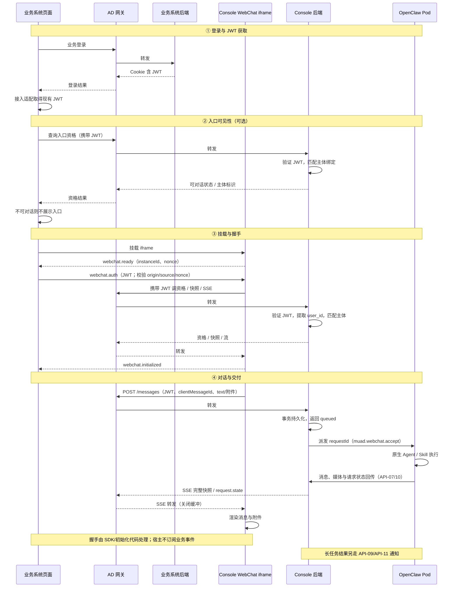

# WebChat 通道模块需求与设计一体化文档

> **文档编号**: MOD-WEBCHAT-001
> **文档版本**: v1.7
> **创建日期**: 2026-10-10
> **修订日期**: 2026-10-21
> **文档状态**: 设计评审中；尚未实现、未联调

认证复用业务平台现有 JWT：每个公开请求由 Console 验证并提取 user_id，不换票；算法、密钥与 Cookie 传递接入时确定。本文与[前端设计](webchat-channel.frontend.design.md)共用 `spec-context.yml`；评审用精简版见[webchat-channel.backend.review.md](webchat-channel.backend.review.md)。接口、字段和场景均为待实现契约，设计门禁不等于验收。

## 1. 文档控制

### 1.1 责任与评审边界

muad 负责 Console、统一聊天页、可选轻量 SDK、OpenClaw 外置插件和本地模拟；业务平台负责入口容器与登录凭据适配，负责人任务拆解时指定。需求见 §2，技术契约见 §3，部署验收见 §4；两份文档场景 ID 各自唯一，跨文档引用注明"前端"。

### 1.2 版本与审查

| 版本 | 变更 |
|---|---|
| v0.1–v1.4 | 初稿；管理员预授权、单窗口、附件白名单、最近 200 条、复用平台 session JWT |
| v1.5 | 修正 REVIEW-01~07；托管聊天页、iframe 主接入、nginx 可选、本地模拟；认证桥、双向媒体、可靠流式 |
| v1.6 | 认证收敛为复用现有 JWT；算法、密钥与 Cookie 传递接入时定 |
| v1.7 | 取消换票与内部会话；每请求验证 JWT；删除 auth_sessions 与换票/撤销接口 |

REVIEW-01 原生 resolver/sessionKey；REVIEW-02 全局主体绑定；REVIEW-03 Pod 媒体上传；REVIEW-04 持久派发与恢复；REVIEW-05 long-task 通道；REVIEW-06 ResponseController/流；REVIEW-07 JWT 鉴权。修复项与验收映射见 §2.5 和 §5。旧 `/webchat/v1/*`、签名 URL、错误码复用、历史分页等已清理。

## 2. 需求分析

### 2.1 目标与已对齐结论

业务平台嵌入统一聊天页，Console 将已授权用户消息交给 OpenClaw 原生通道管线并完整交付回复；保持一人一平台一条对话线、管理员预授权、用户隔离与既有模型池/Skill 策略。

1. Console 同端口托管 `/webchat/embed`；宿主用 iframe 或纯 JS mount，无需 React/Vue/Semi。
2. SDK 可选，只负责挂载、认证握手、销毁；对话、流式、未读、附件渲染都在 iframe 内，宿主不订阅业务事件；宿主可用同一 JWT 调 API-06 决定入口显隐。
3. Console 直接 IP:端口提供页面/API/SSE；生产经 AD 上的独立 webchat 域名访问；浏览器可达且 HTTP/HTTPS 匹配是接入条件。
4. 用户持现有 JWT 进入；每请求验证并提取 user_id，映射已授权 Human User/Agent；不换票，算法/密钥/Cookie 传递接入时定。
5. 本地模拟平台负责登录和测试 JWT；Console、SQLite、插件、OpenClaw 与浏览器走真实实现。
6. Pod session 是上下文真值；Console 持久记录请求、消息和交付状态，未可靠落库不算交付。
7. 单窗口、最近 200 条、`/new` 透传、块级流式；不承诺逐 token。

### 2.2 用户故事

| 编号 | 用户故事 | 优先级 |
|---|---|---|
| US-01 | MSSW 用户发送问题并持续看到回复 | P0 |
| US-02 | 重开页面看到自己的近期消息和当前回复 | P0 |
| US-03 | 上传图片与办公附件供助手分析 | P0 |
| US-04 | 查看、下载助手生成的附件 | P0 |
| US-05 | MSSP 获得相同体验，两个通道正确隔离 | P0 |
| US-06 | `/new` 重置原生上下文，页面近期消息仍可查看 | P1 |
| US-07 | 离线期间的长任务结果在重开聊天页后可见 | P1 |
| US-08 | 管理员只授权指定主体使用其 Human User/Agent | P0 |
| US-09 | 聊天页区分未登录、未授权和可对话状态 | P0 |
| US-10 | 不同技术栈的平台仅挂载和适配认证即可使用 | P0 |
| US-11 | 真实平台接入前本地验证认证、对话、附件与恢复 | P0 |

### 2.3 功能方案

#### 2.3.1 功能清单

| ID | 功能及范围 | 优先级 | 来源 |
|---|---|---|---|
| FEAT-01 | tools/muad-webchat 注册 mssw/mssp，原生 inbound/outbound | P0 | US-01、US-05 |
| FEAT-02 | driver/renderer/startup/镜像/自检及 long-task hooks 接线 | P0 | US-01、US-07 |
| FEAT-03 | Console 同 listener 独立聊天 API、SSE/长轮询 | P0 | US-01 |
| FEAT-04 | 主体绑定、对话锚点、请求、消息、媒体、事件和通知持久化 | P0 | US-02、US-08 |
| FEAT-05 | 浏览器上传、Pod 反拉、Pod 出站上传、授权下载 | P0 | US-03、US-04 |
| FEAT-06 | 消息去重、落库 ACK、spool、恢复、明确失败 | P0 | US-01、US-02 |
| FEAT-07 | 最近 200 条、单窗口与原生命令透传 | P1 | US-02、US-06 |
| FEAT-08 | 长任务正确通道/收件人、离线持久化、聊天页内部通知 | P1 | US-07 |
| FEAT-09 | 双向媒体 30 MiB、类型与数量验证 | P0 | US-03、US-04 |
| FEAT-10 | 平台 JWT 验证/解析、user_id 唯一主体定位、授权与失效 | P0 | US-08 |
| FEAT-11 | eligibility 供聊天页内部消费 | P0 | US-09 |
| FEAT-12 | 管理侧通道、authority/身份登记、类型与双语 | P0 | US-08 |
| FEAT-13 | 托管 embed 页和可选 SDK、直连与可选代理 | P0 | US-10 |
| FEAT-14 | 内部 RPC、幂等接收、租约恢复、不确定状态处理 | P0 | US-01、US-02 |
| FEAT-15 | 本地模拟登录/签发、双用户双平台、完整链路验收 | P0 | US-11 |

#### 2.3.2 字段与附件约束

| 字段 | 约束 |
|---|---|
| platform/channel | mssw/mssp；身份以服务端 authority 配置为准 |
| authority_id | 稳定配置 ID，唯一绑定 platform 与 JWT 验证 profile；issuer/tenant 按接入配置确定 |
| user_id → subject/external_id | 仅从验证成功的 JWT 提取，规范化为非空、≤512 字符主体，精确匹配 identity.external_id；不擅自小写化或回退其他 claim |
| account_id/peer_kind | 本期固定 default/direct，避免 per-channel-peer 多账号混用 |
| external_id_type | 元数据；`^[a-z][a-z0-9_]{0,63}$`，约定 mssw_user_id/mssp_user_id |
| clientMessageId | UUID，同一次逻辑发送的网络重试保持不变 |
| text | UTF-8 ≤65536 字节；文本和附件至少一项非空 |
| attachments | 最多 9 个 ticket；同 ticket 只能绑定一条请求 |
| 文件 | 双向每文件 ≤31457280 字节，字节不得走 exec/RPC |

允许 `.txt/.md/.doc/.docx/.xls/.xlsx/.ppt/.pptx/.zip/.tar.gz/.tgz/.png/.jpg/.jpeg/.gif/.webp/.bmp`；图片验证后内联，其余下载。Console 在 Go 侧校验扩展名、大小和内容一致性（文本编码、OOXML/ZIP/OLE 结构），上游 MIME helper 不作安全边界；Pod 复核字节/hash。本期不做杀毒或压缩包扫描，类型白名单不等于内容安全；拒绝时清临时文件。

### 2.4 范围与边界

| 类别 | 约定 |
|---|---|
| 范围内 | FEAT-01 至 FEAT-15；前端交互见前端设计 |
| 范围外 | OpenClaw fork；新聊天微服务；平台重写 UI；React/Vue 公共组件包；宿主机业务事件；多会话切换；逐 token；自助绑定；目录同步 |
| 保留取舍 | 最近 200 条无更早加载；通知仅在聊天页内；不做每用户频率限流，但有请求体/队列/并发和磁盘边界 |
| 接入待核实 | JWT 的 Cookie 获取/传递、算法/密钥、user_id 规范化、claims 与轮换、登录寿命/退出、网络与 HTTPS/CSP；不阻塞方案 |
| 本地先行 | 认证 profile 和真实后半链路可先验收；模拟通过不代表真实平台已对接 |

### 2.5 验收条件

#### 2.5.1 业务规则

| ID | 约束 | 场景 |
|---|---|---|
| RULE-01 | 双通道独立，前端不能伪造可信 platform | S-01、S-08、E-22 |
| RULE-02 | 同一 Human User 双通道共享 agent/workspace，session 分离 | S-02 |
| RULE-03 | sessionKey 以原生 resolver 为准，核验归属 | S-01、B-09、E-17 |
| RULE-04 | 双向媒体 30 MiB、每消息最多 9 个 | B-01、B-02、B-03 |
| RULE-05 | 未授权不触达 Pod，无 main 回退 | E-09、E-10 |
| RULE-06 | 无效/过期凭据拒绝，长连接同样受到期约束 | E-01、E-02、E-24 |
| RULE-07 | 持久 ACK 才表示 Console 接收交付 | E-04、E-23 |
| RULE-08 | HTTP 双向传文件，exec 仅有限大小控制 JSON | S-05、S-06、E-05 |
| RULE-09 | 复用生产 listener/Service；生产经 AD 域名分流，直连必测 | S-11、E-25 |
| RULE-10 | ResponseController 设置 deadline/Flush，经完整中间件 | S-07、E-07 |
| RULE-11 | 管理员唯一主体绑定，跨 Pod 冲突拒绝 | S-09、S-15、E-16 |
| RULE-12 | 一人一平台单窗口，最近 200 条，`/new` 重置原生上下文 | S-04、S-10、B-09 |
| RULE-13 | 命令原文进入原生命令授权流程，无第二套 Console 语义 | S-10、E-12 |
| RULE-14 | 后端内容校验，前端预检仅改善体验 | E-13、B-10 |
| RULE-15 | 按平台配置验证并检查时效后才提取 user_id；凭据不进 URL/日志/聊天 | E-14、E-15、E-22、E-27 |
| RULE-16 | 同发送 ID 幂等，结果未知时不自动重复 Agent | S-13、E-18 |
| RULE-17 | SSE/轮询共用完整快照，messageId/revision 幂等替换 | S-14、E-21、B-12 |
| RULE-18 | 长任务继承可信通道/目标，不能回退 wecom | S-12、E-20 |
| RULE-19 | iframe 完成对话闭环，本地验证真实后半链路 | S-16、S-17 |

#### 2.5.2 正常场景

E2E 必须覆盖真实浏览器、Console、SQLite、目标镜像/插件和最终结果，不能用成功桩替代；Go 单元/集成用 fake driver。

| ID | 功能 | 层级 | 关键边界、输入和可观测结果 |
|---|---|---|---|
| S-01 | FEAT-01/02/03 | E2E | 模拟平台→iframe→真实 Gateway；mssw 发消息，校验实际 resolver key 与页面回复 |
| S-02 | FEAT-01/04 | E2E | 同 Human User 双通道：同 agent/workspace、不同 session，不混消息 |
| S-03 | FEAT-04/10 | E2E | A/B 真实登录；B 读不到 A 的消息、媒体和事件 |
| S-04 | FEAT-07 | E2E | >200 条后重开；仅最近 200 条与当前运行恢复，无更早入口 |
| S-05 | FEAT-05/09 | E2E | 5 MiB 图片→Pod HTTP 拉取→模型输入；摘要一致、页面可预览 |
| S-06 | FEAT-05/09 | E2E | 真实 Skill 产出 ≥1 MiB 文件→API-10→消息→下载；摘要一致 |
| S-07 | FEAT-03 | E2E | 完整中间件，运行>5 分钟；跨 3 分钟写超时仍收块/心跳，重新认证后恢复 |
| S-08 | FEAT-01/02 | E2E | mssp 登录、原生路由、回复、附件全程正确通道 |
| S-09 | FEAT-10/11/12 | E2E | 有效平台 JWT→Console 验证→user_id 匹配预授权用户；业务平台可先以同一 JWT 查 eligibility 决定入口显隐；apply 健康后直接聊天，无绑定码/隐式建用户 |
| S-10 | FEAT-07 | E2E | 发 `/new`，真实上下文重置、原生回复显示、旧 UI 消息保留；不硬编码确认文案 |
| S-11 | FEAT-03/13 | E2E | 无 nginx 直连 IP:端口与 webchat 独立域名经 AD 分流两种模式的 embed/API/SSE；管理路由回归；核对原 Service/NodePort |
| S-12 | FEAT-02/08 | E2E | 两通道长任务离线完成后重开，通知/结果归属正确 |
| S-13 | FEAT-06/14 | E2E | POST 响应丢失后同 ID 重试；一条逻辑请求、一次 Agent 启动、同一结果 |
| S-14 | FEAT-03/06 | E2E | 回复中断网，按 eventSeq 恢复；无重复文本，最终内容/媒体与持久消息一致 |
| S-15 | FEAT-04/10/12 | E2E | 同 authority+subject 跨 Pod 再绑定冲突；不同 authority 不绕过原生路由唯一性 |
| S-16 | FEAT-13 | E2E | HTML/React/Vue 宿主挂同一 iframe，无消息事件监听，均完成认证和渲染 |
| S-17 | FEAT-15 | E2E | 本地签发端→真 Console/SQLite/镜像→Browser，双用户双平台、媒体、重连完整记录 |
| S-18 | FEAT-02/12 | E2E | 通道 validate/generation/apply/health 与回滚；双语登记；模型池冲突仍拒绝 |
| S-19 | FEAT-04 | integration | 真临时 SQLite 迁移两次、冲突回滚、唯一/FK 与接收/ACK 事务故障 |

#### 2.5.3 异常场景

| ID | 功能 | 层级 | 触发和预期 |
|---|---|---|---|
| E-01 | FEAT-10 | integration | 真验签器/HTTP：错误签名、未知 kid→401 |
| E-02 | FEAT-10 | integration | 过期/未生效或不符合配置时效的 JWT→401；SSE 到期关闭 |
| E-03 | FEAT-05/10 | E2E | B 用 A 的 mediaId 下载→404，无存在性泄漏 |
| E-04 | FEAT-06 | E2E | Console 断连/写库失败；Pod spool 保留，恢复重投去重，未 ACK 不报交付成功 |
| E-05 | FEAT-05 | E2E | Pod 下载中断，同请求重拉成功后才入 Agent，不重复消费 |
| E-06 | FEAT-14 | E2E | 派发前 Pod 不可用：有界退避排队，恢复仅执行一次，超预算失败 |
| E-07 | FEAT-03 | integration | 完整 Handler+真 httptest server，Flush 无 panic；写失败退出并清订阅 |
| E-08 | FEAT-03 | E2E | 代理缓冲/断开 SSE，降级长轮询仍收相同快照 |
| E-09 | FEAT-10/11 | E2E | 有效登录未绑定：业务平台不展示 WebChat 入口；直接访问时 eligibility=false，其余 403，Pod 无请求 |
| E-10 | FEAT-10 | E2E | 未授权发 `/bind`→403，不触达 Gateway |
| E-11 | FEAT-10 | E2E | 停用 identity/binding：新请求立即拒绝，流在复查窗口内关闭，不等 apply |
| E-12 | FEAT-07 | E2E | 已授权普通 agent 发 `/bind`，原生/guard 拒绝，无身份变更 |
| E-13 | FEAT-05/09 | integration | 真上传处理器/临时盘：伪装、错误容器、超限拒绝并清临时文件 |
| E-14 | FEAT-10 | unit | none/算法混淆/非 allowlist 算法拒绝 |
| E-15 | FEAT-06/10 | integration | 失败注入后日志、审计、诊断无 token/Cookie/正文，错误已脱敏 |
| E-16 | FEAT-10 | integration | 多候选旧数据/identity 改归属→冲突；旧授权版本不能派发 |
| E-17 | FEAT-01/14 | E2E | generation/route/session 不符→明确错误，无 main/其他 agent 兜底 |
| E-18 | FEAT-14 | E2E | ACK 丢失或 dispatch 前后崩溃：查日志/真 run，不能判定则 unknown，不重复启动 |
| E-19 | FEAT-05 | E2E | 错 Pod token、篡改 owner/hash→拒绝，无跨用户提交 |
| E-20 | FEAT-02/08 | E2E | 长任务恢复缺/错 channel/target→明确失败，无 wecom 回退 |
| E-21 | FEAT-03/06 | E2E | 游标重复/缺口/过期、慢消费者、Console 重启→重放/resync，revision 不倒退 |
| E-22 | FEAT-10/13 | E2E | JWT 不符合 profile 的来源/claims，或握手 origin/source/nonce 错误→不能取得聊天身份；nonce 仅用于窗口握手，JWT 不需含 nonce/jti |
| E-23 | FEAT-06/14 | E2E | 磁盘/spool 满→接收失败或交付待恢复；已接收记录保留，不丢数据后报成功 |
| E-24 | FEAT-10/13 | E2E | JWT 到期、退出/切用户→关流清旧 UI、受控重新认证，不能无限刷新 |
| E-25 | FEAT-13 | E2E | HTTPS 嵌 HTTP 被阻止；可信 HTTPS/跨域嵌入成功；仅 chat 页允许指定来源嵌入 |
| E-26 | FEAT-15 | integration | 生产 profile 不含模拟登录路由、测试私钥或测试 issuer 信任 |
| E-27 | FEAT-10 | integration | 真验证器/HTTP：缺 user_id、类型/规范化无效、篡改→401；不回退 sub/请求体 userId/管理员身份 |

#### 2.5.4 边界场景

| ID | 功能 | 层级 | 输入与预期 |
|---|---|---|---|
| B-01 | FEAT-09 | unit | 双向 30 MiB 接受 |
| B-02 | FEAT-09 | unit | 双向 30 MiB+1 拒绝 |
| B-03 | FEAT-09 | unit | 9 附件接受，10 拒绝 |
| B-04 | FEAT-03 | unit | UTF-8 64 KiB 接受，多字节越界拒绝 |
| B-05 | FEAT-10 | unit | 30 秒时钟容差，仍服从 JWT 到期 |
| B-06 | FEAT-10 | integration | 浏览器传 podId/agentId/sessionKey/userId 不作依据；未知身份字段拒绝 |
| B-07 | FEAT-10 | unit | user_id 规范化后 512/513 接受/拒绝；数值按 profile 无损转换，不截断 |
| B-08 | FEAT-12 | unit | external_id_type 小写合法；大写/数字首位拒绝 |
| B-09 | FEAT-01/07 | E2E | identityLinks 命中/未命中比较原生 key；`/new` 保留 key；跨 Pod 同名 agent 不冲突 |
| B-10 | FEAT-09 | integration | 文本/Markdown/OOXML/OLE/图片与伪装样本，不只信 MIME 头 |
| B-11 | FEAT-10 | integration | 按 profile 测试新旧验签/解密密钥轮换，移除旧 key 后拒绝旧凭据；kid 仅在平台使用时校验 |
| B-12 | FEAT-03/06 | unit | 同 revision 幂等、旧 revision 丢弃、终态不倒退；seq 与 eventSeq 分离 |
| B-13 | FEAT-14 | integration | 同 ID 同内容复用；同 ID 异内容 409；另一活动请求 409 |

#### 2.5.5 非功能目标

下列为待测目标，不是实测保证；分别报告 Docker/K8s、直连/代理和负载条件。

| ID | 目标与测量边界 |
|---|---|
| NFR-PERF-01 | 最近 200 条后端读取 P95≤150ms |
| NFR-PERF-02 | 持久接收 P95≤300ms，仅入库排队；exec/模型/首块分别测量 |
| NFR-PERF-03 | 同网段单文件上传目标≥20MB/s，记录磁盘/TLS |
| NFR-PERF-04 | Pod 可投递块到页面≤1s，不含模型凑块等待 |
| NFR-REL-01 | 已确认请求/交付可重启恢复，不确定状态明确展示 |
| NFR-SEC-01 | 用户/Pod/authority 隔离、凭据不泄漏，见 S-03/E-15/E-19/E-22 |

## 3. 技术设计

### 3.1 方案选型

#### 3.1.1 托管与通道边界

- 复用 Console 的 Go listener、SQLite 与静态资源托管 `/webchat/embed` 和 API；生产在 AD 上配置独立 webchat 域名并整体指向 Console（embed、静态资源和 API），iframe 与其 API 同源。
- 统一 UI/可选 SDK 在 `console/frontend/` 维护；mount 默认建 iframe，不要求宿主 React/Semi，不暴露 onChunk/onMessage 等业务回调；SDK 产物 `/webchat/sdk.js`。
- embed URL 只含 platform、parentOrigin、instanceId 等非秘密参数；Go handler 按 allowlist 校验，初始化配置安全注入 bootstrap，设置 frame-ancestors；query 不构成身份。
- 同进程减少部署单元但仍新增访问面，必须独立鉴权与容量控制；文件走 HTTP，字节不过容器通道。单窗口是产品取舍，上游存在版本相关的 binding/session 能力。

#### 3.1.2 原生路由（D-ROUTE）

- 插件在 Gateway 注册 mssw/mssp，接入原生 inbound、命令授权、路由和 outbound 文本/媒体交付；只调模型 API 或通用 chat.send 不能替代通道上下文。
- 原生 resolver 读取 bindings、account、peer、dmScope、identityLinks，返回 agentId/sessionKey；插件与派发核验 agent/channel/generation；Console 的 sessionKey 初始可空，收到结果后记录，配置变化时失效重验。
- 示例：`identityLinks.alice=["mssw:platform-user-42"]`、per-channel-peer 下常见结果 `agent:alice:mssw:direct:alice`；不用于手工拼 key，也不能套用 session-cancel 的推导函数；DB 唯一范围须含 Pod。
- 镜像默认 BASE_TAG=2026.7.1，审查 checkout 为 2026.7.2；实现须记录实际 digest/version，验证插件注册、入站、块级 delivery、媒体和命令，SDK 名称以目标镜像为准。

#### 3.1.3 唯一主体绑定（D-IDENTITY）

- 新增 `webchat_principal_bindings`：`(authority_id,subject) → identity_id → human_user_id → 当前 pod_id/agent_id`；authority 固定 platform 与 JWT 验证 profile，issuer/tenant 接入时配置。user_id 规范化为 subject 并匹配 identity.external_id，绑定与 identity 同事务写入。
- 全状态唯一约束阻止跨 Pod 重复主体：每 identity 只关联一主体，每 Human User/platform 只有一条绑定；原有 Pod 内 channel/account/external_id 冲突检查保留；不同 authority 同 subject 仍须满足原生路由无歧义。
- 每请求及派发重新 JOIN 检查 binding/identity/Human User 状态；授权变更递增 authorization_version，未派发请求失败，不按新 owner 继续旧输入。浏览器不能选 Pod/Agent/session；已开始请求保留派发时的目标快照，无法核实则 unknown。

#### 3.1.4 嵌入认证（D-AUTH）

本期链路：**业务平台现有 JWT → Console 每请求验证/解析 → 提取 user_id → 唯一主体绑定 → 已授权 Human User/Agent 对话**。业务平台已有含 JWT 的 Cookie 登录（属性与可读性接入时核实）；不要求新增专用聊天断言或签发接口。Console 在 `internal/webchat/` 隔离验证适配器，调用方只消费验证成功的结果。

| 事项 | 本期契约 / 接入时确定 |
|---|---|
| 身份字段 | 从验证成功的 JWT 读取 user_id，映射为 subject/external_id；不回退 sub、URL/请求体 userId 或管理员身份 |
| 验证与解析 | 签名 JWT 验签、校验时效与 claims 后解析；加密 JWT 解密并验证完整性；仅 Base64 解码不算验证 |
| 算法与密钥 | 与实际平台匹配；算法、密钥来源/轮换、issuer/audience/tenant 接入前配置；不预设 RS256 或新 claim |
| 验证边界 | profile 固定允许算法与信任来源，拒绝 none/算法混淆、篡改/过期/缺 user_id、claims 不匹配；配置缺失不得跳过 |
| user_id 类型 | 规范化为非空字符串；数值按 profile 无损转换，拒绝空值、对象/数组/布尔值及超限值 |
| 凭据传递 | 每请求 `Authorization` 携带 JWT；Cookie 属性、前端可读性、取 JWT 的适配方式接入时定；webchat 独立域名下业务 Cookie 不随 iframe 请求发送，不假设 iframe 继承 Cookie，不降低 HttpOnly 保护 |
| 请求认证 | 公开端点（含 SSE/长轮询）要求 `Authorization: Bearer <JWT>` 与 `X-Webchat-Platform`；platform 只选 profile，不构成身份；本地验签/解密，不逐请求回源；限制凭据长度 |
| 入口资格 | 宿主可在挂载前用当前用户 JWT 调 API-06 决定是否展示入口；浏览器跨 origin 直连仅 eligibility 开 CORS allowlist，或由平台后端代调；资格不构成授权 |

- 不换票：Console 不再签发聊天 token 或建服务端会话；按 platform 选 profile，本地验签/解密、校验时效与 claims 后提取 user_id。密钥常驻内存，JWKS 按缓存/轮换；失败、过期或缺 user_id→401，不降级。
- 复用：JWT 有效期内可重复使用，不消费 jti；nonce/instanceId 仅用于窗口握手；JWT 只存 iframe 内存，不进 URL/日志/localStorage。
- 失效：每请求重验并 JOIN 授权；SSE 连接时验证、15 秒复查授权、到期关闭；401 后 SDK 受控重新握手一次，仍失败显示重新登录；destroy 清理，切用户重建。
- 平台登录态：Console 不查询；其他窗口退出能否立即失效取决于平台撤销机制（接入时定），未撤销 JWT 可持续到到期；管理员停权按既有授权复查生效。宿主获取 JWT 方式接入时定。

### 3.2 架构与可靠派发

业务平台沿用 JWT Cookie 登录，Console 负责验证与 user_id 映射；浏览器到业务后端和 Console 的 HTTP 均经 AD 网关按域名分流（webchat 域名→Console，业务域名→业务后端），本地/无代理时可直连 Console。Cookie 到聊天页的传递适配后定。聊天页由 Console 托管，运行在业务页面的 iframe 中。

从上到下依次是：业务页面 → AD 网关 → Console → OpenClaw Pod → 模型；业务后端是 AD 的下游分支。Pod 执行完成后把消息/媒体/状态回传到 Console，再由 SSE 推给 iframe。webchat 使用独立域名，iframe 与其 API 同源、与宿主页面跨域；AD 网关负责 TLS、域名分流与 SSE 缓冲关闭，本地/无代理时可直连 Console。

认证与一次对话的交互顺序如下；JWT 获取是接入适配点，Cookie 读取/后端适配不在本期锁定。

所有浏览器到业务后端和 Console 的 HTTP 都经 AD 网关转发；该网关需关闭 SSE 缓冲、放宽上传与长连接超时，并只在信任边界内接受 forwarded 头。

入口资格也可由业务后端代调；浏览器跨 origin 直连时仅 eligibility 开放 CORS allowlist，调用同样携带用户 JWT 并由 Console 验证。

1. **入口显隐（可选）**：业务平台用用户 JWT 调 API-06 查询 canChat，决定是否展示入口；跨 origin 直连仅 eligibility 开 CORS allowlist，或由平台后端代调。该结果不替代后续服务端授权。
2. **身份认证**：平台沿用 JWT Cookie 登录；接入适配把 JWT 交给 iframe，Console 每请求验证并映射授权用户。无专用断言签发，获取方式后定；JWT 仅存 iframe 内存。
3. **浏览器对话**：iframe 经 AD 请求 Console，收发消息/附件与 SSE 快照；业务后端不代理对话流，内容不经 postMessage 回传。
4. **模型执行与交付**：Console 先持久接收，worker 经受控 driver exec 调插件 RPC；插件走原生 Agent/Skill，出站经 HTTP 提交并在 ACK 后确认交付；执行与交付状态分开记录。

本地模拟时用模拟宿主页与测试 JWT 后端替换业务前后端，Console、SQLite、插件和 Gateway 仍走真实链路（D-LOCAL）。

#### 3.2.1 模块布局（D-LAYOUT）

| 模块 | 位置与职责 |
|---|---|
| HTTP/认证 | internal/api/webchat_*.go：编解码、认证、writeJSON/writeErr |
| 编排 | console/backend/internal/webchat/：有界 worker、状态/恢复，注入 driver |
| 存储 | internal/repo/webchat_*.go：全部 SQL、迁移、原子状态 |
| 静态与启动 | 既有 internal/web/config/cmd/console：静态路由、响应头、可选 TLS |
| Runtime | tools/muad-webchat、guard/shared/renderer 登记，不 vendor 上游 |
| 本地测试 | console/frontend/test/webchat；console/backend/cmd/webchat-test-platform，仅测试构建 |

#### 3.2.2 接收、RPC 与恢复（D-DELIVERY）

1. API-04 同一事务完成鉴权版本校验、去重、ticket 绑定、请求/用户消息/事件；202 仅表示持久接收。
2. worker 按 conversation 互斥领取并记录 lease/attempt/next_attempt_at；driver helper 经 stdin 传有限 JSON，不拼 shell、不放 token/正文到 argv；operator 凭据读既有配置。
3. 注册 `muad.webchat.accept`（operator.write）与 `muad.webchat.status`（operator.read），不作模型工具。accept 输入 requestId、payloadHash、authorizationVersion、configGeneration、humanUserId、agentId、channel、accountId、peerId、text、attachmentTickets；Pod 身份来自本地配置并核验当前 route。
4. 插件先持久化 requestId/hash/owner，再返回 `{accepted,requestId,state,sessionKey,runId}`；同 ID/hash 复用。status 另返回 executionState 与 deliveryState：生成结束与全部输出 ACK 分开，不能凭生成结束标记交付成功。
5. 有界队列拉取/校验附件后进入目标版本原生 inbound；记录真实 runId 和终态，不预造 runId。
6. exec 超时/ACK 丢失先查 status；有证据未启动才安全重试，否则 unknown 并保持互斥，待核实或人工处理。

状态：`queued → dispatching → accepted → running → succeeded|failed|interrupted`；accepted 可直接完成命令；不确定分支 unknown；终态不倒退。lease 30 秒、派发 15 秒超时；安全阶段按 1/2/4…30 秒带抖动重试，总等待默认 10 分钟可配置。dispatch 前写 invocation intent；重启时 intent 不是已运行证明，缺证据则 unknown；真实中断显示 interrupted。

#### 3.2.3 出站与长任务（D-LONGTASK）

处理真实 delivery 回调，不在 payload 改写/取消前从观察性 hook 抢先发送。输出分配稳定 outputId/revision，写持久 spool（0700/0600），异步提交 API-10/07/09；失败保留重试，Console 提交后 ACK；稳定去重键避免重投生成新消息。媒体复制到插件持久目录并保留到 ACK，不能只存可能被 Skill 清理的路径；磁盘/队列满显式失败，"本地入队"不等于"用户已收到"。

补齐 long-task-hooks 的通道集合、可信 replyChannel/replyTarget、manager、progress、shared/notify-user 和 outbound。主动消息无前台 requestId 时须有真实 taskId/owner，Console 校验 Pod/user/channel，不接受自由填写 humanUserId 建档。取消沿用既有语义，不补发成功/失败通知、不跨用户释放租约；保留 Skill 分层、激活、工具策略和并发门禁。

### 3.3 数据设计（D-DATA）

repo 版本化幂等迁移；ID 为 TEXT UUID，时间 UTC；可变实体含 created_at/updated_at；SQL 参数化且列名显式。

| 表 | 必要字段（类型） | 约束/索引 |
|---|---|---|
| webchat_principal_bindings | binding_id TEXT PK；authority_id/subject/identity_id/human_user_id/platform/status TEXT；authorization_version INTEGER | UNIQUE(authority_id,subject)、UNIQUE(identity_id)、UNIQUE(human_user_id,platform)，FK identity/human；active/disabled |
| webchat_conversations | conversation_id TEXT PK；binding_id/human_user_id/platform/pod_id/agent_id TEXT；session_key TEXT NULL；config_generation/last_message_seq/last_event_seq INTEGER | UNIQUE(human_user_id,platform)；UNIQUE(pod_id,session_key) WHERE 非空 |
| webchat_requests | request_id TEXT PK；conversation_id/client_message_id/payload_hash/state TEXT；authorization_version/attempt INTEGER；target_pod_id/target_agent_id/target_channel/target_session_key TEXT NULL；target_generation INTEGER NULL；run_id/lease_until/next_attempt_at/error_code TEXT NULL | UNIQUE(conversation_id,client_message_id)；conversation 活动状态部分唯一索引；(state,next_attempt_at)；派发前原子冻结目标快照 |
| webchat_messages | message_id TEXT PK；conversation_id/role/text_body/status TEXT；request_id/output_id/run_id TEXT NULL；source_pod_id/source_kind/source_id TEXT；seq/revision INTEGER | UNIQUE(conversation_id,seq)；输出唯一键(source_pod_id,source_kind,source_id,output_id)；pending/streaming/complete/failed/interrupted |
| webchat_media_assets | media_id TEXT PK；conversation_id/human_user_id/pod_id/direction/kind/file_name/mime_type/storage_path/sha256/state TEXT；size_bytes INTEGER；ticket_hash/upload_key/bound_request_id/expires_at TEXT NULL | UNIQUE(ticket_hash)、UNIQUE(pod_id,upload_key)；(state,expires_at)；staging/available/bound/expired/failed |
| webchat_message_media | message_id/media_id TEXT；position INTEGER | PK(message_id,position)、UNIQUE(message_id,media_id)，FK 两实体 |
| webchat_events | conversation_id/source_event_id/type/payload_json/created_at TEXT；event_seq INTEGER | PK(conversation_id,event_seq)、UNIQUE(conversation_id,source_event_id) |
| webchat_notifications | notification_id TEXT PK；conversation_id/human_user_id/source_event_id/kind/payload_json/read_state TEXT | UNIQUE(conversation_id,source_event_id)；(conversation_id,read_state,created_at) |

未标 NULL 的字段必填；消息来源为 request/task/system 的明确归属。FK 受控删除，停权不删历史；identity/human 删除同步收回绑定访问，不转交旧历史。

事务：请求/用户消息 seq、ticket、首事件原子提交；API-07 去重、revision 合并、eventSeq 分配与请求状态同事务；API-10 写盘/hash、rename、提交媒体行，孤儿文件对账。message.seq 只排序，已有消息更新也生成新 eventSeq；历史取最近 200 条，活动回复须在一致快照内。

保留：未绑定上传 15 分钟过期；活动请求引用的 ticket 到终态后保留 24 小时可重拉；媒体长期保留；重放事件默认 24 小时，超窗完整 resync；JWT 不落库。完整快照有写放大，插件合并高频中间输出（目标 ≤4 次/秒），最终输出必持久化。

### 3.4 接口设计

#### 3.4.1 公共约定（D-API）

- 前缀：公开 `/api/v1/webchat/`，内部 `/internal/v1/webchat/`；JSON 成功 `{code:0,data}`，失败 writeErr/writeRepoError；SSE/二进制为显式流格式，写头前错误仍走标准封装。
- 认证：chat、管理、internal 凭据隔离；公开端点只接受 JWT 并声明 platform，每请求验证后按 user_id 解析绑定，操作类再校验绑定状态；eligibility 例外返回未授权状态。
- 错误：新增 errcode 常量，实现时分配未占用数字，补 AllCodes/errorCatalog、zh/en 和守卫测试；不复用旧 40009/40103/40405/40607/50011。

| 拟定常量 | HTTP | 场景 |
|---|---|---|
| WebchatCredentialInvalid / WebchatCredentialExpired | 401 | 验签、解密或时效 |
| WebchatNotAuthorized | 403 | 缺授权/停权 |
| WebchatIdentityConflict / WebchatIdempotencyConflict / WebchatBusy | 409 | 绑定冲突/同 ID 异内容/已有活动请求 |
| WebchatMediaNotFound | 404 | 无媒体或不属于主体 |
| WebchatMediaTooLarge / WebchatMediaTypeUnsupported | 413 / 415 | 大小/类型 |
| WebchatInputInvalid / WebchatTicketInvalid | 400 | 输入/票据 |
| WebchatRouteMismatch / WebchatRuntimeUnavailable | 503 | 路由/运行时 |
| WebchatStoreFailed / WebchatStreamUnavailable | 500 / 503 | 存储/流能力 |

#### 3.4.2 接口清单

| ID | 方法与路径 | 认证 | 作用 | 对应功能 |
|---|---|---|---|---|
| API-01 | POST `/api/v1/webchat/attachments` | JWT+授权 | 上传一个聊天附件，换取可绑定消息的 ticket | FEAT-05/09 |
| API-02 | GET `/api/v1/webchat/attachments/{mediaId}/content` | JWT+归属 | 授权下载或预览附件 | FEAT-05 |
| API-03 | GET `/api/v1/webchat/messages` | JWT+授权 | 取最近消息快照，或按游标增量恢复/长轮询 | FEAT-03/07 |
| API-04 | POST `/api/v1/webchat/messages` | JWT+授权 | 持久接收用户消息并返回 requestId | FEAT-03/14 |
| API-05 | GET `/api/v1/webchat/stream` | JWT+授权 | SSE 推送消息快照、请求状态和通知 | FEAT-03/06 |
| API-06 | GET `/api/v1/webchat/eligibility` | 平台 JWT | 查询当前用户能否使用 WebChat（入口显隐） | FEAT-11 |
| API-07 | POST `/internal/v1/webchat/messages` | Pod token+归属 | Pod 回传消息快照或请求状态 | FEAT-06 |
| API-08 | GET `/internal/v1/webchat/attachments/{ticket}?requestId=...` | Pod token+归属 | Pod 拉取用户上传的附件字节 | FEAT-05 |
| API-09 | POST `/internal/v1/webchat/notifications` | Pod token+归属 | Pod 提交长任务/系统通知 | FEAT-08 |
| API-10 | POST `/internal/v1/webchat/media` | Pod token+归属 | Pod 上传助手生成的媒体 | FEAT-05 |
| API-11 | GET `/api/v1/webchat/notifications?afterId=...&limit=...` | JWT+授权 | 拉取本人通知列表 | FEAT-08 |
| API-12 | POST `/api/v1/webchat/notifications/read` | JWT+授权 | 标记本人通知已读 | FEAT-08 |

**公共请求头**

| 头 | 适用 | 必填 | 说明 |
|---|---|---|---|
| `Authorization: Bearer <平台 JWT>` | 全部公开 API | 是 | 每请求验证；JWT 不落库、不进 URL |
| `X-Webchat-Platform: mssw / mssp` | 全部公开 API | 是 | 只用于选择已登记验证 profile，不构成身份 |
| `Authorization: Bearer <Pod token>` | 全部 internal API | 是 | Pod 身份从 token 解析，不信任请求体中的 Pod/user |
| `Content-Type: application/json` | JSON 请求 | 是 | 错误请求按 400 处理 |
| `Accept: text/event-stream` | API-05 | 是 | 非 SSE 客户端不建立流 |
| `Last-Event-ID` | API-05 恢复 | 否 | 与 `afterEventSeq` 同时出现时必须一致 |

**公共响应约定**

- 成功：`{code:0,data:{...}}`；失败：`{code:<errcode>,message:<本地化文案>}`，不返回堆栈、SQL、文件路径或凭据。
- 二进制响应不使用 JSON 封装；写头前的错误仍返回标准 JSON 错误。
- `eventSeq` 是 conversation 级恢复游标；`message.seq` 只用于消息排序；`revision` 是单条消息版本。

**公共类型**

| 类型 | 字段 | 说明 |
|---|---|---|
| WebchatMessage | messageId、seq、revision、role、textBody、status、runId、attachments | role：user/assistant/system；status：pending/streaming/complete/failed/interrupted；attachments 为 AttachmentRef 数组 |
| AttachmentRef | mediaId、fileName、mimeType、sizeBytes、kind | kind：image/file；不含本地路径、ticket 或下载 token |
| RequestInfo | requestId、state、runId、errorCode | state：queued/dispatching/accepted/running/succeeded/failed/interrupted/unknown |
| Notification | notificationId、kind、payload、readState、createdAt | payload 仅脱敏摘要和授权 messageId/mediaId 引用 |
| Event | eventSeq、type、data | type 与 API-05 的持久/控制事件一致 |

#### API-01：上传附件

**作用**：浏览器先上传一个文件，拿到 ticket；ticket 在 API-04 中绑定到一条消息。一个 ticket 只能绑定一条逻辑请求。

**请求**

| 参数 | 位置 | 类型 | 必填 | 说明 |
|---|---|---|---|---|
| `file` | multipart/form-data | binary | 是 | 单文件；≤31457280 字节；扩展名在白名单内 |
| `Authorization` | header | string | 是 | 平台 JWT |
| `X-Webchat-Platform` | header | string | 是 | mssw / mssp |

**响应 200**

| 字段 | 类型 | 说明 |
|---|---|---|
| `ticket` | string | 不透明票据，有效期 15 分钟；只用于 API-04 |
| `mediaId` | string | 媒体 ID |
| `fileName` | string | 规范化后的文件名 |
| `sizeBytes` | int64 | 实际字节数 |
| `mimeType` | string | 服务端判定的类型 |
| `expiresAt` | string | RFC3339 过期时间 |

**主要错误**：400 输入错误；401 凭据无效；403 无授权；413 超过 30MiB；415 类型不支持；500 存储失败。临时文件在拒绝时清理。

#### API-02：下载附件

**作用**：按 mediaId 授权读取附件字节，用于页面预览或下载；不使用签名 URL，凭据不进 URL。

**请求**

| 参数 | 位置 | 类型 | 必填 | 说明 |
|---|---|---|---|---|
| `mediaId` | path | string | 是 | 媒体 ID |
| `Authorization` | header | string | 是 | 平台 JWT |
| `X-Webchat-Platform` | header | string | 是 | 验证 profile |

**响应 200**：二进制。`Content-Type` 为服务端判定类型；`Content-Disposition` 使用安全文件名；图片 inline，其余 attachment；带 `X-Content-Type-Options: nosniff`。可附带 `X-Content-SHA256` 供客户端校验。

**主要错误**：401 凭据无效；403 无归属；404 不存在或不属于当前主体（不泄漏存在性）；500 存储读取失败。

#### API-03：消息快照与增量恢复

**作用**：首屏取最近 200 条快照；断线后按 eventSeq 取增量事件；也可用长轮询等待新事件。

**请求**

| 参数 | 位置 | 类型 | 必填 | 说明 |
|---|---|---|---|---|
| `limit` | query | int | 否 | 快照条数，1–200，默认 200 |
| `afterEventSeq` | query | int64 | 否 | 出现时进入增量模式；与快照模式互斥 |
| `waitMs` | query | int | 否 | 长轮询等待毫秒，0–25000，默认 0 |
| `Authorization` / `X-Webchat-Platform` | header | string | 是 | 同公共约定 |

**响应 200（快照模式）**

| 字段 | 类型 | 说明 |
|---|---|---|
| `mode` | string | `snapshot` |
| `eventSeq` | int64 | 快照对应的事件水位，可直接用于建 SSE |
| `messages` | WebchatMessage[] | 按 seq 正序，最多 200 条 |
| `activeRequest` | RequestInfo / null | 当前活动请求 |
| `unread` | int | 未读通知数 |

**响应 200（增量模式）**：`{mode:"events",eventSeq,events:[Event]}`，每批最多 200 个事件；有积压立即续取，不跳到最新游标；`waitMs` 超时可返回空 events。

**响应 200（游标异常）**：`{mode:"snapshot",resync:true,eventSeq,messages,activeRequest,unread}`，要求客户端整体重同步。

**主要错误**：400 游标/limit 非法；401/403；500 读取失败。快照与 eventSeq 来自同一一致读事务，包含活动回复；无 beforeSeq、更早加载或会话切换。

#### API-04：发送消息

**作用**：持久接收一条用户消息（文本和/或附件），返回 requestId；202 只表示 Console 已接单，不代表 Agent 已启动或已回复。

**请求**

| 参数 | 位置 | 类型 | 必填 | 说明 |
|---|---|---|---|---|
| `clientMessageId` | body | string | 是 | UUID；同一次逻辑发送的网络重试保持不变 |
| `text` | body | string | 否 | UTF-8 ≤65536 字节；与 attachments 至少一项非空；`/new` 也按普通 text 传 |
| `attachments` | body | array | 否 | 最多 9 项，每项 `{ticket}`；ticket 只能绑定一条请求 |
| `Authorization` / `X-Webchat-Platform` | header | string | 是 | 同公共约定 |

**响应 202**

| 字段 | 类型 | 说明 |
|---|---|---|
| `requestId` | string | Console 逻辑请求 ID |
| `messageId` | string | 用户消息 ID |
| `clientMessageId` | string | 回显客户端 ID |
| `accepted` | bool | true 表示已持久接收 |
| `state` | string | 初始为 queued |
| `runId` | string / null | 此时通常为 null，真实 runId 后续回填 |

**幂等与冲突**：payloadHash 基于规范化正文和有序媒体 ID；同 `clientMessageId` 且 hash 相同 → 返回原结果；同 ID 不同内容 → 409；conversation 已有活动请求 → 409 WebchatBusy。已接收请求不因 ticket 后来过期而失败。

**主要错误**：400 输入/票据非法；401/403；409 冲突；500 持久化失败（此时不能报告 accepted）。

#### API-05：SSE 事件流（D-STREAM）

**作用**：页面保持在线时，由 Console 推送完整消息快照、请求状态和通知；断开后可用 API-03 收敛。

**请求**

| 参数 | 位置 | 类型 | 必填 | 说明 |
|---|---|---|---|---|
| `afterEventSeq` | query | int64 | 否 | 恢复游标 |
| `Last-Event-ID` | header | string | 否 | 与 afterEventSeq 同时存在时必须一致 |
| `Authorization` / `X-Webchat-Platform` | header | string | 是 | 同公共约定 |
| `Accept` | header | string | 是 | `text/event-stream` |

**事件**

| event | data | 说明 |
|---|---|---|
| `message.snapshot` | `{eventSeq,message}` | 单条消息的完整新版本，按 messageId/revision 整体替换 |
| `request.state` | `{eventSeq,requestId,state,runId,errorCode?}` | 请求状态变化；终态不倒退 |
| `notification` | `{eventSeq,notification}` | 长任务/系统通知 |
| `snapshot` | 最近快照 + eventSeq | 控制帧，要求整体替换本地视图 |
| `resync_required` | `{eventSeq}` | 游标失效，客户端改用 API-03 重拉 |
| `auth.expired` | `{eventSeq}` | JWT 到期，客户端重新认证 |
| `auth.revoked` | `{eventSeq}` | 授权/绑定失效 |
| `stream.error` | `{code,message}` | 流错误；不推进游标 |

**主要错误**：写头前 401/403/503 返回标准 JSON；开始后只发控制帧并关闭。心跳为注释帧，不推进游标；连接最长 30 分钟且不超过 JWT 到期。

**实现约束**：

- `http.NewResponseController(w)` 设置 deadline/Flush，经 errorLogRecorder.Unwrap 解包；禁止断言 `w.(http.Flusher)`。
- 写头前确认流能力；开始后只写流帧，不混写 JSON。
- 每帧/心跳前设有界写 deadline（默认 30 秒），检查 SetWriteDeadline/Write/Flush。
- 15 秒心跳并复查授权，45 秒无帧视为失活；可设 X-Accel-Buffering:no。
- hub 只唤醒，DB 事件负责恢复；先订阅再取一致快照/事件上界并去重。
- 每订阅者有界队列；慢消费者关流后按游标重连；注销订阅/goroutine 收敛，断流不取消已接收请求。
- 最终 message 快照先于 request succeeded 提交；无匿名 delta/currentReply；断流后 API-03 可收敛。

#### API-06：资格查询

**作用**：查询当前用户能否使用 WebChat。业务平台可用它在挂载前决定是否展示入口；iframe 也用它初始化页面。

**请求**：仅公共请求头；无 body。

**响应 200**

| 字段 | 类型 | 说明 |
|---|---|---|
| `canChat` | bool | true 可对话；false 未授权/停用 |
| `platform` | string | mssw / mssp |
| `displayName` | string | 展示名（canChat=true 时） |
| `unread` | int | 未读通知数 |
| `principalRef` | string | 已验证 authority+user_id 的稳定非秘密标识，用于辨别主体变化 |
| `expiresAt` | string | JWT 到期时间（canChat=true 时） |
| `reason` | string | canChat=false 时返回，如 `not_authorized` |

**主要错误**：401 凭据无效；400 platform 缺失/非法。可由 iframe 或业务平台调用：宿主在挂载前查询，canChat=false 时自行隐藏入口；业务页面跨 origin 直连只对 eligibility 开 CORS allowlist，或由平台后端代调。principalRef 由已验证 authority+user_id 生成，仅用于辨别主体变化；资格结果不构成授权，其他接口仍逐请求校验。

#### API-07：Pod 回传消息与状态

**作用**：Pod 把 Agent 产生的消息快照、媒体引用和请求状态回传 Console；Console 落库后经 SSE 推给页面。

**请求**

| 参数 | 位置 | 类型 | 必填 | 说明 |
|---|---|---|---|---|
| `sourceEventId` | body | string | 是 | Pod 侧稳定事件 ID，用于去重 |
| `requestId` / `sourceTaskId` | body | string | 二选一 | 前台请求或长任务 ID |
| `channel` | body | string | 是 | mssw / mssp |
| `agentId` / `sessionKey` | body | string | 是 | 派发目标，须与真实任务一致 |
| `runId` | body | string | 否 | 真实原生 run；不得预造 |
| `kind` | body | string | 是 | `message.snapshot` / `request.state` |
| `outputId` / `revision` | body | string / int | message 时必填 | 输出稳定 ID 与单调版本 |
| `role` / `textBody` / `status` | body | string | message 时必填 | assistant/user/system；消息状态 |
| `mediaIds` | body | string[] | 否 | 已通过 API-10 提交的媒体 |
| `state` / `deliveryComplete` | body | string / bool | state 时必填 | 请求状态；所有最终输出 ACK 后才可 true |
| `errorCode` | body | string | 否 | 失败原因 |

**响应 200**：`{accepted:true,eventSeq,messageId?,revision?}`。

**幂等与归属**：同 sourceEventId 同内容幂等、异内容 409；Console 校验 Pod/owner/request/task/channel/agent/session，不匹配拒绝；mediaId 必须已有实际字节。

**主要错误**：400 字段缺失/非法；401/403 归属不符；409 冲突；500 持久化失败。同事务完成去重、单调合并、写事件/请求状态；失败不 ACK，禁止自由 humanUserId 建档。

#### API-08：Pod 拉取上行附件

**作用**：Pod 按 ticket 和 requestId 拉取用户上传的附件字节；同一 ticket 可为同一逻辑请求反复下载，不能跨请求使用。

**请求**

| 参数 | 位置 | 类型 | 必填 | 说明 |
|---|---|---|---|---|
| `ticket` | path | string | 是 | API-01 返回的票据 |
| `requestId` | query | string | 是 | ticket 绑定的逻辑请求 |
| `Authorization: Bearer <Pod token>` | header | string | 是 | Pod 身份 |

**响应 200**：二进制；`Content-Type`、`Content-Length`、`X-Content-SHA256`；Pod 必须校验大小/hash 后再进入原生媒体管线。

**主要错误**：400 ticket/requestId 非法；401/403 非本 Pod 或未绑定；404 票据不存在/过期；409 已绑定其他请求。

#### API-09：Pod 提交通知

**作用**：长任务或系统事件产生通知，持久化后由页面拉取或经 SSE 推送。

**请求**

| 参数 | 位置 | 类型 | 必填 | 说明 |
|---|---|---|---|---|
| `sourceEventId` | body | string | 是 | 稳定去重 ID |
| `sourceTaskId` | body | string | 是 | 真实任务 ID |
| `channel` / `agentId` | body | string | 是 | 须与真实任务一致 |
| `kind` | body | string | 是 | 通知类型 |
| `payload` | body | object | 是 | 仅脱敏摘要及授权 messageId/mediaId 引用 |

**响应 200**：`{accepted:true,eventSeq,notificationId}`。

**主要错误**：400/401/403/409。收件人由真实任务/owner 决定，不接受自由填写 humanUserId。

#### API-10：Pod 上传出站媒体

**作用**：Pod 把助手生成的图片/文件提交给 Console，随后在 API-07 中引用 mediaId。

**请求（multipart/form-data）**

| 参数 | 位置 | 类型 | 必填 | 说明 |
|---|---|---|---|---|
| `file` | form | binary | 是 | ≤30MiB，类型/内容校验同 API-01 |
| `uploadKey` | form | string | 是 | Pod 侧稳定键，幂等 |
| `requestId` / `sourceTaskId` | form | string | 二选一 | 归属请求/任务 |
| `channel` / `agentId` | form | string | 是 | 与真实任务一致 |
| `sha256` / `sizeBytes` | form | string / int64 | 是 | 客户端计算值，服务端复核 |

**响应 200**：`{mediaId,fileName,mimeType,sizeBytes,sha256}`。

**幂等与错误**：同 uploadKey 同内容复用；异内容 409；400/401/403/409/413/415/500。

#### API-11：拉取通知

**作用**：页面打开或恢复时拉取本人通知列表；长任务结果在页面关闭期间也保留。

**请求**

| 参数 | 位置 | 类型 | 必填 | 说明 |
|---|---|---|---|---|
| `afterId` | query | string | 否 | 按 (created_at,notification_id) 稳定定位 |
| `limit` | query | int | 否 | 1–100，默认 50 |

**响应 200**：`{items:Notification[],nextId,unread}`。

**主要错误**：400/401/403。引用消息超出最近 200 条时保留摘要和附件引用，不假装跳转到未加载历史。

#### API-12：标记通知已读

**作用**：更新本人通知的已读状态，幂等。

**请求**

| 参数 | 位置 | 类型 | 必填 | 说明 |
|---|---|---|---|---|
| `notificationIds` | body | string[] | 是 | 1–100 个，只允许本人通知 |

**响应 200**：`{updated:int,unread:int}`。

**主要错误**：400/401/403。重复标记不报错。

#### 原换票/撤销接口（v1.7 移除）

公开端点直接验证 JWT，Console 不再持有可单独撤销的聊天会话；失效由 JWT 到期、平台撤销或授权停用决定，客户端清内存凭据并受控重新认证。

### 3.5 质量实现方案

#### Q-01：错误、超时、性能

handler 不持 SQL/docker 细节；driver 命令经 helper、CommandContext、有限 stdin/stdout，stderr 合并进错误。Go 单元/集成用 fake driver/httptest，go test/vet 通过后再真实 E2E。上传最长 2 分钟；Pod HTTP 默认 60 秒可取消；派发 15 秒、long poll 25 秒，SSE 按 D-STREAM；后台失败显式处理。

接收只做事务，exec 放有界 worker。JWT 验证为本地验签/解密与 claims 校验（微秒级），不逐请求远端核查；JWKS 按缓存/轮换。唯一索引 JOIN 查身份、conversation/seq 查历史、eventSeq 查恢复；媒体批量关联避免 N+1。分别测 API/排队/首块/交付延迟。

#### Q-02：HTTP 与浏览器边界

JSON 走 writeJSON/writeErr、稳定 errcode 和双语；SSE/二进制写头前错误沿统一封装；chat、管理、internal 凭据隔离。仅 embed 页 frame-ancestors 允许登记宿主，管理页禁止外部嵌入；宿主 frame-src 须允许 webchat 域名。webchat 独立域名下 iframe 与其 API 同源，不需要 CORS；宿主页面是另一 origin，postMessage 按 parentOrigin allowlist 校验；业务平台直连 eligibility 属跨 origin，仅该路由开放 CORS/OPTIONS allowlist，或由平台后端代调。不全站通配，不把 CORS 当认证。

#### Q-03：存储和授权

repo 集中 schema、参数化显式列、事务；唯一冲突映射稳定错误。停权不依赖 apply，generation 未生效拒绝派发。Human User 创建仍绑定未占用 model_config_id，登录不自动建用户或共享模型。

#### Q-04：秘密、日志与隔离

平台 JWT 由业务系统签发。Console 按实际算法注入验签公钥/共享密钥或解密密钥及验证配置，不预设只用公钥；材料仅后端运行时可读，不进前端/镜像/git。文件 0600、目录 0700，Pod token 沿 `/run/secrets/muad/pod-service-token` 的 0400；路径服务端生成，防穿越/跨用户引用；JWT 不落库、不落盘。

审计与 Skill telemetry 分离，诊断经 auditlog.RedactDiagnostic 后落库/输出；不记 token/Cookie/Authorization/正文/文件字节。插件注入 log，前缀 `[muad-webchat] [<action>]`；CLI 错误 stderr+非零，stdout 只结构化结果。

#### Q-05：Runtime 和 Skill

schema/validateRuntimeConfig、原子落盘、generation/stage/health/rollback；依赖构建时打包并 offline-safe 自检，运行时不 npm install。system 优先 protected，public/private 冲突需 allow_override；不绕过 activation/工具授权/并发租约。

## 4. 部署与本地验收

### 4.1 直接部署与代理（D-DEPLOY）

| 模式 | 条件 | 验收 |
|---|---|---|
| Console 直连 | 本地/无 AD 场景，同 Go listener 提供页面/API/SSE，不新增聊天 Service | S-11 |
| 本地 HTTP | 不同本地端口模拟不同 origin，隔离数据/密钥 | S-16、S-17 |
| AD 网关（推荐） | 配置独立 webchat 域名并整体分流到 Console，业务域名到业务后端；TLS/证书在 AD；关闭 SSE 缓冲，放宽上传/长连接超时，透传 Authorization | S-11、E-08、E-25 |
| HTTPS 宿主 | AD 网关持有 webchat 域名证书，或 Console 提供匹配的 HTTPS | E-25 |
| Console 直接 TLS | 需实现 cert/key 及同端口 ListenAndServeTLS，不假定已有 | E-25 |

浏览器必须可达 webchat 域名（直连或经 AD 网关），仅平台后端可达不足；HTTPS 嵌 HTTP 受混合内容限制，CORS 不能解决；证书/密钥运行时注入。AD 网关需按域名分流并关闭 SSE 缓冲、放宽上传/长连接超时，只在信任边界内接受 forwarded 头；Console 不信任任意客户端伪造的 forwarded 头。NetworkPolicy 按实际模式允许 AD 网关入口及 Worker→Console 回传；管理、health 和内部 runtime 回归。

### 4.2 发布与回滚

顺序：Console schema/API/UI → Worker 插件镜像/自检 → 目标 Pod 升级 → validate/generation/apply/health → authority/身份授权 → 平台挂载；图片模型 input 能力在目标镜像验证。沿用实际 listener/Service/NodePort，不固定 30080；切换 TLS 协议时同步地址/探针。回滚先停新接收、排空安全交付，保留运行中/unknown 记录和新表/历史；代码与 runtime 按 generation 回滚。

### 4.3 本地完整模拟（D-LOCAL）

交付可复现启动入口/说明，启动模拟平台后端及宿主页、真实 Console、含插件的目标 OpenClaw 容器；独立数据目录，默认 loopback；测试密钥临时生成、严格权限、结束清理；生产构建不含模拟登录端或测试 profile 信任。模拟 JWT 算法是测试 profile。

模拟内容：两 authority、A/B 用户、未授权/停用用户、跨 Pod 冲突 fixture；JWT Cookie 登录、可替换的获取适配、退出/切用户；含真实 user_id 的测试 JWT，缺/篡改 user_id、错签名/过期/claims、密钥轮换；有效 JWT 可再次认证。HTML/React/Vue 宿主只挂 iframe。

完整链：模拟登录取得 JWT → 接入适配/iframe 握手 → Console 验证并映射授权 → 真持久请求 → 真原生 channel/Agent → 块级交付 → 浏览器渲染；覆盖双向媒体、长任务、断网/重启。域名分流模式用本地反向代理或多端口/多 host 模拟 webchat 域名与业务域名。模拟仅替代平台身份来源，不用预制回复替代真实后半链路。确定性 provider 可用于协议测试但须标注为模型替身；S-01/S-05/S-06 至少用目标模型和真实 Skill 验证，无条件场景保持待验。交付启动/停止/重跑说明、镜像版本/digest、配置摘要、场景报告及脱敏日志/截图；真实平台认证、网络、CSP/HTTPS 和退出行为仍需接入验收。

### 4.4 运维与清理

监控队列年龄/深度、unknown 请求、spool 大小/重试、媒体失败、授权失败、SSE 慢消费者、replay/resync 及磁盘；磁盘初始告警 80%，其余阈值压测后定。按索引分批清超窗事件、未绑定上传和确认孤儿；不清活动请求文件、未 ACK spool 或 200 条外历史。存储耗尽拒绝新接收，保留已有数据。

## 5. 风险与依赖

| ID | 风险 | 应对/待核实 | 场景 |
|---|---|---|---|
| RISK-01 | 块级体验 | 目标镜像测真实 delivery，不承诺 token | S-07 |
| RISK-02 | 上游版本差异 | digest 和 SDK/session/媒体/命令实测 | S-01、S-18、E-17 |
| RISK-03 | writer 包装/超时 | ResponseController 检查写错误 | E-07 |
| RISK-04 | 浏览器/代理阻断 | HTTPS/frame policy/CORS/AD 网关缓冲与超时 | E-08、E-25 |
| RISK-05 | JWT 算法/传递待定 | 复用现有 JWT 及 user_id，profile/获取适配接入前定，测试 profile 先行 | E-01、E-22、E-27 |
| RISK-06 | 端口/网络 | 原部署端口，浏览器与 Worker 方向均测 | S-11、S-17 |
| RISK-07 | 回传/重启缺失 | spool+ACK/恢复，不 best-effort 冒充成功 | E-04、E-18、E-21 |
| RISK-08 | 凭据冒用/跨窗口注入 | 每请求验证/时效/准确窗口来源；有效 JWT 复用不误判为重放 | E-14、E-22、E-27 |
| RISK-09 | 绕过入口 | 服务端授权与 Pod owner 检查 | E-09、E-19 |
| RISK-10 | 退出≠停权 | 授权复查按请求生效；JWT 未撤销时残余寿命受有效期约束 | E-11、E-24 |
| RISK-11 | 磁盘/写放大 | 有界队列、合并、容量监测 | E-23 |
| RISK-12 | 密钥轮换 | 按 profile 备好新验证/解密材料后切换，旧 key 撤销窗口实测 | B-11 |
| RISK-13 | 测试泄漏生产 | 构建/密钥/issuer 隔离 | E-26 |
| RISK-14 | 长任务错通道 | mssw/mssp 可信 target，未知失败 | S-12、E-20 |

## 6. 需求追溯矩阵

| 用户故事 | 功能 | 接口/落点 | 验收 | 状态 |
|---|---|---|---|---|
| US-01 | FEAT-01/02/03/06/14 | API-04/05/07、D-ROUTE、D-DELIVERY | S-01、S-07、S-13、E-18 | 待实现 |
| US-02 | FEAT-04/06/07 | API-03/05 | S-03、S-04、S-14、S-19 | 待实现 |
| US-03 | FEAT-05/09 | API-01/08 | S-05、E-05、E-13、B-01、B-02、B-03、B-10 | 待实现 |
| US-04 | FEAT-05/09 | API-02/10/07 | S-06、E-03、E-19 | 待实现 |
| US-05 | FEAT-01/02 | API-04/05、D-ROUTE | S-02、S-08 | 待实现 |
| US-06 | FEAT-07 | API-04/03 | S-10、E-12、B-09 | 待实现 |
| US-07 | FEAT-02/08 | API-09/11/12、D-LONGTASK | S-12、E-20 | 待实现 |
| US-08 | FEAT-04/10/12 | API-06、D-IDENTITY、D-AUTH、管理登记 | S-09、S-15、S-18、E-09、E-11、E-16、E-22、E-27 | 待实现 |
| US-09 | FEAT-11 | API-06 | S-09、E-09 | 待实现 |
| US-10 | FEAT-13 | embed、API-06、D-DEPLOY | S-11、S-16、E-24、E-25 | 待实现 |
| US-11 | FEAT-15 | D-LOCAL | S-17、E-26 | 待实现 |

RULE 映射见 §2.5.1，RISK 见 §5；所有场景均待实现验证。

## Spec Compliance Matrix

每行 item ID 为 Context 稳定引用。applied 只表示约束已落设计，不表示已测试。

| Spec/Rule | enforcement | 设计影响与落点 | item ID | 验证 | 状态 |
|---|---|---|---|---|---|
| backend-code-quality-performance#RULE-backend-quality-001 | required | §3.5 Q-01 错误/超时/fake/go test/vet | SC-B01 | E-05、E-07、E-23 | applied |
| backend-code-quality-performance#RULE-backend-write-err-001 | required | §3.4 D-API、Q-02 稳定 errcode | SC-B02 | E-01、E-13、errorCatalog | applied |
| backend-database#RULE-backend-database-001 | required | §3.3 参数化/事务/幂等迁移 | SC-B03 | S-19、B-13 | applied |
| backend-database#RULE-backend-no-select-star-001 | required | §3.3 显式列/批量关联 | SC-B04 | S-19、regex verifier | applied |
| backend-directory-structure#RULE-backend-directory-001 | required | §3.2.1 D-LAYOUT 分层 | SC-B05 | S-01、包依赖审查 | applied |
| backend-logging#RULE-backend-logging-001 | required | §3.5 Q-04 审计/telemetry 分离 | SC-B06 | E-15 | applied |
| backend-logging#RULE-backend-redact-001 | required | §3.5 Q-04 诊断脱敏 | SC-B07 | E-15、E-23 | applied |
| backend-platform-rules#RULE-backend-platform-001 | required | §3.1.3 隔离、Q-03/Q-05 apply | SC-B08 | S-03、S-18 | applied |
| backend-platform-rules#RULE-backend-http-envelope-001 | required | §3.4 D-API JSON/流边界 | SC-B09 | E-01、E-07、TestHTTPEncoder | applied |
| backend-platform-rules#RULE-backend-model-pool-001 | required | Q-03 独占模型池，无登录建用户 | SC-B10 | S-09、S-18 | applied |
| runtime-config-and-apply#RULE-runtime-config-001 | required | Q-05、§4.2 apply/health/rollback | SC-R01 | S-18 | applied |
| runtime-config-and-apply#RULE-runtime-validate-before-write-001 | required | Q-05 validate/generation/原子写 | SC-R02 | S-18 | applied |
| runtime-directory-structure#RULE-runtime-directory-001 | required | §3.2.1 tools/bin，无上游 fork | SC-R03 | S-01、S-18 | applied |
| runtime-isolation-and-security#RULE-runtime-security-001 | required | Q-04 运行时注入/Pod 隔离 | SC-R04 | S-03、E-19、E-26 | applied |
| runtime-isolation-and-security#RULE-runtime-secret-file-mode-001 | required | §3.2.3、Q-04 权限与原子写 | SC-R05 | S-06、E-04、文件权限断言 | applied |
| runtime-skill-execution#RULE-runtime-skill-001 | required | §3.2.3、Q-05 激活/进度/并发 | SC-R06 | S-06、S-12、E-20 | applied |
| runtime-skill-execution#RULE-runtime-skill-layering-001 | required | Q-05 system protected/冲突策略 | SC-R07 | S-06、Skill 策略回归 | applied |
| runtime-skill-execution#RULE-runtime-log-injection-001 | required | Q-04 注入 log | SC-R08 | E-15 | applied |
| runtime-skill-execution#RULE-runtime-log-prefix-001 | required | Q-04 模块/action 前缀 | SC-R09 | E-15 | applied |
| runtime-skill-execution#RULE-runtime-skill-fail-loud-001 | required | Q-04 stderr/非零、stdout 机器结果 | SC-R10 | E-05、E-19 | applied |

前端 7 条 required 规则矩阵见前端设计。

## 附录：证据与术语

仓库证据：`bin/openclaw-config-renderer.mjs`、`console/backend/internal/runtimeconfig/routes.go`、`console/backend/internal/repo/identities.go`、`console/backend/internal/api/server.go`、`tools/muad-runtime-guard/src/long-task-hooks.mjs`、`build/docker-build/Dockerfile.openclaw`。上游参考：`src/routing/session-key.ts`、`src/routing/resolve-route.ts`、`src/config/types.agents.ts`、`extensions/nextcloud-talk/src/inbound.ts`；官方[入站](https://docs.openclaw.ai/plugins/sdk-channel-inbound)/[出站](https://docs.openclaw.ai/plugins/sdk-channel-outbound)文档仅辅助，兼容以目标镜像验收为准。浏览器参考：[postMessage](https://developer.mozilla.org/en-US/docs/Web/API/Window/postMessage)、[frame-ancestors](https://developer.mozilla.org/en-US/docs/Web/HTTP/Reference/Headers/Content-Security-Policy/frame-ancestors)、[混合内容](https://developer.mozilla.org/en-US/docs/Web/Security/Defenses/Mixed_content)。

authority 是可信身份域；sessionKey 是原生路由结果；requestId 是 Console 逻辑发送；runId 是实际原生运行，可能暂缺；message.seq 排序、eventSeq 恢复、revision 单消息版本；ACK 表示 Console 持久接收，不表示已读。
