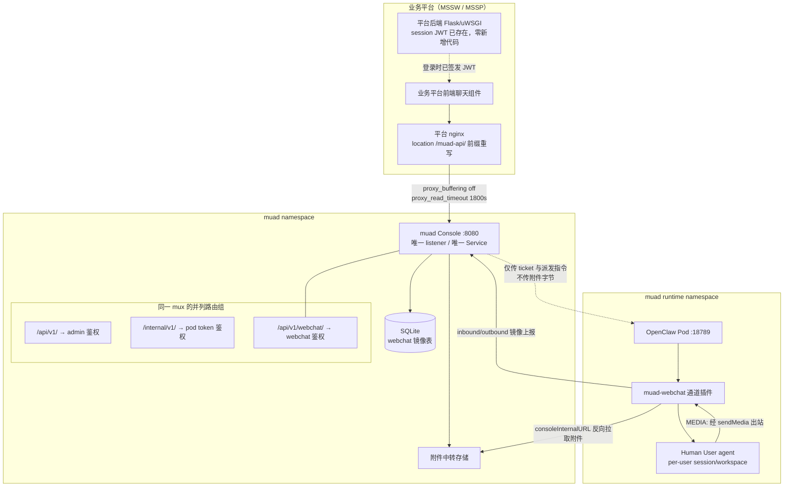
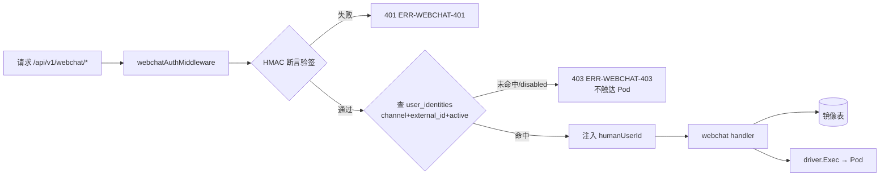
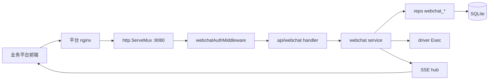
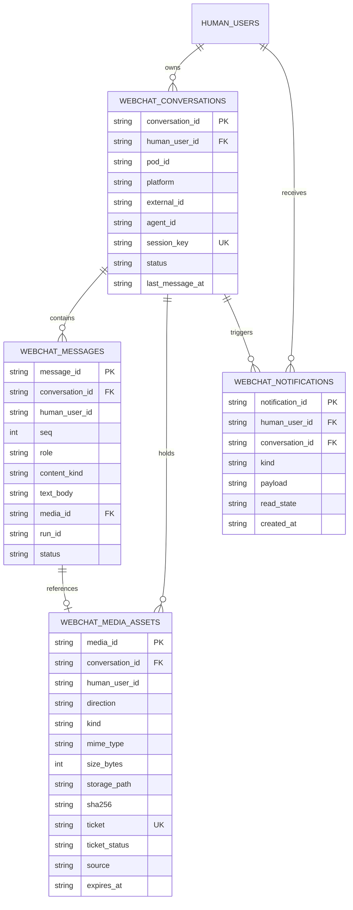
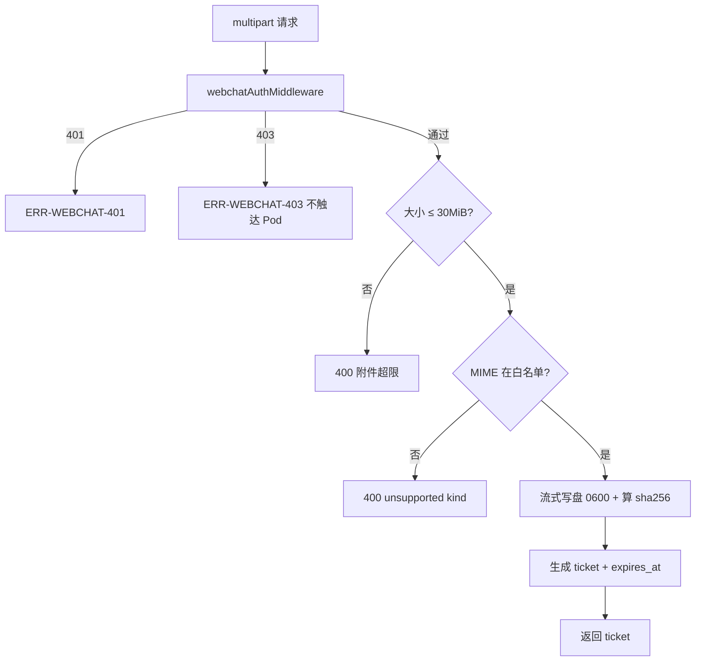
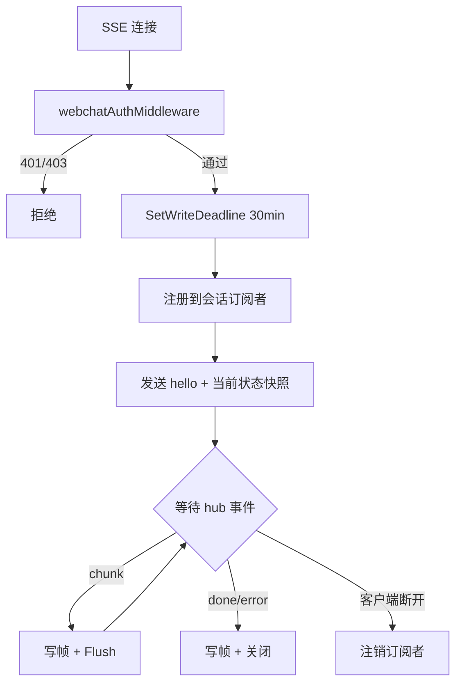

# WebChat 通道 模块需求与设计一体化文档

> **文档编号**: MOD-WEBCHAT-001
> **文档版本**: v1.4
> **创建日期**: 2026-10-10
> **文档状态**: 设计评审中

**评审边界说明**:
- **需求评审**: 第 2 章（需求分析）→ 通过后锁定为需求基线 v1.1
- **设计评审**: 第 3-4 章（技术设计 + 部署运维）→ 通过后锁定设计基线 v1.1
- **交接契约**: 2.5 验收条件 — 需求定义 What，设计实现 How

**ID 体系**: US（用户故事）、FEAT（功能）、API（接口）、RULE（业务规则/系统约束）、TC（测试用例）、RISK（风险）、NFR（非功能指标）
场景编号：S-（正常）、E-（异常）、B-（边界）

**填写约定**: 表内数值/阈值均为真实目标或"待定"，无实测依据不编造。接口设计按 HTTP API 形态。

**v1.1 修订说明**：身份模型由"自助绑定码"改为"管理员预授权白名单"；部署形态确认为同端口 8080 独立路由组。

**v1.2 修订说明**：确立**单窗口单会话线**；Console 对斜杠命令与附件**原样透传**（不包装、不拦截、不提供专用接口），命令语义完全交由 claw。修订依据见 §3.1 决策五。

**v1.3 修订说明**：第一，附件白名单收窄为日常办公文档、压缓包与常用图片（§2.3.3）；第二，历史仅返回**最近 200 条**，不做更早分页、不建会话保留期与清理策略；第三，不做消息频率限流。

**v1.4 修订说明**：鉴权机制由“平台额外签发 HMAC 短时断言”改为“**直接复用业务平台既有 session JWT，由 Console 以平台公钥本地验签**”。依据见 §3.1 决策七。此方案下平台**零新增代码**、Console **不向平台发起任何调用**（满足 Console 到平台的网络限制）；JWT 签名算法由平台方单独设计后补充，本文以 `{待平台补充}` 标注。

---

## 目录

- [1. 文档控制](#1-文档控制)
- [2. 需求分析](#2-需求分析)
  - [2.1 需求概述](#21-需求概述-必填)
  - [2.2 痛点与价值](#22-痛点与价值-必填)
  - [2.3 功能方案](#23-功能方案-必填)
  - [2.4 范围与边界](#24-范围与边界-必填)
  - [2.5 验收条件](#25-验收条件-必填)
- [3. 技术设计](#3-技术设计)
  - [3.1 方案选型](#31-方案选型-必填)
  - [3.2 架构设计](#32-架构设计-必填)
  - [3.3 数据设计](#33-数据设计-必填)
  - [3.4 接口设计](#34-接口设计-必填)
  - [3.5 质量实现方案](#35-质量实现方案-必填)
- [4. 部署与运维](#4-部署与运维)
- [5. 风险与依赖](#5-风险与依赖)
- [6. 需求追溯矩阵](#6-需求追溯矩阵)
- [Spec Compliance Matrix](#spec-compliance-matrix)
- [附录：术语表](#附录术语表)

---

## 1. 文档控制

### 1.1 责任人

| 角色 | 姓名 | 职责范围 |
|------|------|---------|
| 产品经理 | 待定 | 需求定义、业务验收 |
| 开发负责人 | 待定 | 技术方案、代码实现 |
| 测试负责人 | 待定 | 测试策略、质量保证 |
| 架构师 | 待定 | 架构审核、技术决策 |

### 1.2 修订历史

| 版本 | 日期 | 作者 | 变更描述 |
|------|------|------|---------|
| v0.1 | 2026-10-10 | | 初始草稿（多轮技术对齐） |
| v1.1 | 2026-10-10 | | 身份模型改为管理员预授权白名单；确认同端口 8080 独立路由组；明确上游不支持多会话切换 |
| v1.2 | 2026-10-10 | | 改为单窗口单会话线；斜杠命令与附件原样透传，Console 不包装不拦截 |
| v1.3 | 2026-10-11 | | 确立附件类型白名单；历史仅返回最近 200 条；移除会话保留期与限流等特殊逻辑 |
| v1.4 | 2026-10-13 | | 鉴权改为**直接复用平台 session JWT、Console 本地验签**；平台零新增代码，Console 不调用平台 |
| v1.3 | 2026-10-11 | | 确立附件类型白名单；历史仅返回最近 200 条；移除会话保留期与限流等特殊逻辑 |

---

## 2. 需求分析

### 2.1 需求概述 [必填]

| 项目 | 内容 |
|------|------|
| **模块名称** | WebChat 通道（mssw / mssp 双平台） |
| **模块ID** | MOD-WEBCHAT-001 |
| **所属系统/产品线** | muad-openclaw 控制面 + Runtime Pod + 业务平台（MSSW/MSSP） |
| **需求类型** | 新功能 |
| **业务背景** | 业务产品平台需要内置 AI 对话入口，让 Human User 在已登录的 MSSW/MSSP 页面上直接与安全 GPT 助手对话 |
| **核心目标** | 基于现有 OpenClaw 底座新增自研 IM 通道，使业务平台前端经 muad Console 后端能力接入对话，复用既有 Human User / agent / session 隔离模型，**不新增中间服务、不改端口映射**；交互与企微一致（单对话窗口 + `/new` 重置）|

**已对齐的关键结论（前序讨论沉淀）**:

1. WebChat 前端入口代码写在**业务平台**内，Console 只提供后端能力。
2. 浏览器通过**平台 nginx** 以 `location /muad-api/` 前缀重写反代到 Console；MSSW 的 Flask/uWSGI **不在聊天链路**上。鉴权**直接复用平台既有的 session JWT**，Console 本地验签，平台零新增代码、Console 不调用平台。
3. **同端口 8080**：webchat 走 `/api/v1/webchat/` 独立 sub-mux + 独立鉴权中间件，与 `/api/v1/`、`/internal/v1/` 并列。**Helm Service / NodePort 零变更**。
4. **身份模型 = 管理员预授权白名单**：管理员建 Human User 时直接填平台 user_id 建 IM Identity；**无绑定码流程、无 main 回退、无自助绑定**。未授权用户在 API 层 403，不触达 Pod。
5. **会话记录以 Pod 内 OpenClaw session 为唯一真值**，Console 存镜像表用于产品展示、通知 inbox 与快速读；**不在业务平台再存第二份**。
6. **上游已确认不支持"同用户多会话并行切换"**（证据见 §3.1 决策四）。故 v1 范围：历史**只读查阅** + `/new` 开新会话；不支持切回历史继续对话。
7. `mediaMaxMb` 生产已配 30 MiB，**同时管 inbound 与 outbound**（上游三处解析点均已核实）。
8. 附件采用 **Reverse Pull**：Console 落盘，Pod 经 `consoleInternalURL` 拉取，字节不走 exec。
9. `external_id_type` 为纯描述性元数据（本仓库无任何比对逻辑），约定取 `mssw_user_id` / `mssp_user_id`，**不做前端自动填充**（避免产生第二个真相源）。
10. **guard 的 `CHANNELS` map 不需要改**：该表只在 `/bind` 命令路径被读取（`binding-context.mjs:48→110`），webchat 不走 `/bind`。
11. **单窗口 + 命令透传**：一个用户只有一条会话线，UI 不提供会话列表与切换；`/new` 等斜杠命令由前端作为普通消息发出，Console 原样透传给 claw 并把回复原路返回，**不封装专用命令接口**。附件（入站/出站）同样透明走同一条链路。

### 2.2 痛点与价值 [必填]

| 维度 | 内容 |
|------|------|
| **目标用户** | 业务平台（MSSW / MSSP）的登录用户，即 muad 的 Human User；规模数十并发 / 上百 Human User |
| **当前问题** | ① 对话只能走外部 IM（企微/微信/MM），业务平台内无 AI 入口 ② 外置 IM 凭证管理成本高，且无法按平台登录态自然衔接 ③ 外部 IM 的入口不受 muad 控制，任何持有机器人联系人的账号都能发消息，无白名单 |
| **业务影响** | 用户在业务平台内需跳转外部 IM；未授权用户也能触达机器人；平台 user_id 与 Console 用户无关联 |
| **预期价值** | 业务平台原生对话入口；**平台 user_id 经管理员预授权后直接可用**；按用户隔离会话与记忆；附件上下行打通；未授权默认拒绝 |

**用户故事**

| 编号 | 用户故事 | 优先级 |
|------|---------|--------|
| US-01 | 作为 MSSW 登录用户，我希望在业务平台页面直接向安全 GPT 提问，以便不切换应用获得答案 | P0 |
| US-02 | 作为已授权用户，我希望退出平台再登录后仍看到历史会话，以便继续之前的讨论 | P0 |
| US-03 | 作为已授权用户，我希望上传图片/附件让助手分析，以便处理文档类任务 | P0 |
| US-04 | 作为已授权用户，我希望收到助手产出的附件（如周报 tar），以便下载使用 | P0 |
| US-05 | 作为 MSSP 登录用户，我希望与 MSSW 一致的对话能力，以便两个平台体验统一 | P1 |
| US-06 | 作为已授权用户，我希望用 `/new` 开新会话并查阅历史消息，以便分主题管理讨论 | P1 |
| US-07 | 作为已授权用户，我希望关掉页面后重新打开仍能收到长任务完成通知，以便不丢失重要结果 | P1 |
| US-08 | 作为管理员，我希望只让我创建过的用户能使用对话入口，以便未授权用户完全无法触达 | P0 |
| US-09 | 作为平台运营方，我希望按当前登录用户查询"是否展示对话入口"，以便无权限用户看不到该功能 | P1 |

### 2.3 功能方案 [必填]

#### 2.3.1 功能清单

| 功能ID | 功能名称 | 功能描述 | 优先级 | 来源 |
|--------|---------|---------|--------|------|
| FEAT-01 | OpenClaw 通道插件 | 新增 `tools/muad-webchat` 插件，注册 channel `mssw`/`mssp`，提供入站/出站适配器与媒体能力 | P0 | US-01 |
| FEAT-02 | 通道注册与镜像接线 | driver / startup-context / image-plugin-paths / Dockerfile 全链路登记新通道 | P0 | US-01 |
| FEAT-03 | WebChat 后端 API 与同端口路由组 | `/api/v1/webchat/*` 独立 sub-mux + 独立鉴权中间件，同 8080 端口 | P0 | US-01 |
| FEAT-04 | 数据模型 | webchat 会话/消息/附件/通知镜像表 + 幂等迁移 | P0 | US-02 |
| FEAT-05 | 附件反向拉取 | Console 落盘，Pod 经 `consoleInternalURL` 拉取，签名 URL 下发 | P0 | US-03/US-04 |
| FEAT-06 | 会话镜像写入 | Pod 插件 inbound/outbound 时上报 Console，落库为产品展示层 | P0 | US-02 |
| FEAT-07 | 历史查阅（单窗口） | 历史只读分页查阅；`/new` 等斜杠命令经普通消息路径透传，Console 不包装 | P1 | US-06 |
| FEAT-08 | 通知持久化 | 关页面期间的通知落库，重开页面可拉取 | P1 | US-07 |
| FEAT-09 | 媒体尺寸统一 | inbound/outbound 均取 `resolveChannelMediaMaxBytes`，对齐生产 30 MiB | P0 | US-03/US-04 |
| FEAT-10 | 资格校验（白名单 fail-closed） | 验签后查 `user_identities`，未命中 403 且不触达 Pod | P0 | US-08 |
| FEAT-11 | 入口可见性 API | `GET /webchat/v1/eligibility`，供平台判断是否渲染入口 | P1 | US-09 |
| FEAT-12 | Console 前端通道登记 | `channels.ts` 增 mssw/msp；`types/api.ts` 扩 Channel 联合；i18n 双语 | P0 | US-08 |

> **已删除**：v1.0 的 FEAT-11「绑定流程打通」（绑定码激活、`/bind` 命令、CHANNELS map 扩展）在 v1.1 中整体移除——webchat 采用管理员预授权，不走自助绑定。

#### 2.3.2 字段约束

**FEAT-10 身份标识字段（管理员在 Console 身份标识表单填写）**

| 字段名 | 字段类型 | 必填 | 约束 | 说明 |
|--------|---------|------|------|------|
| channel | string | Y | enum `mssw`/`mssp` | muad 外部通道 id |
| openclaw_channel | string | 自动 | = channel | 与 driver `OpenClawChannelFor` 对齐 |
| account_id | string | Y | `^[A-Za-z0-9][A-Za-z0-9._:-]{0,127}$`，默认 `default` | 机器人账号维度 |
| external_id | string | Y | 非空，≤512 字符 | **平台真实 user_id**，路由匹配的唯一依据 |
| external_id_type | string | Y | `^[a-z][a-z0-9_]{0,63}$` | 纯描述性；约定 `mssw_user_id`/`mssp_user_id` |
| peer_kind | string | Y | 固定 `direct` | 仅支持私聊 |

**FEAT-04 各表核心约束** 见 §3.3。

#### 2.3.3 附件类型白名单（FEAT-05）

入站附件仅接受下列类型，以外一律 `40009`。

| 类别 | 扩展名 | MIME（嗅探值） |
|------|--------|---------------|
| 纯文本 | `.txt` | `text/plain` |
| Markdown | `.md` | `text/markdown` |
| Word | `.doc` `.docx` | `application/msword` `application/vnd.openxmlformats-officedocument.wordprocessingml.document` |
| Excel | `.xls` `.xlsx` | `application/vnd.ms-excel` `application/vnd.openxmlformats-officedocument.spreadsheetml.sheet` |
| PowerPoint | `.ppt` `.pptx` | `application/vnd.ms-powerpoint` `application/vnd.openxmlformats-officedocument.presentationml.presentation` |
| 压缩包 | `.zip` | `application/zip` `application/x-zip-compressed` |
| 压缩包 | `.tar.gz` `.tgz` | `application/gzip` `application/x-gzip` |
| 图片 | `.png` | `image/png` |
| 图片 | `.jpg` `.jpeg` | `image/jpeg` |
| 图片 | `.gif` | `image/gif` |
| 图片 | `.webp` | `image/webp` |
| 图片 | `.bmp` | `image/bmp` |

**校验规则**：

1. **以嗅探到的 MIME 为准**，不信任客户端声明的 `Content-Type`——否则可把可执行文件伪装成 `text/plain`。上游 `saveMediaBuffer` 本身即做 MIME sniffing，此处复用其结果而不自研嗅探。
2. 扩展名与嗅探 MIME **双双校验**，任一不在表内即拒绝。
3. **不含任何可执行/脚本类型**（`.exe`、`.sh`、`.js`、`.py` 等显式排除）——这是白名单设计的目的。
4. 压缩包内容**不做扫描**：威胁模型与“用户让 agent 处理一个恶意 zip”相同，由 agent 侧既有沙箱（workspace 限制 + 工具策略）承接，不为附件另建扫描体系。

### 2.4 范围与边界 [必填]

| 类别 | 内容 |
|------|------|
| **范围（In Scope）** | ① `tools/muad-webchat` 通道插件 ② Console `/api/v1/webchat/*` 路由组（同 8080 端口）③ 平台断言验签 + 资格 fail-closed ④ 4 张镜像表 ⑤ 附件上传/签名 URL/反向拉取 ⑥ 会话镜像与通知落库 ⑦ 历史只读分页 + 斜杠命令透传 ⑧ SSE + 长轮询双模 ⑨ 通道在 driver/startup-context/image-plugin-paths/frontend 的登记 ⑩ nginx `location` 前缀重写与 NetworkPolicy |
| **非范围（Out of Scope）** | ① 业务平台前端 UI 实现（仅给契约与验收）② 新建独立微服务或独立端口 ③ 业务平台侧会话存储 ④ **切换历史会话继续对话**（上游不支持，见 §3.1 决策四）⑤ 逐字 token 级流式 ⑥ webchat 用户自助绑定（无 `/bind`、无绑定码）⑦ **斜杠命令包装/拦截/白名单**（原样透传，与企微一致）⑦ OpenClaw 上游源码修改 ⑧ 平台用户目录自动同步（v1 为管理员手工填写） |
| **前置假设** | ① 平台 session JWT 已含用户 `_id`（`{claim 名称待平台补充}`），且 Console 可获得平台验签公钥；签名算法由平台方单独设计后补充② 平台 nginx 可按 location 配前缀重写与 `proxy_buffering off` ③ 集群允许 muad ns 建 NetworkPolicy ④ 业务 Skill 已能产出附件并经 `MEDIA:` 交付（既有能力）⑤ 管理员建 Human User 时可获得平台 user_id |
| **有意妥协 / 技术债** | ① 块级流式（`reply_payload_sending` 粒度）而非逐字；观感粗于预期时再评估 ② Console 镜像与 Pod 真值可能短暂不一致，靠 reconciliation 兜底 ③ `external_id_type` 不被功能校验，靠约定与文档维持一致性 ④ 资格白名单为手工维护，用户量大后需目录同步（已列为后续项） |

### 2.5 验收条件 [必填]

#### 2.5.1 业务规则与约束

| ID | 类型 | 描述 | 验证场景 |
|----|------|------|---------|
| RULE-01 | 业务规则 | mssw 与 mssp 为两个独立 channel；external_id 各自取平台 user_id，不得混用 | S-01, S-08 |
| RULE-02 | 业务规则 | 同一 Human User 在 mssw/mssp 上路由到同一 agentId，共享 workspace 与 MEMORY.md；会话独立 | S-02 |
| RULE-03 | 业务规则 | 会话隔离：sessionKey = `agent:<agentId>:<channel>:direct:<external_id>`，不同用户不得串 | S-03 |
| RULE-04 | 系统约束 | inbound/outbound 媒体上限均取生产 30 MiB；超出拒绝，不进入模型 | B-01, B-02 |
| RULE-14 | 系统约束 | 入站附件类型**仅限白名单**（§2.3.3），以**嗅探 MIME** 判定、不信任客户端声明；可执行/脚本类型一律拒绝 | B-10, E-13 |
| RULE-05 | 系统约束 | **未授权用户一律 403，请求不触达 Pod**；无 main agent 回退、不执行任何 tool | E-09, E-10 |
| RULE-06 | 系统约束 | 平台 session JWT 验签失败/过期一律 401；不存在匿名或默认用户回退 | E-01, E-02 |
| RULE-15 | 系统约束 | JWT 验签必须**固定期望算法**、禁用 `alg:none` 与算法混淆；JWT 原文与 `Authorization` 头**一律不得进日志/审计** | E-14, E-15 |
| RULE-07 | 系统约束 | Console 镜像表仅作展示层，Pod 内 session 为唯一真值；镜像缺失不得阻塞对话 | E-05 |
| RULE-08 | 系统约束 | 附件字节不得经 docker/k8s exec 传输，必须走 consoleInternalURL 反向拉取 | S-05, E-06 |
| RULE-09 | 系统约束 | webchat 与 Console **同端口 8080**，独立路由组；**不得**新增端口或改变 Helm Service/NodePort 配置 | S-11 |
| RULE-10 | 系统约束 | SSE handler **必须**调用 `SetWriteDeadline` 延长写超时，否则 3 分钟被全局 `WriteTimeout` 掐断 | S-07, E-11 |
| RULE-11 | 系统约束 | webchat 用户不可自助绑定；资格仅由管理员通过身份标识显式授予 | E-09, S-09 |
| RULE-12 | 系统约束 | 单窗口单会话线：一个 (human_user_id, platform) 只有一条会话，UI 不提供会话列表/切换；不支持切换历史会话继续对话，历史仅供查阅 | S-04, S-10 |
| RULE-13 | 系统约束 | 斜杠命令与附件**原样透传**：Console 不包装、不拦截、不维护命令白名单、不提供专用命令接口；claw 的回复（含 `/new` 的确认语）与附件按普通消息/附件路径返回 | S-10, S-06 |

#### 2.5.2 功能验收场景

**正常场景**

| 场景ID | 功能ID | 优先级 | 测试层级 | 关键真实边界 | 前置条件 | 操作步骤 | 预期结果 |
|--------|--------|--------|---------|-------------|---------|---------|---------|
| S-01 | FEAT-01/02 | P0 | E2E | nginx → Console → 真实 Pod gateway | Pod 启用 mssw；管理员已为 Human User 建 mssw 身份 | 平台前端带断言调 `/webchat/v1/conversations` 发消息 | 返回 messageId；Pod 内生成 `agent:<agentId>:mssw:direct:<external_id>` session；返回助手回复 |
| S-02 | FEAT-01 | P0 | E2E | Console → 真实 Pod（双通道身份） | 同一 Human User 同时有 mssw 与 mssp 身份 | 分别从两平台发消息 | 均路由到同一 agentId；workspace/MEMORY.md 共享；session key 各自独立 |
| S-03 | FEAT-03/04 | P0 | E2E | Console API → SQLite → 前端渲染 | 用户 A 与 B 各有会话 | A 发消息后 B 拉取自己的会话列表 | B 看不到 A 的任何消息与会话 |
| S-04 | FEAT-03/07 | P0 | E2E | Browser → Console → UI | 已有超过 200 条历史消息 | 退出平台重新登录，打开聊天页 | 返回**最近 200 条**（更早不返回、无加载更多入口）；`nextSeq` 正确 |
| S-05 | FEAT-05 | P0 | E2E | Console 落盘 → Pod 真实 HTTP 拉取 | 用户上传 5 MiB `.png` | POST `/attachments` 再发消息 | 图片经 consoleInternalURL 被 Pod 拉取，以 IMAGE content block 进入模型 |
| S-06 | FEAT-01 | P0 | E2E | 真实 Pod + 真实 Skill | Skill 产出 ≥1 MiB 附件 | 触发产出附件的 Skill | 助手回复含附件；用户经签名 URL 可下载；无静默丢弃 |
| S-07 | FEAT-03 | P1 | E2E | Browser → nginx → Console SSE | 长任务运行中 | 前端建立 SSE 连接并保持 5 分钟 | 块级增量持续到达；第 4 分钟（>3min）连接仍未断 |
| S-08 | FEAT-01 | P1 | E2E | 真实 Pod | MSSP 用户已建 mssp 身份 | 从 MSSP 发消息 | 路由正确，行为与 mssw 一致 |
| S-09 | FEAT-10 | P0 | E2E | Console API → 真实 Pod | 管理员刚为 Human User 建好 mssw 身份 | 该用户首次打开聊天页即发消息 | **无需任何绑定码**，直接路由到其 agent 并返回回复 |
| S-10 | FEAT-07 | P1 | E2E | Browser → Console → 真实 Pod | 会话已有若干轮对话 | 用户发送 `/new` | `/new` 作为普通消息透传；claw 回 `✅ New session started.`（与企微一致）；Pod 内 `session_windows.reason='new'`，旧 transcript 归档；UI 表现为右对齐 `/new` 气泡 + 左对齐 AI 确认，**无额外分隔线概念** |
| S-11 | FEAT-03 | P0 | E2E | K8s Service / NodePort | 已按 `--set service.nodePort=30080` 部署 | 经 NodePort 访问 `/muad-api/...` 与 `/api/v1/...` | 两者均正常；Service spec 与 NodePort 值未变 |

**异常场景**

| 场景ID | 功能ID | 测试层级 | 关键真实边界 | 触发条件 | 系统行为 | 用户感知 |
|--------|--------|---------|-------------|---------|---------|---------|
| E-01 | FEAT-10 | integration | Console 验签 | 断言签名错误 | 401 + `ERR-WEBCHAT-401` | 提示重新登录 |
| E-02 | FEAT-10 | integration | Console 验签 | 断言过期（>15 min） | 401 + `ERR-WEBCHAT-401` | 提示重新登录 |
| E-03 | FEAT-05 | integration | Console API | conversationId 不属于该 userId | 404 + `ERR-WEBCHAT-404` | 提示会话不存在 |
| E-04 | FEAT-06 | integration | Console 写库 | 镜像上报失败 | 记录错误但不阻塞对话；Pod 真值不受影响 | 对话正常返回 |
| E-05 | FEAT-05 | E2E | Console → Pod HTTP | Pod 拉取附件超时/失败 | 派发前校验票据状态，失败则拒绝派发并返回 502 | 提示附件处理失败，可重试 |
| E-06 | FEAT-02 | E2E | 真实 Pod | Pod 正在重启/升级 | 消息先落库，返回 `degraded: pod_unavailable`，后台重试 | 提示服务恢复中，消息不丢 |
| E-07 | FEAT-03 | integration | Console SSE | 未调 `SetWriteDeadline` | （反向用例）连接在第 3 分钟被掐断 | 流中断 |
| E-08 | FEAT-03 | E2E | Browser → Console | Pod 不可用 | 返回错误帧，不挂起 | 提示并允许重试 |
| E-09 | FEAT-10 | E2E | Console API → 真实 Pod | 平台 user_id 未建身份 | **403 + `ERR-WEBCHAT-403`；请求不触达 Pod；不产生任何 agent run** | 提示无对话权限 |
| E-10 | FEAT-10 | E2E | Console API → 真实 Pod | 未授权用户尝试发 `/bind MUAD-XXXX` | 同样 403；`/bind` 不进入 agent | 提示无对话权限 |
| E-11 | FEAT-10 | integration | Console API | 用户身份被管理员停用（status=disabled） | 实时生效（apply 后）403 | 提示无对话权限 |
| E-12 | FEAT-07 | E2E | Console → 真实 Pod | 授权用户发送 `/bind MUAD-XXXX` | 命令被透传；guard 因 `agentId !== mainAgentId` 拒绝，返回错误话术；**不产生身份变更** | 收到提示，无副作用 |
| E-13 | FEAT-05 | integration | Console 上传校验 | 上传可执行文件（或伪装 MIME） | 嗅探后命中非白名单，返回 40009；**不落盘、不生成 ticket、不进入模型** | 提示不支持该文件类型 |
| E-14 | FEAT-10 | unit | JWT 验签器 | token 声明 `alg: none` 或改为平台未使用的算法 | 验签拒绝并 401；**不因 token 自述算法而改变校验方式** | 提示重新登录 |
| E-15 | FEAT-10 | unit | 日志脱敏 | 触发一次含 JWT 的失败请求 | 日志与审计字段中**不出现 JWT 原文、`Authorization` 头值**；仅记录 `humanUserId` 与失败原因 | 无可观测泄露 |

**边界场景**

| 场景ID | 测试层级 | 关键真实边界 | 字段/条件 | 边界值 | 预期行为 |
|--------|---------|-------------|----------|--------|---------|
| B-01 | unit | 媒体上限解析 | inbound 附件大小 | 30 MiB 整 | 接受 |
| B-02 | unit | 媒体上限解析 | inbound 附件大小 | 30 MiB + 1 字节 | 拒绝并返回明确错误码，不进入模型 |
| B-03 | unit | 附件数量 | attachments 长度 | 9 / 10 | 9 接受；10 拒绝 |
| B-04 | unit | text 长度 | text 字节数 | 64 KiB / 64 KiB+1 | 上限内接受，超出拒绝 |
| B-05 | unit | JWT 时效 | `exp` 与当前时间差 | 未过期 / 已过期 | 未过期放行；已过期 401 `ERR-WEBCHAT-401` |
| B-11 | unit | JWT 算法固定 | token `alg` 头 | 期望算法 / `none` / 其他 | 仅期望算法通过；`none` 与其余一律拒绝（防算法混淆） |
| B-06 | unit | conversationId | 属于其他 userId | 异地会话 id | 拒绝并 404，不泄漏存在性 |
| B-07 | unit | external_id 长度 | 字符数 | 512 / 513 | 上限内接受，超出拒绝 |
| B-08 | unit | external_id_type | 格式 | `mssw_user_id` / `Mssw_UserId` / `1abc` | 前两者中仅前者通过；非法格式拒绝 |
| B-09 | E2E | 真实 Pod | `/new` 后 session key | 同一 (agent, channel, external_id) | session key **不变**（仍为 `agent:<agentId>:<channel>:direct:<external_id>`）；仅 `session_windows` 新增一条 `reason='new'` |
| B-10 | unit | 附件类型校验 | 嗅探 MIME + 扩展名 | `.png` / `.exe` / 改后缀的 `.txt` | 白名单内放行；`.exe` 拒绝；真实 MIME 为 exe 但后缀 `.txt` **拒绝**（以嗅探值为准） |

#### 2.5.3 非功能指标

**性能指标**

| 指标ID | 指标名称 | 目标值 | 测量方法 |
|--------|---------|-------|---------|
| NFR-PERF-01 | 最近 200 条历史读取 P95 | ≤ 150 ms | APM/压测 |
| NFR-PERF-02 | 发消息接口 P95（不含模型耗时） | ≤ 300 ms | 压测报告 |
| NFR-PERF-03 | 附件上传吞吐（单连接） | ≥ 20 MB/s | 压测报告 |
| NFR-PERF-04 | SSE 块级延迟（Pod 产出到浏览器） | ≤ 1 s | 实测 |
| NFR-PERF-05 | 资格校验开销 | ≤ 1 ms（本地 SQLite 查询） | 压测 |

**可靠性指标**

| 指标ID | 指标名称 | 目标值 |
|--------|---------|--------|
| NFR-REL-01 | 镜像上报失败不影响对话成功率 | 100% 场景可观测 |
| NFR-REL-02 | 长任务通知在页面重开后可达 | 100%（以落库为前提） |
| NFR-REL-03 | SSE 长连接在 30 min 内不被服务端超时掐断 | 100% |

**安全性要求**

| 指标ID | 安全域 | 验收标准 |
|--------|--------|---------|
| NFR-SEC-01 | 认证鉴权 | 无有效平台 JWT 一律 401；无匿名/默认用户回退 |
| NFR-SEC-02 | 授权白名单 | 未建身份的用户一律 403 且不触达 Pod |
| NFR-SEC-03 | 越权访问 | userId 无法访问他人 conversationId / 附件 ticket |
| NFR-SEC-04 | 秘密管理 | 平台签名密钥、媒体签名密钥运行时注入，不进镜像、不进 git；落盘 0o600 |
| NFR-SEC-05 | 日志脱敏 | 用户消息内容、附件内容、**平台 JWT 原文与 Authorization 头**不进日志与审计字段 |

---

## 3. 技术设计

### 3.1 方案选型 [必填]

#### 决策一：是否新建独立 Go 微服务承载 webchat

| 对比维度 | 权重 | 方案A：Console 加同端口路由组 | 得分 | 方案B：独立微服务 | 得分 |
|---------|------|-------|------|-------|------|
| 功能完备性 | 30% | 复用全部 DB/driver/auth | 9 | 需重拿或代理全部能力 | 5 |
| 部署影响 | 25% | **同 8080 端口，Helm/NodePort 零变更** | 10 | 新 Service/端口/NP，NodePort 冲突风险 | 3 |
| 性能预期 | 20% | SQLite 毫秒级；goroutine 承载 SSE | 9 | 同量级但多一跳 | 7 |
| 实现复杂度 | 15% | 低（同进程加 sub-mux，有现成先例） | 9 | 高 | 4 |
| 风险评估 | 10% | 攻击面不扩大；docker/k8s 权限不复制 | 9 | 高权限能力复制，攻击面翻倍 | 3 |
| **最终得分** | **100%** | | **9.25** | | **4.55** |

**结论：方案A。** 关键依据：`api/server.go:118-141` 已有三组并列先例——`/api/v1/` 挂 admin 鉴权、`/internal/v1/` 挂 pod service token 鉴权、`/` 挂静态资源。webchat 加第四组 `/api/v1/webchat/` 挂 `webchatAuthMiddleware`，是完全同构的改动。

**拆分的触发条件**（届时拆 `cmd/webchat/main.go` 复用 `internal/`，成本极低）：聊天 goroutine/连接数影响 apply 管线；需独立发布节奏；合规要求网络隔离；需独立 Ingress 域名。

#### 决策二：身份模型——自助绑定码 vs 管理员预授权

| 对比维度 | 权重 | 方案A：管理员预授权白名单 | 得分 | 方案B：自助绑定码 | 得分 |
|---------|------|-------|------|-------|------|
| 安全性 | 35% | **默认拒绝**，先授权后可用；未授权 403 不触达 Pod | 10 | 先放行到 main agent，靠绑定码收敛；任何平台用户都能触达机器人 | 5 |
| 实现复杂度 | 25% | 复用现有 identity API；中间件加 30 行 | 9 | 需绑定码表/限流/激活/CHANNELS map/`/bind` 命令 | 4 |
| 运维成本 | 20% | 管理员填平台 user_id（用户量小可接受） | 7 | 绑定码外发链路，用户侧多一步 | 6 |
| 与外部 IM 一致性 | 10% | 与企微模型不同（但 webchat 入口可控，可控即可白名单） | 7 | 完全一致 | 10 |
| 产品体验 | 10% | 授权后开箱即用 | 9 | 首次需获取并输入绑定码 | 5 |
| **最终得分** | **100%** | | **9.15** | | **5.35** |

**结论：方案A。** 决定性理由：**外部 IM 的入口不受 muad 控制**（任何人都能给机器人发消息），所以必须"先放行再收敛"；而 **webchat 的入口完全在 muad 手里**（用户身份来自 muad 验签的平台断言），因此可以且应当"默认拒绝，显式授权"。

这把 guard 的 `binding-context.mjs` 改动也一并省掉了——该表的 `resolveChannel` 只在 `/bind` 命令路径被调用，webchat 不走 `/bind`。

#### 决策三：附件传输方式

| 对比维度 | 权重 | 方案A：Reverse Pull | 得分 | 方案B：ExecStdin 灌字节 | 得分 |
|---------|------|-------|------|-------|------|
| 性能预期 | 35% | exec 只传 ticket（毫秒级） | 10 | 30 MiB 走 exec 约 0.3–1.0 s | 4 |
| 实现复杂度 | 20% | Console 加中转端点 | 8 | 复用现成 ExecStdin | 9 |
| K8s 友好度 | 25% | 不压 apiserver | 10 | 每条过 apiserver，有 exec 会话上限 | 3 |
| 安全 | 20% | 复用既有 pod service token 鉴权 | 9 | 同 | 8 |
| **最终得分** | **100%** | | **9.45** | | **5.2** |

**结论：方案A。** 复用已建立方向 `Pod → consoleInternalURL`（session-manager resolver、binding-client、long-task-state-client 均在使用）。

#### 决策四：多会话能力（上游能力探测结论）

对上游源码（`/Users/jahan/workspace/openclaw`，2026.7.2）做了专项探测，结论是**不支持"同用户多会话并行切换"**。证据：

| # | 探测点 | 证据 | 结论 |
|---|--------|------|------|
| 1 | session key 推导 | `src/routing/session-key.ts:243-246`：`per-channel-peer` 下 `agent:${agentId}:${channel}:direct:${peerId}` | 一个 peer 只有一个 key，确定性推导 |
| 2 | `/new` 语义 | `src/auto-reply/commands-registry.shared.ts:557` `defineBuiltinCommand("new","Start a new session.",...)` → `session-reset-service.ts:993` `performGatewaySessionReset({key, reason:"new"})` | **入参是已存在的 key**，只在其内开新 window，非新建可寻址会话 |
| 3 | `conversations.turn/send` | `packages/gateway-protocol/src/schema/agent.ts:177-201`；`src/gateway/conversation-send.ts:101-106` 未找到即 `ConversationInputError` | 选的是**对话地址**（channel/accountId/kind/target），同一地址永远解析到同一 session |
| 4 | `sourceSessionKey` | `src/sessions/input-provenance.ts:137` 仅作日志标签；`src/agents/requester-tool-policy.ts:112-119` 用于工具授权判断 | **是溯源元数据，不是会话选择器** |
| 5 | `sessionOverride` | `src/routing/resolve-route.ts:659-662` 是内部 `choose()` 闭包参数，无 config/binding 字段可设置 | 无法"只对 webchat 放开 dmScope" |
| 6 | 会话列表 | `sessions.list` 无 peer 过滤；无 `sessions.switch`；`conversations.list` 为地址维度 | 无"切换会话"入口 |

**结论**：v1 采用「历史**只读查阅** + `/new` 开新会话」。若产品坚持多会话并行，仅剩两条路且均有代价：
- 改全局 `dmScope` 为 `per-account-channel-peer` → wecom/wechat/mattermost 存量用户 session key 全变，历史断档
- 一个 Human User 建多条 identity（`external_id = <userId>#<convId>`）→ identity 语义从"人"污染为"人+会话"，绑定码 scope 复杂化

#### 决策五：交互模型——单窗口 + 命令透传

| 对比维度 | 权重 | 方案A：单窗口 + 命令透传 | 得分 | 方案B：会话列表 + Console 包装命令 | 得分 |
|---------|------|-------|------|-------|------|
| 与上游语义一致 | 35% | 完全吻合（一 peer 一 session key） | 10 | UI 暗示多会话，与实际不符 | 3 |
| 实现复杂度 | 25% | 命令即普通消息，零新增接口 | 10 | 需 `POST /new`、`current_window`、分隔线渲染 | 4 |
| 与企微一致性 | 20% | 完全一致 | 10 | 用户需重新学习 | 5 |
| 可扩展性 | 10% | 新内置命令自动可用 | 9 | 每加命令都要改 Console | 3 |
| 歧义风险 | 10% | 无（`/new` 气泡即分隔） | 10 | 高（切过去以为是独立记忆） | 3 |
| **最终得分** | **100%** | | **9.85** | | **3.55** |

**结论：方案A。** Console 退化为纯管道：不包装命令、不拦截、不维护白名单、不提供专用端点。`/new` 由前端作为普通消息发出，claw 回 `✅ New session started.`，与企微逐字一致；附件（入站上传 + 出站 `MEDIA:`）同样只走既有的 `API-01/02` 与 `API-07/08`，无专用通道。

**附带安全说明**：透传意味着 `/bind` 也会进入。授权用户的 `agentId !== mainAgentId`，guard 的 `requireDirectContext`（`binding-context.mjs:72-86`）直接拒绝并返回错误话术，**不产生身份变更**（E-12 覆盖）。

#### 决策六：附件白名单范围与历史上限

| 决策点 | 选择 | 被否决项 | 理由 |
|--------|------|---------|------|
| 入站附件类型 | 白名单：办公文档（txt/md/doc/docx/xls/xlsx/ppt/pptx）+ 压缩包（zip/tar.gz）+ 常用图片（png/jpg/jpeg/gif/webp/bmp） | 黑名单 / 不限制 | 业务场景只需文档与图片；白名单天然排除可执行文件，比黑名单更安全且更易审计 |
| MIME 判定依据 | **嗅探值**，不信任客户端 `Content-Type` | 信任客户端声明 | 客户端声明可伪造（`text/plain` 实为 exe）；上游 `saveMediaBuffer` 已做 sniffing，复用即可 |
| 压缩包内容 | 不扫描 | 接入病毒扫描 | 威胁模型与"用户让 agent 处理恶意 zip"相同，由既有 agent 沙箱承接；不为附件另建体系 |
| 历史返回范围 | **最近 200 条**（按 seq 倒序，`limit` 上限即 200） | 无限分页 / 保留期策略 | 产品只需回溯近期上下文；上游 `chat.history` 亦有 6 MiB 响应预算与 `maxEntries` 默认约束，200 条已覆盖实际用量 |
| 会话清理与保留期 | **不做** | 定期归档/清理任务 |  Pod 侧 PVC 承载，真值在 OpenClaw；产品层有 200 条上限即够，无需额外生命周期管理 |
| 消息频率限流 | **不做** | 按用户/会话限流 | 单用户单会话天然串行（40911 已有 in-flight 互斥），无并发放大面 |

#### 决策七：身份凭据来源（v1.4 定稿）

约束前提：**Console 到业务平台的网络访问受限，只能调用普通业务接口**；因此"Console 调平台验身份"（v1.x 曾考虑的复用 `/api/me` 方案）不可行。

| 对比维度 | 权重 | A. 平台后端新签 token | B. 复用平台 session JWT | C. 信任客户端 userId | D. 前端自签 |
|---|---|---|---|---|---|
| 客户端可伪造 | 40% | 否(9) | **否(9)** | 是(1) | **是(0)** |
| Console 需调平台 | 20% | 否(10) | **否(10)** | 否(10) | 否(10) |
| 平台新增代码 | 20% | 是(5) | **否(10)** | 否(10) | 否(10) |
| 前端工作量 | 10% | 中(6) | **低(8)** | 低(9) | 中(6) |
| 长期可维护 | 10% | 高(9) | **高(9)** | 低(3) | 无(0) |
| **加权得分** | | **8.15** | **9.30** | **4.70** | **4.20** |

**结论：方案 B。** 平台 session JWT 已含用户 `_id`（已确认），Console 以平台公钥**本地验签**：平台零新增代码、Console 不向平台发起调用（满足网络限制）、客户端不可伪造。

**安全性论证**：该 JWT 本就是用户在整个业务平台上的完整 bearer 凭据，谁获得它本就可在平台内为所欲为；将其复用于 webchat **不扩大攻击面**。这与"前端自签密钥"有本质区别——后者是公开信息。

**撤销机制**：JWT 无状态，但停权经 `user_identities` 状态即时生效（identity=disabled → 403），无需 JWT 黑名单。

**风险与应对**：
- 算法混淆 → 固定期望算法、禁 `alg:none`（RULE-15 / E-14）
- 平台轮换密钥 → 多公钥按 `kid` 并存，或约定先推新公钥再切换（RISK-12）
- JWT 泄露进日志 → 主动不记录 + `RedactDiagnostic` 的 `bearerValue` 兜底（NFR-SEC-05 / E-15）
- JWT 存放形式 → HttpOnly cookie + nginx 透传为优先；若平台用 localStorage 则由前端显式带 `Authorization`

#### 关键决策记录

| 决策点 | 选择 | 被否决项 | 理由 | 可逆性 |
|--------|------|---------|------|--------|
| 服务边界 | Console 同端口独立路由组 | 独立微服务/独立端口 | 零端口与 Helm 变更；docker/k8s 高权限能力不复制 | 易回退 |
| 身份模型 | 管理员预授权白名单 | 自助绑定码 | webchat 入口可控，应默认拒绝而非先放行再收敛 | 难回退 |
| 前端归属 | 业务平台自研 UI | muad 托管 SPA + iframe | 入口必须在业务平台内 | 难回退 |
| 会话真值 | Pod session 为真值，Console 存镜像 | 业务平台再存一份 | 三份副本导致保留策略/会话映射/媒体引用多重漂移 | 难回退 |
| 鉴权 | 复用平台 session JWT，Console 本地验签 | 平台新签 token / 信任客户端 userId / 前端自签 / nginx 注入信任头 | 前三者分别要求平台新增代码、可被伪造、密钥公开；后者安全性完全依赖 NP。详见 §3.1 决策七 | 易回退 |
| 附件传输 | Reverse Pull | ExecStdin 灌字节 | 30 MiB 走 exec 慢且压 apiserver | 易回退 |
| 多会话 | 历史只读 + `/new` | 多会话并行切换 | 上游已确认不支持，硬做与三套机制打架 | 可演进（v2） |
| 流式粒度 | 块级（`reply_payload_sending`） | 逐字 token 级 | 逐字需额外验证上游回调，不作为 v1 承诺 | 可升级 |
| 交互模型 | 单窗口 + 命令透传 | 会话列表 + Console 包装命令 | 上游只有一个 session key；UI 给会话列表等于误导用户 | 难回退（产品形态） |

#### 技术栈

| 类别 | 选型 | 版本 | 选型理由 |
|------|------|------|---------|
| 后端语言 | Go | 1.26（沿用 go.mod） | 复用现有 Console；goroutine 承载 SSE |
| 路由 | `http.ServeMux` 子树模式 + sub-mux | Go 1.22+ | 与 `/api/v1/`、`/internal/v1/` 完全同构 |
| SSE | 标准库 `http.Flusher` + `http.NewResponseController` | Go 1.20+ | 无第三方依赖；已验证可覆盖 `Server.WriteTimeout` |
| 通道插件 | Node ESM（.mjs，零依赖） | openclaw 镜像内置 Node | 对齐 `tools/muad-runtime-guard`；满足 `validateRuntimePluginsOfflineSafe` |
| 数据库 | SQLite（`internal/repo`） | modernc.org/sqlite | 沿用存储，无新中间件 |
| 鉴权 | 平台既有 session JWT + Console 本地验签（`golang-jwt/jwt/v5` 或同类） | `{算法待平台补充}` | 平台零新增代码；Console 不调用平台，满足网络限制 |

> **`ResponseController` 覆盖 `WriteTimeout` 的验证记录**（设计已核实，非假设）：
> `$GOROOT/src/net/http/server.go:993-996` 通过 `defer` 在 handler 前对 `c.rwc` 设置绝对写 deadline；
> `server.go:503-505` `(*response).SetWriteDeadline` 直接转发到同一个 `c.conn.rwc`；
> `responsecontroller.go:105-117` `ResponseController.SetWriteDeadline` 解包到 `*response` 后调用。
> `net.Conn.SetWriteDeadline` 为绝对时间且可重复设置，**后调用者生效**，故 SSE handler 可自行延长。

### 3.2 架构设计 [必填]



**资格校验在架构中的位置**（fail-closed 边界）：



**技术分层**



#### 外部依赖清单

| 外部系统 | 依赖类型 | 协议 | 超时 | 降级策略 |
|---------|---------|------|------|---------|
| 平台后端 | token 签发 | HTTPS | 5 s | 签发失败则用户无法登录，前端提示重试 |
| 平台 nginx | 反向代理 + 前缀重写 | HTTPS | `proxy_read_timeout` 需 > 最长 run | 不可配则降级长轮询 |
| OpenClaw Pod | 消息派发 | docker/k8s exec | 15 s | exec 失败返回 502，可重试 |
| OpenClaw Pod | 附件拉取 | HTTP（consoleInternalURL） | 30 s | 超时拒绝派发（E-05） |
| LLM Provider | 模型推理 | 既有链路 | 既有配置 | 既有降级 |

### 3.3 数据设计 [必填]

> **要点一**：因资格白名单保证"能聊就一定已授权"，`human_user_id` 为 **NOT NULL**，不存在未绑定态。
> **要点二**：单窗口单会话线（RULE-12），`webchat_conversations` 是**一人一平台一行**的锚点表，仅用于缓存身份解析结果与展示时间戳；**它不是用户可见概念，前端不接触它**。

**新增表: `webchat_conversations`**

| 字段名 | 类型 | 可空 | 默认值 | 索引 | 说明 |
|--------|------|------|--------|------|------|
| conversation_id | TEXT | N | — | PK | 内部主键 `conv_` + 32 hex（**非用户可见概念**） |
| human_user_id | TEXT | N | — | IDX-01 | **NOT NULL**，授权后才有会话 |
| platform | TEXT | N | — | IDX-01 | `mssw`/`mssp` |
| external_id | TEXT | N | — | IDX-01 | 平台 user_id |
| pod_id | TEXT | N | — | IDX-03 | 所属 Pod（身份解析缓存） |
| agent_id | TEXT | N | — | IDX-03 | 路由目标 agent（授权后恒非 main） |
| session_key | TEXT | N | — | UNIQUE | `agent:<agentId>:<channel>:direct:<external_id>` |
| status | TEXT | N | 'active' | — | active / archived |
| created_at | TEXT | N | CURRENT_TIMESTAMP | | |
| updated_at | TEXT | N | CURRENT_TIMESTAMP | | |
| last_message_at | TEXT | Y | NULL | IDX-02 | 最后消息时间（仅展示用） |

**新增表: `webchat_messages`**

| 字段名 | 类型 | 可空 | 默认值 | 索引 | 说明 |
|--------|------|------|--------|------|------|
| message_id | TEXT | N | — | PK | `msg_` + 32 hex |
| conversation_id | TEXT | N | — | IDX-01 | 所属会话 |
| human_user_id | TEXT | N | — | IDX-04 | 冗余归属，便于按用户查询 |
| seq | INTEGER | N | — | UNIQUE(conversation_id, seq) | 会话内单调递增序号 |
| role | TEXT | N | — | — | user / assistant / system |
| content_kind | TEXT | N | 'text' | — | text / image / document / audio / video |
| text_body | TEXT | Y | NULL | — | 文本内容（纯媒体消息可空） |
| media_id | TEXT | Y | NULL | IDX-05 | 关联 media_assets |
| run_id | TEXT | Y | NULL | IDX-06 | 关联 agent run（assistant） |
| status | TEXT | N | 'complete' | IDX-06 | pending / complete / failed |
| created_at | TEXT | N | CURRENT_TIMESTAMP | | |

**新增表: `webchat_media_assets`**

| 字段名 | 类型 | 可空 | 默认值 | 索引 | 说明 |
|--------|------|------|--------|------|------|
| media_id | TEXT | N | — | PK | `med_` + 32 hex |
| conversation_id | TEXT | N | — | IDX-01 | 所属会话 |
| human_user_id | TEXT | N | — | IDX-03 | 归属用户 |
| direction | TEXT | N | — | — | inbound / outbound |
| kind | TEXT | N | — | | image / document / audio / video |
| mime_type | TEXT | N | — | — | |
| size_bytes | INTEGER | N | — | — | 落盘字节数 |
| storage_path | TEXT | N | — | — | Console 本地相对路径 |
| sha256 | TEXT | N | — | IDX-02 | 内容哈希，去重与校验 |
| ticket | TEXT | Y | NULL | UNIQUE | 入站票据（`att_` + 32 hex） |
| ticket_status | TEXT | N | 'pending' | IDX-04 | pending / pulled / expired / failed |
| source | TEXT | N | 'upload' | — | upload / agent_output |
| created_at | TEXT | N | CURRENT_TIMESTAMP | | |
| expires_at | TEXT | Y | NULL | IDX-04 | ticket 过期时间 |

**新增表: `webchat_notifications`**

| 字段名 | 类型 | 可空 | 默认值 | 索引 | 说明 |
|--------|------|------|--------|------|------|
| notification_id | TEXT | N | — | PK | `ntf_` + 32 hex |
| human_user_id | TEXT | N | — | IDX-01 | 接收者 |
| conversation_id | TEXT | N | — | IDX-01 | 关联会话 |
| kind | TEXT | N | — | — | long_task_done / reply / system |
| payload | TEXT | N | '{}' | — | JSON 摘要（**已脱敏**） |
| read_state | TEXT | N | 'unread' | IDX-02 | unread / read |
| created_at | TEXT | N | CURRENT_TIMESTAMP | IDX-02 | |

**索引设计**

| 索引名 | 类型 | 字段 | 使用场景 |
|--------|------|------|---------|
| IDX-01 | UNIQUE | webchat_conversations(human_user_id, platform) | **一人一平台只有一条会话线**（单窗口约束的数据库层保证） |
| IDX-02 | INDEX | webchat_conversations(human_user_id, status, last_message_at DESC) | 会话列表（NFR-PERF-01） |
| IDX-03 | INDEX | webchat_conversations(pod_id, agent_id) | 按 Pod/agent 反查 |
| IDX-04 | INDEX | webchat_messages(human_user_id, created_at DESC) | 用户维度消息查询 |
| IDX-05 | INDEX | webchat_messages(media_id) | 媒体反查 |
| IDX-06 | INDEX | webchat_messages(conversation_id, seq) | 会话内分页游标 |
| IDX-07 | INDEX | webchat_media_assets(sha256) | 去重 |
| IDX-08 | INDEX | webchat_media_assets(ticket_status, expires_at) | 过期票据清理 |
| IDX-09 | INDEX | webchat_notifications(human_user_id, read_state, created_at DESC) | 未读拉取 |

> 索引随 `CREATE TABLE IF NOT EXISTS` 幂等迁移一并创建，风格对齐 `repo/schema.go` 现有内联迁移。

**ER图**



**容量预估**

| 维度 | 预估值 |
|------|--------|
| 初始用户规模 | 数十并发 / 上百 Human User |
| 单会话消息量 | 50–500 条（首屏拉 50，游标翻页） |
| 附件大小 | 单文件 ≤ 30 MiB（对齐生产 mediaMaxMb） |
| 3 年消息量 | 100 用户 × 1 会话 × 2 平台 × 500 条 ≈ 10 万行，SQLite 无压力（**产品层只读最近 200 条**，但镜像表全量落库不作清理） |
| 会话行数 | ≤ 100 用户 × 2 平台 = 200 行（一人一行） |
| 附件存储 | 需评估 Console 本地盘容量并制定清理策略（§3.5） |

### 3.4 接口设计 [必填]

> **入口形态**：HTTP API，全部挂 `/api/v1/webchat/` 前缀。
> **部署形态**：同 Console 8080 端口，独立 sub-mux + `webchatAuthMiddleware`（见 §3.1 决策一、§3.2）。
> **路径映射**：平台 nginx `location /muad-api/` + `proxy_pass ...:8080/api/v1/webchat/`，故前端只见 `/muad-api/...`，Console 内保持 `/api/v1/` 既有约定。
> **响应封装**：统一 `writeJSON` / `writeErr`，payload `{code, message, data}`。
> **鉴权头**：`Authorization: Bearer <平台 session JWT>`（若平台 JWT 存于 HttpOnly cookie，则由 nginx 透传 cookie、Console 从 `Cookie` 头解析——**优先推荐**，可避免 JWT 暴露给前端 JS；两者取其一，由 #3 确认项决定）。

#### 路由挂载方式（对齐既有先例）

```go
// console/backend/internal/api/server.go — 在 Handler() 中新增第三组
	webchat := http.NewServeMux()
	s.registerWebchatRoutes(webchat)
	mux.Handle("/api/v1/webchat/", s.webchatAuthMiddleware(webchat))
```

> Go 1.22 `ServeMux` 模式优先级：`/api/v1/webchat/`（更长字面前缀）优先于 `/api/v1/`，二者并列注册不冲突。
> `webchatAuthMiddleware` 职责：验 HMAC 断言 → 查 `user_identities` → 未命中 403（**不进入 handler，不触达 Pod**）→ 命中则把 `humanUserId`/`podId`/`agentId` 注入 context。
> `/api/v1/webchat/eligibility` 是**唯一例外**：验签失败仍 401，但未授权时返回 `{canChat:false}` 而非 403（否则平台无法区分"未登录"与"未授权"）。

#### 接口清单

> **无会话维度的原因**：单窗口单会话线（RULE-12），一个 (human_user_id, platform) 只有一条会话，由身份唯一决定。故所有接口**不带 conversationId**，Console 按当前登录用户解析出唯一会话。
> **无命令接口的原因**：斜杠命令透传（RULE-13），`/new` 等作为普通消息发送，不提供专用端点。

| 接口ID | 名称 | 方法 | 路径 | 详细 |
|--------|------|------|------|------|
| API-01 | 附件上传 | POST | `/api/v1/webchat/attachments` | [↓](#api-01) |
| API-02 | 附件内容（签名 URL） | GET | `/api/v1/webchat/attachments/{mediaId}/content` | [↓](#api-02) |
| API-03 | 历史消息（分页） | GET | `/api/v1/webchat/messages` | [↓](#api-03) |
| API-04 | 发送消息 | POST | `/api/v1/webchat/messages` | [↓](#api-04) |
| API-05 | 消息流（SSE） | GET | `/api/v1/webchat/stream` | [↓](#api-05) |
| API-06 | 入口可见性 | GET | `/api/v1/webchat/eligibility` | [↓](#api-06) |
| API-07 | Pod 上报镜像 | POST | `/internal/v1/webchat/messages` | [↓](#api-07) |
| API-08 | Pod 拉取附件 | GET | `/internal/v1/webchat/attachments/{ticket}` | [↓](#api-08) |
| API-09 | Pod 上报通知 | POST | `/internal/v1/webchat/notifications` | [↓](#api-09) |

> 斜杠命令（`/new`、`/reset`、`/compact`、`/think`…）**不走独立接口**：前端把命令文本当普通消息 `POST /api/v1/webchat/messages`，Console 原样透传，claw 的回复按 `API-07` 镜像上报后经 `API-04/05` 同路返回。

---

#### API-01: 附件上传

**请求** `multipart/form-data`

| 参数 | 类型 | 必填 | 说明 |
|------|------|------|------|
| file | binary | Y | 文件内容，≤ 30 MiB |
| kind | string | N | image/document/audio/video，缺省按 MIME 嗅探 |

**响应**

```json
{ "code": 0, "message": "success", "data": { "ticket": "att_...", "mediaId": "med_...", "sizeBytes": 5242880, "mimeType": "image/png", "expiresAt": "2026-10-10T10:15:00Z" } }
```

**错误码**

| 错误码 | 信息 | 场景 | HTTP状态码 |
|--------|------|------|-----------|
| 40001 | 参数错误 | 缺 file | 400 |
| 40008 | invalid channel config | 附件超 30 MiB | 400 |
| 40009 | unsupported media kind | 嗅探 MIME 或扩展名不在 §2.3.3 白名单 | 400 |
| 40101 | unauthorized | 平台断言无效/过期 | 401 |
| 40304 | not authorized | 未建身份（白名单外） | 403 |
| 50011 | attachment store failed | 落盘失败 | 500 |

**处理逻辑**



---

#### API-02: 附件内容（签名 URL）

**请求** `GET /api/v1/webchat/attachments/{mediaId}/content?exp=<unix>&sig=<hmac>`

| 参数 | 类型 | 必填 | 说明 |
|------|------|------|------|
| mediaId | path | Y | 媒体 id |
| exp | query | Y | 过期时间戳 |
| sig | query | Y | `HMAC-SHA256(mediaId\|exp, mediaSigningKey)` |

**响应**：二进制流，`Content-Type` 按 mime，`Content-Disposition: inline`（图片）或 `attachment`（文件）。

**错误码**：40103（签名无效）/ 40405（媒体不存在或已过期）/ 40305（媒体不属于该用户）。

---

#### API-03: 历史消息（分页）

**请求** `GET /api/v1/webchat/messages?afterSeq=<seq>&limit=<n>`

**说明**：不带会话参数——Console 由 `human_user_id` + `platform` 解析出该用户在此平台的**唯一会话**（RULE-12）。

**分页语义（v1.3 收窄）**：

- **不带 `afterSeq`** → 返回**最近 200 条**（按 `seq` 倒序取 200 条后正序返回）。
- **带 `afterSeq`** → 返回 `seq > afterSeq` 的消息，用于轮询/SSE 重连后的增量同步。
- **`limit` 上限 200**；超过按 200 截断。
- **不提供"加载更早"能力**：没有 `beforeSeq`、没有 `hasMore`、没有总数字段——产品明确只需回溯最近 200 条（决策六）。

**响应**

```json
{ "code": 0, "data": { "inFlight": true, "nextSeq": 129, "messages": [ { "messageId": "msg_...", "role": "user", "seq": 7, "contentKind": "text", "textBody": "...", "createdAt": "..." }, { "messageId": "msg_...", "role": "assistant", "seq": 8, "contentKind": "text", "textBody": "已累积的回复文本...", "createdAt": "..." } ], "currentReply": "本次已累积的完整回复文本", "pendingNotifications": 2 } }
```

**错误码**：40101 / 40304 / 40001（`limit` 越界：1–200）。

> 首屏即最近 200 条。`nextSeq` 供前端记录增量位点。`currentReply` 为当前 in-flight run 的已累积文本，前端**整体替换渲染**（不自行 append）。

---

#### API-04: 发送消息

**请求** `POST /api/v1/webchat/messages`

```json
{ "text": "请问如何处置这条告警", "attachments": [ { "ticket": "att_..." } ] }
```

**响应** (202) `{ "messageId": "msg_...", "runId": "run_...", "accepted": true }`

**说明**：斜杠命令（`/new`、`/reset`、`/compact`、`/think` 等）**原样透传**（RULE-13）——`/new` 即 `{"text":"/new"}`，claw 的确认语按普通 assistant 消息返回。

**错误码**：40001（text 与 attachments 均空）/ 40002（text 超 64 KiB）/ 40003（attachments > 9）/ 40010（附件票据无效或已过期）/ 40101 / 40304 / 40911（该会话已有 in-flight run）/ 50203（Pod 派发失败）。

---

#### API-05: 消息流（SSE）

**请求** `GET /api/v1/webchat/stream`，`Accept: text/event-stream`

**响应** `text/event-stream`，帧格式：

```
event: chunk
data: {"type":"chunk","text":"增量文本","seq":7}

event: message
data: {"type":"message","message":{...含附件与签名 URL...}}

event: done
data: {"type":"done","runId":"run_..."}

event: error
data: {"type":"error","code":"pod_unavailable","message":"服务恢复中"}
```

**关键实现（硬要求，见 RULE-10 / E-07）**:

```go
func (s *Server) handleWebchatStream(w http.ResponseWriter, r *http.Request) {
	// 必须：覆盖全局 WriteTimeout(3min)，否则长任务 SSE 在第 3 分钟被掐断
	rc := http.NewResponseController(w)
	if err := rc.SetWriteDeadline(time.Now().Add(30 * time.Minute)); err != nil {
		writeErr(w, r, errcode.InternalStreamDeadline)
		return
	}
	w.Header().Set("Content-Type", "text/event-stream")
	w.Header().Set("Cache-Control", "no-cache")
	w.Header().Set("Connection", "keep-alive")
	w.Header().Set("X-Accel-Buffering", "no")   // 双保险防中间层缓冲
	flusher := w.(http.Flusher)
	// ... 注册订阅者 → hello 快照 → 循环等 hub 事件 → 写帧 + Flush
	// 客户端断开经 r.Context().Done() 感知并注销
}
```

**处理逻辑**



> hub 为进程内 `map[sessionKey][]chan event`，带互斥锁；广播不阻塞（缓冲 channel + 慢消费者丢弃并标记需重拉）。

---

#### API-06: 入口可见性

**请求** `GET /api/v1/webchat/eligibility`

**响应**

```json
{ "code": 0, "data": { "canChat": true, "platform": "mssw", "unread": 2 } }
```

```json
{ "code": 0, "data": { "canChat": false, "reason": "not_authorized" } }
```

**错误码**：40101（未登录/断言无效）。

**语义说明**：本接口是 `webchatAuthMiddleware` 的唯一例外——**未授权时返回 200 + `canChat:false`**，让业务平台能区分"未登录（401）"与"已登录但未授权（canChat:false）"，从而决定是否渲染入口。
> ⚠️ 这是 **UX 层**，不是安全边界。安全边界由中间件对其余所有端点的 403 保证。

---

#### API-07: Pod 上报镜像（内部）

**请求** `POST /internal/v1/webchat/messages`，鉴权：`Authorization: Bearer <pod-service-token>`

```json
{ "podId": "pod-01", "sessionKey": "agent:a1:mssw:direct:53842", "humanUserId": "hu_...", "platform": "mssw", "direction": "inbound|outbound", "seq": 7, "role": "user|assistant|system", "contentKind": "text|image|document", "textBody": "...", "media": { "sha256": "...", "kind": "image", "mimeType": "image/png", "sizeBytes": 1234 }, "runId": "run_..." }
```

**响应** `{ "code": 0, "data": { "messageId": "msg_...", "accepted": true } }`

**错误码**：40104（service token 无效）/ 40004（字段缺失）/ 40607（会话不存在，Console 兜底建档）。

> 见 E-04：**上报失败不得阻塞对话**，插件侧 best-effort + 重试。
> 斜杠命令的用户消息与 claw 的确认回复（如 `/new` → `✅ New session started.`）均经此接口按普通消息落库，Console 不做特殊标记。

---

#### API-08: Pod 拉取附件（内部，Reverse Pull）

**请求** `GET /internal/v1/webchat/attachments/{ticket}`，鉴权：pod service token

**响应**：二进制流（原始字节）。

**错误码**：40405（票据不存在/已过期/已消费）/ 40104。

**票据状态机**：`pending → pulled`（一次性，防重放）。过期（默认 15 min）后 Pod 拉取失败 → 拒绝派发（E-05）。

---

#### API-09: Pod 上报通知（内部）

**请求** `POST /internal/v1/webchat/notifications`

```json
{ "humanUserId": "hu_...", "kind": "long_task_done", "payload": { "taskId": "lt_...", "summary": "周报已生成" } }
```

**响应** `{ "code": 0, "data": { "notificationId": "ntf_..." } }`

**说明**：落库为 unread；若该用户 SSE 在线则同时推送。payload 必须已脱敏。

---

### 3.5 质量实现方案 [必填]

#### 性能设计

| 指标ID | 热点路径 | 目标值 | 实现方案（含被放弃的较慢方案） |
|--------|---------|-------|------------------------------|
| NFR-PERF-01 | 会话列表/历史读取 | ≤ 100 ms | SQLite 索引 + 游标分页（IDX-02/IDX-06）。放弃方案：每次 exec 进 Pod 调 `chat.history`（约 300–600 ms，翻页重复付费，K8s 下压 apiserver） |
| NFR-PERF-02 | 发消息接口 | ≤ 300 ms | Exec 仅传 ticket 与指令（几十字节）；附件字节不经 exec。放弃方案：ExecStdin 灌附件（30 MiB 约 0.3–1.0 s） |
| NFR-PERF-03 | 附件上传吞吐 | ≥ 20 MB/s | 流式 `io.Copy` 落盘，不整文件读入内存。放弃方案：`bytes.Buffer` 全量读（大文件 OOM 风险） |
| NFR-PERF-04 | SSE 块级延迟 | ≤ 1 s | 进程内 hub 直推；Pod 经 consoleInternalURL 上报即广播。放弃方案：轮询 DB（≥1.5 s 粒度） |
| NFR-PERF-05 | 资格校验 | ≤ 1 ms | 中间件内一次 SQLite 主键/唯一索引查询。放弃方案：每次请求回调平台验 session（网络往返 + 平台可用性耦合） |
| NFR-PERF-06 | 镜像写库不阻塞对话 | 对话成功率 100% | 上报走独立 goroutine + 有界队列，失败仅记录。放弃方案：同步写库（Pod 出站被 Console 可用性阻塞） |

**并发与容量**：SSE 连接以 goroutine 承载（约 2–8 KB/连接），上百并发约 1 MB 内存，无容量风险；暂不做独立扩容。

**超时预算**：
- 附件上传端点复用 `skill_upload_timeout.go` 的 `SetReadDeadline` 模式（2 min），避免被全局 `ReadTimeout: 15s` 掐断。
- SSE 端点必须 `SetWriteDeadline(30min)`，覆盖全局 `WriteTimeout: 3min`（RULE-10；未实现即缺陷，见 E-07）。

#### 可靠性设计

| 风险ID | 失效模式 | 影响 | 应对措施 | 验证场景 |
|--------|---------|------|---------|---------|
| RISK-01 | 镜像上报失败 | Console 展示缺消息 | 插件 best-effort + 重试；提供按需从 Pod 补拉的 reconciliation；Console 标记"可能有缺口" | E-04 |
| RISK-02 | Pod 重启/升级期间收消息 | 消息派发失败 | 消息先落库，返回 `degraded: pod_unavailable`，后台重试 | E-06 |
| RISK-03 | 附件票据过期未被拉取 | 消息无法派发 | 派发前校验票据状态；过期则拒绝并提示重传 | E-05 |
| RISK-04 | SSE 被中间层缓冲 | 前端收不到增量 | `X-Accel-Buffering: no` + nginx `proxy_buffering off`；不可配则降级长轮询（API-05） | E-08 |
| RISK-05 | 忘记调 `SetWriteDeadline` | SSE 第 3 分钟被掐断 | 代码评审清单必查项 + E-07 反向用例 | E-07 |
| RISK-06 | 长任务完成时用户离线 | 通知丢失 | 通知落库 unread；重开页面拉 `pendingNotifications` | US-07 |
| RISK-07 | 平台用户目录变更（新增/离职）未同步 | 授权列表过期 | v1 由管理员手工增删身份；后续做目录同步（已列后续项） | E-11 |

#### 安全性设计

| 指标ID | 验收标准 | 实现方案 |
|--------|---------|---------|
| NFR-SEC-01 | 无有效 JWT 一律 401 | `webchatAuthMiddleware` 以平台公钥验签：**固定期望算法**（禁 `alg:none` 与混淆）→ 校验 `exp` → 取 `_id` claim → 查 `user_identities` → 放行/403。无匿名/默认用户回退 |
| NFR-SEC-02 | 未建身份一律 403 且不触达 Pod | 中间件在 handler 前查 `user_identities`；`/bind` 等指令同样被挡在中间件层 |
| NFR-SEC-03 | 越权访问被拒 | 所有查询以 `(human_user_id, conversation_id)` 双条件收敛；附件 ticket 绑定 human_user_id；签名 URL 绑定 media_id |
| NFR-SEC-04 | 秘密不进镜像/git | 平台签名密钥、media 签名密钥经 Console 配置注入；`openclaw.json` 落盘 0o600 |
| NFR-SEC-05 | 日志脱敏 | 用户 `textBody`、附件内容、**平台 JWT** 一律不进日志；`auditlog.RedactDiagnostic` 的 `bearerValue` 正则兜底 `Authorization` 头；审计与 apply 失败字段同样脱敏 |
| NFR-SEC-06 | NetworkPolicy 兜底 | muad ns 仅放行平台 nginx 所在 ns 访问 Console 8080 |

#### 可观测性设计

| 场景 | 实现方案 |
|------|---------|
| 日志 | 结构化 + `[webchat-api]` / `[muad-webchat]` 稳定前缀；记录关键 id（conversationId/messageId/podId/humanUserId），**不记录内容** |
| 指标 | SSE 活跃连接数、in-flight run 数、上报失败计数、附件拉取失败计数、票据过期计数、**资格校验 403 计数** |
| 审计 | 资格变更（身份建/停/删）、通道启停走 `audit_log`（Metadata 仅类型化字段，无自由文本） |
| 排查 | `conversationId` 贯穿前端 → Console → Pod 日志，便于串链 |

---

## 4. 部署与运维

### 4.1 部署架构

| 环境 | 配置 | 实例数 | 用途 |
|------|--------|--------|------|
| dev | 沿用现有 Console | 1 | 开发调试 |
| prod | 沿用现有 Console（**无新增实例、无新增端口**） | 沿用 | 生产环境 |

**无新增微服务、无新增 Deployment、无新增 Service、无新增端口。** 变更集中在：Console 二进制（新路由组 + 新表）、Pod 镜像（base 层加插件 + app 层 COPY）、平台 nginx location、muad ns NetworkPolicy。

### 4.2 发布与回滚

**发布顺序（关键：图片能力需重启 Pod）**

| 阶段 | 范围 | 操作 | 进入条件 | 回滚条件 |
|------|------|------|---------|---------|
| 1 | Console | 发布新 console 镜像（webchat 表 + 同端口路由组） | 迁移幂等通过 | API 异常率 > 1% |
| 2 | Worker 镜像 | 发布含 `muad-webchat` 插件的 base + app 镜像 | 镜像自检通过 | 自检失败或 Pod 起不来 |
| 3 | 插件上线 | 仅新 Pod 用新镜像；旧 Pod 不动 | — | 灰度异常 |
| 4 | 配置 apply | 对目标 Pod apply（channels 增 mssw/mssp） | apply health 通过 | apply 失败自动 rollback（既有能力） |
| 5 | 重启 Pod | `RestartPod` 使 `input:["text","image"]` 生效 | 阶段 4 完成 | 重启后异常 |
| 6 | 授权开通 | 管理员为 Human User 建 mssw/mssp 身份 | 阶段 5 完成 | 身份删/停即收回 |

> **RISK-B05 复述**（来自 `llm-model-image-input` 实测）：模型能力字段 `input` 仅热重载不够，**必须重启目标 Pod**，否则图片仍被 offload 成路径文本。
>
> **端口与 Helm 校验（RULE-09）**：阶段 1 完成后必须核对 `service.port`/`targetPort` 仍为 8080、`--set service.nodePort=30080` 仍生效，且 `/api/v1/`、`/internal/v1/` 路由组回归正常（S-11）。

**回滚步骤**: 同发布逆序；配置回滚走既有 `runtime-config-transaction` rollback + 重启 + health。

### 4.3 监控告警

| 指标 | 阈值 | 级别 | 处理SLA |
|------|------|------|---------|
| SSE 活跃连接数 | > 500 | P2 | 15 min |
| 资格校验 403 率 | > 20%（提示授权列表不同步） | P3 | 60 min |
| 镜像上报失败率 | > 1% | P2 | 15 min |
| 附件拉取失败率 | > 5% | P1 | 5 min |
| webchat API 错误率 | > 1% | P1 | 5 min |
| 附件存储磁盘使用率 | > 80% | P2 | 15 min |
| Pod 派发失败率 | > 5% | P1 | 5 min |

### 4.4 数据迁移

| 阶段 | 操作 | 验证方法 |
|------|------|---------|
| 1 | Console 启动时幂等创建 4 张 webchat 表 + 索引（`CREATE TABLE IF NOT EXISTS`） | 查 schema |
| 2 | 无存量数据（webchat 为全新通道，零历史包袱） | 行数为 0 |
| 3 | 附件存储目录创建，权限 0700 | 查目录权限 |

**附件清理策略**：仅清理**未消费 ticket** 的临时文件（`ticket_status=pending/expired` 且过 `expires_at`，默认 15 min）——这是上传后未被 Pod 拉取的孤儿数据，属运维必需。**已入库媒体不做保留期清理**（决策六）：消息有 200 条读取上限，附件文件随消息长期留存，仅受磁盘容量监控约束（§4.3 的 80% 告警）。

---

## 5. 风险与依赖

### 5.1 项目依赖

| 依赖模块/团队 | 依赖内容 | 状态 | 风险等级 |
|-------------|---------|------|---------|
| 业务平台后端（MSSW/MSSP） | 签发 HMAC 用户断言；提供登录态 | 待对接 | 高 |
| 业务平台前端 | 聊天 UI 实现（按其技术栈） | 待实现 | 高 |
| 平台运维 | nginx `location /muad-api/` 前缀重写 + `proxy_buffering off` + `proxy_read_timeout` | 待确认 | 高 |
| 平台运维 | muad ns NetworkPolicy 放行平台 nginx ns | 待确认 | 中 |
| 平台运维 | 确认 8080 与 NodePort 30080 不被既有配置占用/冲突 | 待确认 | 中 |
| OpenClaw 上游 | 媒体管线、`registerChannel`/`registerHttpRoute` 契约、块级流式粒度 | 需真机验证 | 高 |
| Console 管理员 | 为 Human User 填平台 user_id 建身份（授权操作） | 待流程化 | 中 |
| 产品 | 入站文件类型白名单、会话保留期、活跃会话数上限 | 待定 | 中 |

### 5.2 风险识别

| 风险ID | 类型 | 描述 | 概率 | 影响 | 应对措施 | 验证场景 |
|--------|------|------|------|------|---------|---------|
| RISK-01 | 技术 | 块级流式粒度由 `reply_payload_sending` 决定（`textChunkLimit` 4000），观感可能粗于预期 | 中 | 中 | 实测粒度；不满足则评估逐字方案 | S-07 |
| RISK-02 | 技术 | 上游 2026.7.1 与本地 checkout（2026.7.2）行为差异；session store 已 SQLite-first，muad 现有 `sessions.json` 清理逻辑可能成 no-op | 中 | 中 | 在 2026.7.1 镜像内实测；据此调整通道移除策略 | E-12 |
| RISK-03 | 技术 | `SetWriteDeadline` 未调用或调用失败导致 SSE 被 3 min 掐断 | 中 | 高 | 代码评审清单必查 + E-07 反向用例 | E-07 |
| RISK-04 | 集成 | 平台 nginx location 无法按需配置（不能关 buffering / 不能调 timeout / 不能前缀重写） | 中 | 高（SSE 不可用） | 降级长轮询（API-05），后端零改动 | E-08 |
| RISK-05 | 集成 | 平台 JWT 中无用户 `_id` claim，或 claim 名称与约定不一致 | 低 | 高 | 方案立项前已确认**含 user_id**；实现时以配置项声明 claim 名称并在启动时校验样例 token | E-01/E-02 |
| RISK-06 | 集成 | NodePort 30080 已被集群内其他服务占用 | 中 | 中 | 部署前核对；若冲突需平台侧协调换端口（会破坏"零端口变更"承诺） | S-11 |
| RISK-07 | 数据 | Console 镜像与 Pod 真值不一致 | 中 | 中 | 标记缺口 + reconciliation 补拉；展示层明示"可能不完整" | E-04 |
| RISK-08 | 安全 | 伪造/重放平台 JWT 冒充用户 | 低 | 高 | 服务端私钥签名不可伪造；验签固定算法防混淆（E-14）；JWT 本身就是平台全权 bearer 凭据，复用不扩大攻击面；停权经 `user_identities` 即时生效 | E-01/E-02 |
| RISK-12 | 运维 | 平台轮换签名密钥后 Console 静态公钥失效，全量 401 | 中 | 高 | 支持多公钥按 `kid` 匹配（轮换期并存）；或约定“平台先推新公钥、滞后再切换”，并把该步骤写入 §4.2 发布流程 | E-01 |
| RISK-09 | 安全 | 未授权用户直接构造请求打 API | 中 | 高 | **安全边界在中间件 403，不在入口隐藏**；E-09/E-10 覆盖 | E-09/E-10 |
| RISK-10 | 运维 | 授权列表与平台用户目录不同步（离职/新增） | 中 | 中 | v1 管理员手工维护；监控 403 率异常；后续做目录同步 | E-11 |
| RISK-11 | 容量 | Console 附件本地盘写满（已入库媒体不做保留期清理） | 中 | 中 | 磁盘 80% 告警（§4.3）+ 孤儿 ticket 清理（§4.4）；超限时人工介入归档 | NFR-PERF-03 |

---

## 6. 需求追溯矩阵

| 用户故事 | 功能ID | 接口ID | 测试用例ID | 测试层级 | 状态 |
|---------|--------|--------|-----------|---------|------|
| US-01 | FEAT-01 | API-04 | S-01 | E2E | 待实现 |
| US-01 | FEAT-09 | API-04 | B-01, B-02 | unit | 待实现 |
| US-02 | FEAT-03/04/07 | API-03 | S-04 | E2E | 待实现 |
| US-02 | FEAT-07 | API-04 | S-10 | E2E | 待实现 |
| US-03 | FEAT-01/05 | API-01, API-04, API-08 | S-05, E-05 | E2E | 待实现 |
| US-03 | FEAT-09 | API-01 | B-01, B-02 | unit | 待实现 |
| US-04 | FEAT-01/05 | API-02, API-07 | S-06 | E2E | 待实现 |
| US-05 | FEAT-01/02 | API-04 | S-08 | E2E | 待实现 |
| US-06 | FEAT-07 | API-03, API-04 | S-04, S-10, B-09 | E2E | 待实现 |
| US-07 | FEAT-08 | API-03, API-09 | RISK-06 | E2E | 待实现 |
| US-08 | FEAT-10 | 全部 webchat 端点 | E-09, E-10, E-11 | E2E | 待实现 |
| US-08 | FEAT-12 | API-01/04 | S-01 | E2E | 待实现 |
| US-09 | FEAT-11 | API-06 | S-09 | E2E | 待实现 |
| RULE-01 | FEAT-01/02 | — | S-01, S-08 | E2E | 待实现 |
| RULE-02 | FEAT-01 | — | S-02 | E2E | 待实现 |
| RULE-03 | FEAT-03/04 | API-03, API-04 | S-03 | E2E | 待实现 |
| RULE-04 | FEAT-09 | API-01 | B-01, B-02 | unit | 待实现 |
| RULE-05 | FEAT-10 | 全部 | E-09, E-10 | E2E | 待实现 |
| RULE-06 | FEAT-10 | API-01/04 | E-01, E-02 | integration | 待实现 |
| RULE-07 | FEAT-06 | API-07 | E-04 | integration | 待实现 |
| RULE-08 | FEAT-05 | API-08 | S-05, E-05 | E2E | 待实现 |
| RULE-09 | FEAT-03 | — | S-11 | E2E | 待实现 |
| RULE-10 | FEAT-03 | API-05 | S-07, E-07 | E2E | 待实现 |
| RULE-11 | FEAT-10 | 全部 | E-09, E-10, S-09 | E2E | 待实现 |
| RULE-12 | FEAT-07 | API-03, API-04 | S-04, S-10, B-09 | E2E | 待实现 |
| RULE-13 | FEAT-07 | API-04, API-07 | S-10, S-06 | E2E | 待实现 |
| RULE-14 | FEAT-05 | API-01 | B-10, E-13 | unit | 待实现 |
| RULE-15 | FEAT-10 | API-01/04 | E-14, E-15 | unit | 待实现 |
| RISK-01 | FEAT-01 | API-05 | S-07 | manual | 待实现 |
| RISK-02 | FEAT-02 | — | E-12 | manual | 待实现 |
| RISK-03 | FEAT-03 | API-05 | E-07 | E2E | 待实现 |
| RISK-04 | FEAT-03 | API-03 | E-08 | E2E | 待实现 |
| RISK-05 | FEAT-10 | API-01/04 | E-01, E-02 | integration | 待实现 |
| RISK-06 | FEAT-03 | — | S-11 | E2E | 待实现 |
| RISK-07 | FEAT-06 | API-07 | E-04 | integration | 待实现 |
| RISK-08 | FEAT-10 | API-01/04 | E-01, E-02 | integration | 待实现 |
| RISK-09 | FEAT-10 | 全部 | E-09, E-10 | E2E | 待实现 |
| RISK-10 | FEAT-10 | API-06 | E-11 | E2E | 待实现 |
| RISK-11 | FEAT-05 | — | NFR-PERF-03 | manual | 待实现 |

> **闭合性检查**：每个 FEAT 有来源（US-XX / 需求描述）✓；每个 FEAT 有验收场景 ✓；每个场景有测试层级与关键真实边界 ✓；RULE 与高影响 RISK 均有验证场景 ✓；矩阵无断点 ✓。
>
> **遗留缺口（需在 plan 前补齐）**：RISK-01 块级流式粒度需实测——已与产品达成一致：**待本方案评审通过后启动真机验证**，验证结果不影响 v1 范围，仅决定是否升级逐字流式。

> **另需平台方补充**：JWT 签名算法与验签公钥获取方式、用户 `_id` 的 claim 名称、JWT 存放形式（HttpOnly cookie / localStorage）。当前设计以 `{待平台补充}` 标注，不影响其余章节定稿。

---

## Spec Compliance Matrix

> 从 `spec-context.yml` 继承并逐 Rule 回填。required Rule 均有具体设计落点与验收场景。

| Spec/Rule | enforcement | 设计影响 | 设计落点 | 验证场景 | 状态/N/A 理由 |
|-----------|-------------|---------|---------|---------|----------------|
| `backend-code-quality-performance#RULE-backend-quality-001` | required | webchat handler 涉及 exec、HTTP 拉取、SSE 长连接，均需 context deadline | §3.4 各接口超时；§3.5 性能设计超时预算；§3.2 外部依赖清单 | E-05, E-07, E-08 | applied |
| `backend-code-quality-performance#RULE-backend-write-err-001` | required | webchat 全部错误响应必须走 `writeErr` + errcode 常量 | §3.4 各接口"错误码"表 | S-01, E-01 | applied |
| `backend-database#RULE-backend-database-001` | required | 4 张新表 SQL 必须参数化、限于 `internal/repo`、迁移幂等 | §3.3 表定义 + 幂等迁移 + 索引 | S-03, S-04 | applied |
| `backend-database#RULE-backend-no-select-star-001` | required | 查询必须显式列 | §3.3 索引设计的查询场景；repo 层列清单 const | S-03, S-04 | applied |
| `backend-directory-structure#RULE-backend-directory-001` | required | 新代码落 `internal/api/webchat_*.go` + `internal/repo/webchat_*.go`；handler 不持持久化与 driver 细节 | §3.2 技术分层图；§3.4 路由挂载 | S-01 | applied |
| `backend-logging#RULE-backend-logging-001` | required | 不得记录用户消息内容；webchat 审计与 skill telemetry 分离 | §3.5 可观测性设计 | NFR-SEC-05 | applied |
| `backend-logging#RULE-backend-redact-001` | required | 通知 payload、apply/driver 失败字段须 `RedactDiagnostic` | §3.4 API-09；§3.5 NFR-SEC-05 | E-04 | applied |
| `backend-platform-rules#RULE-backend-platform-001` | required | 必须保持多用户隔离、secret 不进镜像、generation apply 语义不被破坏 | §3.5 NFR-SEC-04/06；§4.2 阶段 4；RULE-02/RULE-03 | S-02, S-03, E-12 | applied |
| `backend-platform-rules#RULE-backend-http-envelope-001` | required | 所有 webchat handler 经 `writeJSON`/`writeErr` | §3.4 统一约定 | 全部接口 | applied |
| `backend-platform-rules#RULE-backend-model-pool-001` | required | webchat 不创建 Human User、不绑定 model_config_id；资格仅通过身份标识授予，复用既有 identity 校验路径 | §3.4 API-04（仅建会话不建用户）；§2.3.2 身份字段约束 | S-09 | applied |
| `runtime-config-and-apply#RULE-runtime-config-001` | required | 新通道配置必须经 schema 校验 + 事务 apply + rollback | §4.2 阶段 4；FEAT-02 renderer/startup-context 扩展 | E-12 | applied |
| `runtime-config-and-apply#RULE-runtime-validate-before-write-001` | required | 渲染路径必须调 `validateRuntimeConfig`；generation 单调递增 | §4.2 阶段 4；`startup-context` 与 `inject-channels` 两处调用点保持一致 | E-12 | applied |
| `runtime-directory-structure#RULE-runtime-directory-001` | required | 插件落 `tools/muad-webchat`，不 vendor 上游源码 | §3.1 技术栈；FEAT-01 | S-01 | applied |
| `runtime-isolation-and-security#RULE-runtime-security-001` | required | 平台签名密钥运行时注入不进镜像；每 Human User 隔离 workspace/session | §3.5 NFR-SEC-04；RULE-02/RULE-03 | S-02, S-03 | applied |
| `runtime-isolation-and-security#RULE-runtime-secret-file-mode-001` | required | 附件落盘与配置写盘须 0o600 | §3.4 API-01 处理逻辑（流式写盘 0600）；§3.3 附件清理 | S-05 | applied |
| `runtime-skill-execution#RULE-runtime-skill-001` | required | Skill 产出附件需经激活门禁与进度机制后由 `MEDIA:` 交付 | §3.4 API-02；US-04/S-06 | S-06 | applied |
| `runtime-skill-execution#RULE-runtime-skill-layering-001` | required | 不改变 skill 分层解析顺序；附件产物仍落 workspace 沙箱内 | §3.2 `AGENT` 节点；S-06 | S-06 | applied |
| `runtime-skill-execution#RULE-runtime-log-injection-001` | required | 插件日志经注入 `log` 回调，禁散落 `console.*` | FEAT-01 插件实现约定 | NFR-SEC-05 | applied |
| `runtime-skill-execution#RULE-runtime-log-prefix-001` | required | 日志带稳定模块前缀 `[muad-webchat]` + `[<action>]` 子标签 | §3.5 可观测性设计 | NFR-SEC-05 | applied |
| `runtime-skill-execution#RULE-runtime-skill-fail-loud-001` | required | 媒体下载/落盘失败必须 fail loud 到 stderr，stdout 仅机器可读结果 | FEAT-01 插件 inbound 媒体处理约定 | E-05 | applied |
| `frontend-directory-structure#RULE-frontend-directory-001` | required | muad 前端新增通道定义必须经 `src/channels.ts`；HTTP 经 `api.ts` | FEAT-12；前端设计 §3.5 | S-01 | applied |
| `frontend-directory-structure#RULE-frontend-api-types-001` | required | webchat 契约类型集中 `src/types/api.ts` 并 re-export | FEAT-12 | S-01 | applied |
| `frontend-quality-standards#RULE-frontend-quality-001` | required | strict typing + 显式 loading/error/success 三态 | 前端设计 §3.6 UI 状态 | 前端 S-01 | applied |
| `frontend-quality-standards#RULE-frontend-api-client-001` | required | Console 侧管理页必须走 `api.ts`；业务平台侧按等价约定收敛 | 前端设计 §3.5 数据获取层 | 前端 S-01 | applied |
| `frontend-quality-standards#RULE-frontend-i18n-001` | required | 新增 `channel.mssw`/`channel.mssp` 等 key 须同步 zh/en | FEAT-12 | S-08 | applied |
| `frontend-component-specs#RULE-frontend-component-001` | required | props 类型化；展示组件无网络 IO；布局优先组件库 | 前端设计 §3.3/§3.4 | 前端 S-01 | applied |
| `frontend-component-specs#RULE-frontend-semi-shell-001` | required | Console 侧沿用 `main.tsx` 的 `ConfigProvider`，不新包一层 | FEAT-12（零架构改动） | S-08 | applied |

> `PATTERN-*` 为 advisory，不进入 required 门禁。
>
> **关于 `runtime-skill-execution` 三条 RULE**：`muad-webchat` 不是 Skill 脚本，但其 inbound 媒体处理与出站 `MEDIA:` 路径与 Skill 执行管线耦合，故按 required 落地并给出验证场景，而非标 N/A。

---

## 附录：术语表

| 术语 | 定义 |
|------|------|
| WebChat | 本文档定义的业务平台内置对话通道，含 mssw / mssp 两个 channel id |
| 预授权白名单 | 管理员建 Human User 时直接填平台 user_id 建身份；未授权用户 API 层 403，无自助绑定 |
| Reverse Pull | 附件字节由 Pod 主动从 Console 拉取，而非经 exec 推送 |
| 镜像表 | Console 中 webchat_conversations / webchat_messages 等展示层副本；Pod 内 session 为唯一真值 |
| 平台断言 | 业务平台后端用 HMAC-SHA256 签发的短时 JWT，含 platform/userId/exp/nonce |
| ticket | 入站附件的一次性票据，Pod 拉取后置为 pulled |
| sessionKey | OpenClaw 会话键，本需求形态 `agent:<agentId>:<channel>:direct:<external_id>` |
| `/new` | OpenClaw 内置命令（`commands-registry.shared.ts:557`），在当前 session key 内开新 window，旧 transcript 归档 |
| MEDIA: | Skill/Agent 在最终回复中输出绝对路径，由 OpenClaw final-reply 管线转为通道附件 |
| mediaMaxMb | 上游配置项，本需求中 inbound 与 outbound 共用，生产值 30 MiB |
| dmScope | OpenClaw 会话作用域，muad 硬编码 `per-channel-peer` |
| 平台 session JWT | 业务平台登录时签发、已含用户 `_id` 的既有令牌；webchat 直接复用它做身份凭据 |
| Console 本地验签 | Console 以平台公钥在本地验证 JWT，不向平台发起调用 |
| 算法固定（algorithm pinning） | 验签时只接受约定的签名算法，拒绝 token 自述的 `alg:none` 等，防算法混淆攻击 |

---

*文档结束*
