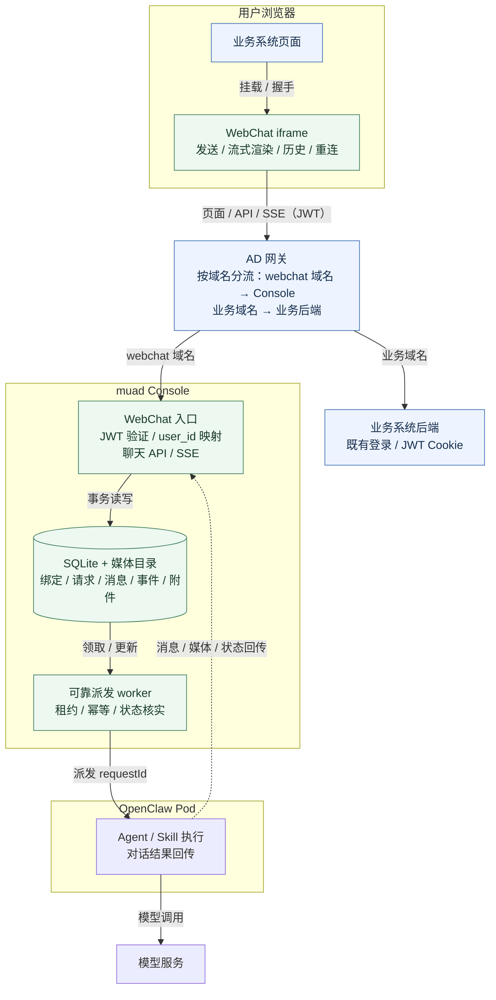
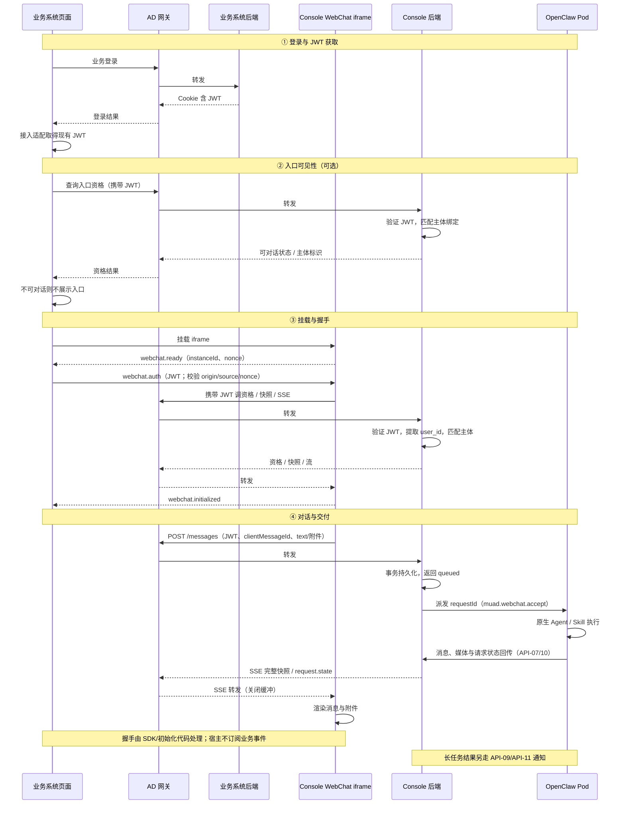

# WebChat 通道后端设计评审版

### 背景：海外有一些服务经理和渠道人员无法正常使用企微机器人，但是可以使用平台，需要在平台上增加web对话入口

## 1. 目标与范围

业务平台把 Console 托管的统一聊天页嵌入 iframe，用户用业务平台现有 JWT 登录；Console 将已授权用户的消息交给 OpenClaw 原生通道（mssw/mssp）执行，并把回复、附件和长任务结果可靠地交付回页面。

- 一人一平台一条对话线，管理员预授权，用户隔离，沿用既有模型池与 Skill 策略。
- 单窗口、最近 200 条、`/new` 作为普通消息透传、块级流式；不承诺逐 token。
- 聊天页由 Console 托管，业务平台只提供入口容器和认证适配；可选纯 JS SDK 只负责挂载、握手和销毁。
- 浏览器到业务后端和 Console 的流量经 AD 网关按域名分流（webchat 域名→Console，业务域名→业务后端）；业务浏览器也可在挂载前用 JWT 查询资格决定入口显隐。

## 2. 核心设计决策

| 主题 | 决策 |
|---|---|
| 认证 | 复用业务平台现有 JWT；每个公开请求携带 JWT，Console 按平台 profile 验证、提取 user_id，再匹配唯一主体绑定和已授权 Human User/Agent。**不换票、不建内部聊天会话**；算法、密钥和 Cookie 获取方式接入时确定 |
| 入口 | Console 同端口托管 `/webchat/embed` 和聊天 API；iframe 为主接入，SDK 可选；AD 配置独立 webchat 域名并整体分流到 Console，Console 直连保留给本地/无代理场景 |
| 通道 | 外置插件注册 mssw/mssp，走 OpenClaw 原生 inbound/outbound；不 fork 上游 |
| 路由 | 以原生 resolver 的实际 sessionKey 为准；Console 记录并核验 agent/channel/generation 归属，不手工拼 key |
| 身份与授权 | 全局唯一主体绑定 `(authority,subject)→identity→Human User/Pod`；跨 Pod 冲突拒绝；每请求重新 JOIN 检查授权状态 |
| 接收与交付 | API-04 事务持久化后才返回 202；worker 经受控 driver exec 调插件 RPC；插件持久化 requestId、spool、ACK；不确定是否启动时标记 unknown，不重复启动 Agent |
| 流式 | SSE 推送完整消息快照 + revision + eventSeq；断线按游标恢复，长轮询降级；最终内容以持久快照为准 |
| 媒体 | 双向 HTTP 传输，每文件 ≤30MiB、每消息 ≤9 个；ticket 绑定 requestId，Pod 复核字节/hash；字节不走 exec/RPC |
| 长任务 | 继承可信 channel/target，结果与未读通知持久化；缺失/错误目标明确失败，禁止回退 wecom |
| 部署 | 浏览器必须可达 webchat 域名（直连或经 AD）；AD 关闭 SSE 缓冲、放宽上传/长连接超时；HTTPS 宿主需要可信 HTTPS 入口 |

## 3. 总体架构

主链路从上到下：业务页面 → WebChat iframe → AD 网关 → Console（入口 → SQLite → worker）→ OpenClaw Pod → 模型；只有一条回传虚线，表示 Pod 把消息/媒体/状态交回 Console，再由 SSE 推给 iframe。webchat 使用独立域名，iframe 与其 API 同源、与宿主页面跨域。

## 4. 关键时序

要点：

- **认证**：JWT 只存 iframe 内存，每个请求经 AD 到 Console 重新验证；不换票，JWT 有效期内可重复使用。
- **入口**：业务平台可用同一 JWT 先查资格决定是否展示入口；资格结果不构成授权。
- **发送**：先持久化再派发，202 只表示 Console 已接单，不代表模型已开始回复。
- **回传**：Pod 通过 API-07/10 回传消息、媒体和状态；Console 落库后经 SSE 推完整快照。
- **长任务**：通知走 API-09/API-11，不占用当前请求的 SSE 游标。

## 5. 关键场景

预期按"用户或运维能直接看到的结果"描述，不展开内部实现；精确断言以完整设计为准。

### 5.1 正常场景

| ID | 场景 | 层级 | 预期 |
|---|---|---|---|
| S-01 | mssw 端到端 | E2E | 用户登录后发消息，能连续看到助手回复；后台记录的路由 key 正确，消息进入正确的 Agent |
| S-02 | 双通道隔离 | E2E | 同一用户从 MSSW 和 MSSP 进入，各看各的会话，消息不串 |
| S-04 | 最近 200 条 | E2E | 历史超过 200 条后重开页面，只看到最近 200 条和正在回复的消息，不能向上加载更早记录 |
| S-05 | 图片上行 | E2E | 用户上传 5MiB 图片，助手能收到并识别；页面可预览，上传与送达内容一致 |
| S-06 | 文件下行 | E2E | 助手生成 ≥1MiB 文件，用户能在页面看到并下载，下载内容与生成文件一致 |
| S-07 | SSE 长连接 | E2E | 一次回复持续超过 5 分钟，页面仍持续收到内容；网络或认证续期后能恢复 |
| S-09 | JWT 授权 | E2E | 用户带有效 JWT 打开页面，Console 能识别并匹配到管理员授权的用户，直接进入聊天，不需要绑定码 |
| S-10 | `/new` | E2E | 发送 `/new` 后原生上下文重置，助手正常回复，页面历史消息仍保留 |
| S-12 | 长任务离线 | E2E | 长任务执行期间用户离开页面，任务完成后重开，能看到结果和未读通知，归属正确 |
| S-13 | 幂等重试 | E2E | 发送响应丢失后，用户用同一个 clientMessageId 重试，最终只执行一次，结果一致 |
| S-14 | 断网恢复 | E2E | 回复过程中断网，恢复后继续显示，不重复、不丢内容，最终与服务器记录一致 |
| S-15 | 绑定冲突 | E2E | 同一用户在两个 Pod 上重复绑定会被拒绝；换 authority 也不能绕过原生路由唯一性 |
| S-17 | 本地完整模拟 | E2E | 本地模拟登录后，完整走真实 Console、SQLite、镜像和浏览器；双用户双平台、媒体、重连都有结果 |
| S-18 | 通道配置 apply | E2E | 配置提交后 validate/apply/health 正常生效，失败能回滚；中英文名称正确；模型池冲突仍被拒绝 |

### 5.2 异常场景

| ID | 场景 | 层级 | 预期 |
|---|---|---|---|
| E-01 | 错误签名/未知 kid | integration | 伪造或未知签名 key 的 JWT 被拒绝，返回 401 |
| E-02 | JWT 过期/未生效 | integration | 过期或未生效的 JWT 被拒绝，返回 401；正在进行的 SSE 到期时关闭 |
| E-04 | Console 断连/写库失败 | E2E | Pod 不会丢消息；Console 恢复后重投且不重复；没有确认的消息不能算已送达 |
| E-06 | 派发前 Pod 不可用 | E2E | 请求先排队；Pod 恢复后只执行一次；等待超过预算就明确失败 |
| E-09 | 登录但未绑定 | E2E | 业务平台不展示 WebChat 入口；即使直接访问，资格为 false、其余接口 403，Pod 收不到请求 |
| E-11 | 停用 identity/binding | E2E | 新请求立即被拒；已打开的流在复查窗口内关闭，不用等配置 apply |
| E-18 | ACK 丢失/派发中崩溃 | E2E | 先查真实运行记录；判断不了就标 unknown，不会重复启动 Agent |
| E-20 | 长任务缺/错 channel | E2E | 直接明确失败，不会退回 wecom |
| E-22 | profile/握手不匹配 | E2E | JWT 不符合该平台配置，或握手来源/nonce 不对，拿不到聊天身份 |
| E-24 | JWT 到期/退出/切用户 | E2E | 关闭旧流、清空旧页面内容，重新走一次认证，不能无限重试 |
| E-27 | user_id 缺失/篡改/类型无效 | integration | 返回 401；不会退而使用 sub、请求体里的 userId 或管理员身份 |

### 5.3 边界场景

| ID | 场景 | 层级 | 预期 |
|---|---|---|---|
| B-01/B-02 | 双向 30MiB / 30MiB+1 | unit | 30MiB 可以上传/下载，30MiB+1 被拒绝 |
| B-03 | 每消息 9 / 10 个附件 | unit | 9 个可以，10 个被拒绝 |
| B-04 | UTF-8 64KiB | unit | 按字节计算 64KiB 可接受，多字节字符越界则拒绝 |
| B-07 | user_id 512/513 字符 | unit | 转换成主体后 512 字符可以，513 字符拒绝；数字 ID 不能悄悄截断 |
| B-13 | 同 ID 同内容 / 异内容 | integration | 同 ID 同内容复用原结果；同 ID 异内容返回 409；会话已有活动请求也返回 409 |
