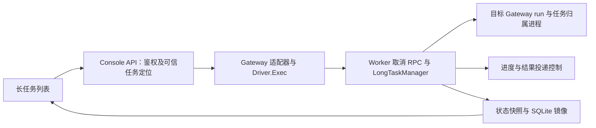

# 长任务执行防误触发与控制台终止：后端及运行时设计

> 文档编号：MOD-LONG-TASK-CONTROL-1.0
> 版本：v1.0
> 创建日期：2026-10-15
> 状态：已批准，待实现

## 1. 文档控制

### 1.1 来源与确认范围

本需求来自本次会话的旧版长任务误触发 review 及后续讨论。用户已明确：唯一匹配的长任务 Skill 优先自动执行，多个匹配由用户选择；首期增加控制台终止入口，目的为停止误下发的任务；失败任务不增加重试按钮。

2026-10-15 用户在审阅两份草稿后明确回复“定稿，开始拆分任务”，据此批准本设计并进入任务拆解。上游取消能力仍须按验收验证，不以设计批准代替实现验证。实现基线为当前仓库，OpenClaw 基础镜像默认版本以 `Dockerfile.base` 的 `2026.7.1` 为准；相邻工作区的 `2026.7.2` 源码仅作线索，不能替代固定镜像契约验证。

### 1.2 修订历史

| 版本 | 日期 | 说明 |
|---|---|---|
| v0.1 | 2026-10-15 | 保存已确认的触发策略、控制台终止范围和可评审技术草稿 |
| v1.0 | 2026-10-15 | 用户回复“定稿，开始拆分任务”，设计批准；验收约束保留，进入任务拆解 |

## 2. 需求分析

### 2.1 需求概述

保持正常长任务直接执行的体验，减少参考 Skill 导致的误执行，并为管理员提供按任务停止的能力。取消必须影响 Worker 实际执行及后续投递，控制台数据库只保存运行状态镜像。

### 2.2 痛点与价值

10/02 的显式提交已移除读取即入队，但前台命令检测仍遗漏默认工作目录下的相对脚本及 `find -exec` 等形式。语义匹配继续由模型完成，误识别或用户误下发仍需运行中止损。当前列表只有查询，Worker 没有任务取消入口，状态约束仅接受四种状态。

### 2.3 功能方案

| 功能 | 内容 | 优先级 | 来源 |
|---|---|---|---|
| FEAT-01 | 唯一适用且参数齐全直接执行；多个合理候选先选择；参考、缺参、无匹配不提交 | P0 | 用户本轮第 1 项及前述误触发案例 |
| FEAT-02 | 补齐常见前台长任务脚本拦截；拒绝执行时零入队 | P0 | review 已复现的命令缺口 |
| FEAT-03 | 控制台管理员按 taskId 取消尚未执行的排队任务 | P0 | 用户本轮第 2 项与已讨论控制台范围 |
| FEAT-04 | 控制台管理员终止正在执行的任务，确认停止后进入已取消 | P0 | 用户本轮第 2 项 |
| FEAT-05 | 取消与完成幂等收敛、清理资源、阻止后续进度及最终结果投递 | P0 | 手动终止的完整执行语义 |
| FEAT-06 | 状态镜像、操作审计、多用户隔离和旧 Worker 能力识别 | P0 | 现有平台规范及首期可用性 |

### 2.4 范围与边界

首期入口为现有控制台管理登录范围内的长任务列表。任务级操作覆盖 queued/running；取消处理中展示状态；succeeded/failed/cancelled 保留历史且没有重试操作。任务取消失败只展示结果和诊断，不新增重试按钮。IM 取消入口、暂停恢复、批量终止、所有长任务强制确认、逐 Skill 必填参数 Schema 迁移及完整执行环境隔离不在首期。

保留显式提交、本轮读取及参数预检。模型对唯一匹配及自然语言参数的理解不是确定性授权证明；本轮通过目标约束与真实模型回归降低误识别，不宣称完全消除语义错误。命令检测用于防常见误执行，不宣称覆盖任意解释器代码或混淆 Shell。已经完成的外部写入和已经发出的消息不会因取消撤回；业务脚本提交的远端任务只有接入其取消能力后才能宣称停止。

### 2.5 验收条件

#### 2.5.1 业务规则

| 规则 | 约束 | 验证场景 |
|---|---|---|
| RULE-01 | 唯一匹配直接执行，多个候选先选择；参考其他 Skill 不扩大用户原目标 | S-01、S-02、S-03 |
| RULE-02 | 读取与命令拒绝均不入队，不登记长任务执行或推送进度 | S-03、S-04 |
| RULE-03 | 取消只作用于 taskId 对应的可信运行，不影响同 Agent 普通聊天及其他任务 | S-06、S-07、E-03 |
| RULE-04 | cancelling 仍占执行槽；真实执行停止、资源完成清理后才 cancelled | S-06、S-07、E-01 |
| RULE-05 | 取消与完成只有一个终态；重复请求幂等；历史快照不能改写终态 | B-01、B-02、B-03 |
| RULE-06 | 取消后阻止新投递，保留历史；状态未知不能伪报已取消 | S-06、E-01、E-02 |

#### 2.5.2 功能验收场景

| 场景 | 功能 | 层级 | 关键真实边界与可观测结果 |
|---|---|---|---|
| S-01 | FEAT-01 | E2E | 真实模型、Worker 工具、队列及脚本哨兵：唯一适用且完整输入，无额外确认，恰好执行一次 |
| S-02 | FEAT-01 | E2E | 真实模型及 IM 入站：多个合理候选先列差异，选择前零执行，用户选择后仅执行所选 Skill |
| S-03 | FEAT-01/02 | E2E | 使用本次截图等价请求，真实读取其他长任务文档后访问 company_label 测试接口；无关 Skill 零任务、零业务、零进度；不得接触真实客户业务 |
| S-04 | FEAT-02 | integration | 真实 guard、临时 Skill 文件和 Shell 解析：默认工作目录相对路径、cd、包装器、find -exec 被拒绝；普通 read/cat/ls/grep 查看通过；全程零提交 |
| S-05 | FEAT-03/06 | E2E | 浏览器 → Console API → 真实 Worker 队列 → SQLite → 列表：取消排队任务后哨兵从未执行，最终 cancelled，排队数减少 |
| S-06 | FEAT-04/05 | E2E | 真实固定版本 Gateway、模型、长时间脚本及其子进程、收件观察器：终止后进程停止、业务计数不再增长、资源清理、无新结果投递，列表 cancelled |
| S-07 | FEAT-04/05/06 | E2E | 同用户另一个任务及另一用户真实任务继续运行；主会话可用；终止任务清理后执行槽恰好释放一次，下一项按原顺序启动 |
| S-08 | FEAT-06 | E2E | Console 配置 → DTO/schema → generation 事务 → Worker health：能力与指导成功应用；故障健康检查触发回滚，无模型绑定或 Skill 分层改变 |
| E-01 | FEAT-04/06 | E2E | Worker 不可达、RPC 超时或停止未确认：显示失败或终止中并保留诊断；不得伪报 cancelled、提前释放槽位或启动重试任务 |
| E-02 | FEAT-04/06 | E2E | 旧 Worker、缺失取消能力或重启后运行归属不可证明：返回明确不支持/无法确认，保留实际可知状态，不按历史 PID 盲杀 |
| E-03 | FEAT-06 | integration | httptest → 真实 Store → fake Driver：未登录、伪造 Pod/Agent、越界 taskId、畸形请求均被拒绝且零运行调用；错误包络和审计脱敏正确 |
| E-04 | FEAT-03/04/05 | integration | 真实 manager 和状态文件：取消记录写入失败时明确报错，不接受取消成功；隔离清理错误，不改写为成功 |
| E-06 | FEAT-01 | E2E | 真实模型与隔离 Worker：无适用 Skill、仅缺用户必填输入、显式名称与本轮请求不一致时说明或追问；未完成预检前零入队、零业务脚本执行 |
| B-01 | FEAT-03/04/05 | integration | 可控执行屏障与真实 manager：queued 转 running、spawn 尚未发生及自然完成时请求取消，验证线性化规则和无双终态 |
| B-02 | FEAT-05/06 | integration | 相同取消请求多次、RPC 返回丢失后重复请求：无重复终止、无重复终态通知、无重复释放资源 |
| B-03 | FEAT-05/06 | integration | 真实 SQLite：重复及乱序快照、旧四状态记录、迁移重复执行，已取消/已完成状态不回退、不被自动改 failed，历史记录和索引保留 |
| B-04 | FEAT-04/05 | E2E | 固定版本 Worker 重启时存在任务：取消墓碑保留，取消中的任务不恢复执行；孤儿运行只有归属证明且确认停止后才 cancelled |

前端操作状态及无重试入口的浏览器验收见同目录前端设计 S-09、S-10、E-05。各 P0 功能均由上述正常及异常/边界场景覆盖，E2E 不得改用 fake 模型或 fake Worker 冒充。

## 3. 技术设计

### 3.1 方案选型

保留 Go + SQLite 控制面、Node 外置插件、既有队列和 OpenClaw 原生运行。采用 Worker 任务级取消协议，控制台根据可信任务记录定位 Pod，经现有 Driver.Exec 和集中 Gateway 适配器调用插件 RPC。相比控制台逐任务轮询进程，按操作发起 RPC 并沿用状态快照减少网络往返；列表不新增逐行能力探测。

不采用仅改 SQLite 状态、仅 kill CLI、按 Agent/Pod 全局杀进程或回滚用户操作的方案：这些方式不能提供目标任务实际停止且不波及其他任务的契约。语义路径保持用户已选择的唯一匹配自动执行，不增加普遍确认。

### 3.2 架构设计

#### EXEC-GUARD：前台命令与触发约束

命令解析独立到 guard 内可测试模块，使用有 Shell 语法结构的解析器；实现前确认镜像依赖安装方式，不能提交未打包依赖。工作目录来自可信工具/Agent 上下文，参数中的 workdir 按原生工具实际语义处理。正确跟踪相对路径、cd、包装器和子命令；纯查看按操作与参数判定，禁止把支持执行的 find/awk/sed 整类跳过。无法判定且引用授权业务入口时拒绝，不提交；read 任意候选文档不会切换整轮执行权限。

固定指导明确用户原目标优先，“参考”不授权运行被参考 Skill；唯一匹配且参数完整仍可调用显式提交，多候选先选。selectionBasis 为 explicit_name 时可核对可信原始命令；语义唯一匹配继续依赖模型，不能把模型自报布尔值当作用户确认。

#### CANCEL-RUNTIME：取消运行与资源清理

LongTaskManager 增加按 taskId 的取消入口及短临界区。queued 可在移除排队记录并可靠保存取消终态后完成；running 先可靠保存取消请求和 revision，再转 cancelling，关闭新工具调用与投递入口，然后取消真实 Gateway run 并处理其归属的业务进程。

运行身份必须关联 taskId、后台 sessionKey、真实 runId 及 Worker 实例。优先复用固定 OpenClaw 版本的公开取消能力；相邻源码提供的 chat.abort 只是候选。实现的首个验证点必须确认 2026.7.1 对 agent 运行、排队和 exec 子进程的停止契约。若原生取消不覆盖子进程，须通过受支持的进程控制接口或已有归属句柄补齐，不能把 CLI 进程组等同于 Gateway 内业务进程组。该验证未通过则方案保持未就绪，不降级为假取消，也不 fork 上游。

CLI 退出只作为辅助证据。确认目标执行停止并清理其 Skill/browser 租约、进度桥、临时材料后，进入 cancelled 并释放槽位、按原规则 drain。cancelling 继续计入运行数。超时保留 cancelling 与稳定诊断，由 Worker 有界重试/对账确认；不提供任务重试按钮，不以超时判定已停止。不得释放其他 run 的资源。

取消与完成的线性化点在同一任务临界区：已提交成功/失败终态则返回 already_terminal；取消请求先可靠提交则后续完成回调不能再发送成功结果，确认停止后归 cancelled。启动前、spawn 间隙和重复取消使用同一取消标记，阻止取消后再启动。

#### CANCEL-DELIVERY：取消与投递

后台结果由 manager 控制投递许可，替换现有子 CLI 无条件 --deliver；产物/附件与原有通道语义必须保留。若通过 stdout/JSON 取得结果，必须持续消费并限制诊断缓冲，避免管道堵塞。进度队列在取消后丢弃尚未发起的发送，投递前再次检查任务状态；脚本显式发送消息的既有路径也须纳入可信任务取消检查，不能只拦最终回复 hook。已向外部系统发起的投递可能仍到达，不能承诺撤回。

任务临界区同时仲裁取消与最终投递许可；许可已发起的消息视为在途。只发送一次明确的取消终态通知，不再发送成功或通用失败通知。停止之后的迟到脚本进度及退出回调不得覆盖取消状态。

### 3.3 数据设计

#### STATE-MODEL：任务状态及持久化

状态扩充为 queued/running/cancelling/cancelled/succeeded/failed。新增取消状态不是业务失败。既有 0600 JSONL 保存取消请求、状态修订号及必要归属信息，重启不重新执行取消中的任务。

`long_task_tasks` 保留既有列和索引，拟新增：

| 字段 | SQLite 类型/默认 | 约束及含义 |
|---|---|---|
| state_revision | INTEGER NOT NULL DEFAULT 0 | 非负，Worker 每次任务状态变化递增；0 兼容旧记录 |
| cancel_requested_at | TEXT NOT NULL DEFAULT '' | Worker 接受请求时间；空字符串表示未接受 |
| cancel_requested_by | TEXT NOT NULL DEFAULT '' | 来自已鉴权控制面操作人，不接受模型输入 |
| cancelled_at | TEXT NOT NULL DEFAULT '' | 真实停止及资源清理完成时间 |

取消原因首期固定为手动取消，沿用 terminal_reason/error_code 稳定标识；用户不填写原因表单。任务状态 CHECK 增加 cancelling/cancelled，迁移在 repo 内使用事务重建约束、显式列复制、校验行数和重建索引，版本化且可重复执行，不使用 writable_schema，不丢历史记录。

状态合并只接受较新 revision 的合法前进；相同 revision 幂等。旧格式按既有时间与合法状态迁移兼容，不能覆盖新格式取消终态。乱序/回退快照只记录诊断，不再将已有终态自动改成 failed。pool 计数采用最新有效快照，并与 cancelling 占槽规则一致。

#### AUTH-AUDIT：鉴权与审计

HTTP 客户端只给 taskId；Pod、Agent、session 归属由 Store/Worker 校验。RPC 仅供控制面 operator.write，不注册为模型业务工具。沿用当前管理登录和审计身份，记录请求结果、停止结果及取消时间；业务操作审计与 Skill 进度分离。错误入日志/审计前 RedactDiagnostic，禁止写完整 prompt、绑定参数、命令或凭证。取消不创建用户、不改模型配置，不引入模型回退；跨用户回归使用已独立绑定的测试用户。

### 3.4 接口设计

| 接口 | 契约 | 功能 |
|---|---|---|
| API-01 | `POST /api/v1/long-tasks/{taskId}/cancel`，空请求体 | FEAT-03/04/06 |
| API-02 | 内部 Gateway `muad.long-task.cancel`，`{taskId, requestedBy}`；operator.write | FEAT-03/04/05/06 |
| API-03 | 现有长任务列表/快照扩充状态、revision 及取消时间，列表附 `canCancel`、可选 `cancelUnavailableReason` | FEAT-05/06 |

API-01 统一响应包络：`{code:0,message:"success",data:{taskId,outcome,status,stateRevision}}`。outcome 为 cancel_requested/cancelled/already_terminal；running 接受后返回 202 + cancelling，排队取消确认后 200 + cancelled；终态重复请求 200 + 实际终态。202 仅代表已接受，不代表已停止。

不存在任务 404；未登录 401；归属或请求冲突 409；旧 Worker 无能力、归属无法证明、Worker/RPC 不可用、记录持久化失败分别映射稳定错误场景，使用现有 errcode 业务分段分配新常量及中英文文案，不复用已有子码。接受结果丢失后可按同一 taskId 幂等查询/取消，不能重新提交业务任务。

控制面读取可信任务后通过 gateway 模块封装 Driver.Exec 调用；外部命令有 context deadline，参数用 argv/JSON 安全传递，不在 handler 拼 Shell 或裸 exec。Worker health 提供取消能力版本，控制面按 Pod 缓存，避免逐行 RPC。能力未知时不推断 canCancel=true；即使前端显示可操作，服务端仍重新验证能力和实际状态。

### 3.5 质量实现方案

#### QUALITY-BOUNDARIES：代码、测试与错误

后端 handler 仅做 HTTP 编解码及调用下层，SQL/迁移在 internal/repo，Worker 调用在 internal/gateway 经现有 driver；新增 Go 文件仍在 console/backend，运行时模块仍在 tools/muad-runtime-guard，指导仍在 bin。函数保持单一职责并控制长度，显式处理错误，不引入静默异常。

所有 HTTP 输出走 writeJSON/writeErr 和稳定 errcode，S/E/B 场景提供迁移、取消竞争、故障、归属与投递断言；Go 单测使用 fake Driver，真实 Docker/K8s 仅用于明确隔离的 E2E。运行时错误写 stderr/非零退出；插件日志注入 log，入口接 api.logger.warn，使用稳定 `[muad-runtime-guard][longtask-cancel]` 前缀，仅记录 ID、状态和脱敏错误。

#### CONFIG-COMPAT：运行配置与 Skill 层次

指导/能力配置通过原 DTO/schema、generation、prepare/validate/commit、health/rollback 生效，renderer 先 validateRuntimeConfig 再原子写入，文件 0600，service token 仍为规范路径 0400。effective Skill 授权及 system protected 优先级不变，public/private 冲突仍要求 allow_override。任务终止按既有可信 root 和运行归属执行，不修改 Skill 资产来模拟停止。

#### PERFORMANCE：容量与清理

取消以 taskId 索引查找，worker manager 维护任务索引与一次取消操作；按现有状态变更推送，不在请求内无界轮询或对全部进程扫描。终止对账定时器有上限并随任务完成清理，复用每 Pod 能力缓存和现有 5 秒列表后台刷新。当前无取消延迟/吞吐实测，不填写虚构 SLO；实施时记录原生 abort、子进程退出和列表收敛各阶段耗时，超出有界调用时限仍保留真实状态。

## 4. 部署与运维

先完成 Console 状态兼容和 SQLite 迁移，再更新 Worker 插件/指导，最后按实际能力开放 UI。取消能力缺失时展示不可用原因，不执行危险兜底。迁移保留所有旧任务，生产已有任务只有证明真实运行归属时才支持终止。

回滚需评估旧 Console/Worker 对新增状态和字段的兼容；不直接回退到无法读取新状态的二进制。取消墓碑和历史保留；对取消中或归属不明的旧任务先对账，不因重启伪造停止。发布前完成 2026.7.1、真实脚本进程及实际收件端的取消 E2E；当前进入任务拆解，实际验证与发布按后续任务执行。

## 5. 风险与依赖

| 风险 | 应对 | 场景 |
|---|---|---|
| RISK-01：误匹配仍可能存在 | 保留唯一自动/多候选选择，固定指导及截图等价真实模型回归 | S-01/02/03 |
| RISK-02：杀 CLI 但业务继续运行 | 先验证固定版本取消契约；按真实 run 及进程归属停止后才终态 | S-06、E-02、B-04 |
| RISK-03：取消与完成/投递竞争 | 同一任务临界区、持久取消标记、投递许可仲裁和幂等清理 | S-06、B-01/02 |
| RISK-04：旧快照或旧 schema 破坏终态 | 保数据迁移、revision、先 Console 后 Worker 的兼容发布 | B-03、S-08 |
| RISK-05：误停同 Agent 其他业务 | taskId/session/run 归属校验、精确资源释放 | S-07、E-03 |
| RISK-06：取消动作本身失败 | 明确诊断与未知状态，保留槽位至确认；没有任务重试按钮 | E-01/04 |

## 6. 需求追溯矩阵

| 来源 | 功能 | 接口/落点 | 场景 | 状态 |
|---|---|---|---|---|
| 用户第 1 项 | FEAT-01 | EXEC-GUARD、既有显式提交工具 | S-01/02/03、E-06 | 设计已批准，待实现 |
| review 命令缺口 | FEAT-02 | EXEC-GUARD | S-03/04 | 设计已批准，待实现 |
| 用户第 2 项 | FEAT-03 | API-01/02、CANCEL-RUNTIME | S-05、E-04、B-01 | 设计已批准，待实现 |
| 用户第 2 项 | FEAT-04 | API-01/02、CANCEL-RUNTIME | S-06/07、E-01/02 | 设计已批准，待实现 |
| 完整终止语义 | FEAT-05 | API-02/03、CANCEL-DELIVERY、STATE-MODEL | S-06/07、B-01/02/03/04 | 设计已批准，待实现 |
| 平台约束 | FEAT-06 | API-01/02/03、AUTH-AUDIT、CONFIG-COMPAT | S-05/07/08、E-01/02/03、B-03 | 设计已批准，待实现 |

## Spec Compliance Matrix

| Spec/Rule | enforcement | 设计影响及具体落点 | 验证场景/verifier | 状态 |
|---|---|---|---|---|
| backend-code-quality-performance#RULE-backend-quality-001 | required | QUALITY-BOUNDARIES、PERFORMANCE：显式错误、有界 RPC、Go test/vet | E-01/03/04；原规范 verifier | 设计已确认，待实施验证 |
| backend-code-quality-performance#RULE-backend-write-err-001 | required | API-01、QUALITY-BOUNDARIES：writeErr 仅接 errcode | E-03；原规范 regex | 设计已确认，待实施验证 |
| backend-database#RULE-backend-database-001 | required | STATE-MODEL：repo-only 参数化 SQL、事务保数据及幂等迁移 | B-03；原规范 verifier | 设计已确认，待实施验证 |
| backend-database#RULE-backend-no-select-star-001 | required | STATE-MODEL：显式列迁移/查询 | B-03；原规范 regex | 设计已确认，待实施验证 |
| backend-directory-structure#RULE-backend-directory-001 | required | QUALITY-BOUNDARIES：api/repo/gateway/driver 分层 | E-03；原规范 verifier | 设计已确认，待实施验证 |
| backend-logging#RULE-backend-logging-001 | required | AUTH-AUDIT：操作审计与进度分离、不记录敏感输入 | E-03；原规范 verifier | 设计已确认，待实施验证 |
| backend-logging#RULE-backend-redact-001 | required | AUTH-AUDIT：错误记录前 RedactDiagnostic | E-01/03；原规范 verifier | 设计已确认，待实施验证 |
| backend-platform-rules#RULE-backend-platform-001 | required | AUTH-AUDIT、CONFIG-COMPAT：用户隔离、既有模型绑定、事务配置 | S-07/08、E-03；原规范 verifier | 设计已确认，待实施验证 |
| backend-platform-rules#RULE-backend-http-envelope-001 | required | API-01、QUALITY-BOUNDARIES：统一包络及稳定错误码 | E-03；TestHTTPEncoder | 设计已确认，待实施验证 |
| backend-platform-rules#RULE-backend-model-pool-001 | required | AUTH-AUDIT：只操作已存在任务，不创建用户或改变模型绑定；隔离用户沿用强制独占绑定 | S-07/08、E-03；原规范 verifier | 设计已确认，待实施验证 |
| runtime-config-and-apply#RULE-runtime-config-001 | required | CONFIG-COMPAT：schema 与事务健康/回滚 | S-08；原规范 verifier | 设计已确认，待实施验证 |
| runtime-config-and-apply#RULE-runtime-validate-before-write-001 | required | CONFIG-COMPAT：先 validate、generation、原子写 | S-08；原规范 verifier | 设计已确认，待实施验证 |
| runtime-directory-structure#RULE-runtime-directory-001 | required | QUALITY-BOUNDARIES：tools/bin 外置能力，不 fork | S-04/06；原规范 verifier | 设计已确认，待实施验证 |
| runtime-isolation-and-security#RULE-runtime-security-001 | required | AUTH-AUDIT、CANCEL-RUNTIME：可信运行归属及用户隔离、凭证运行时注入 | S-07、E-03；原规范 verifier | 设计已确认，待实施验证 |
| runtime-isolation-and-security#RULE-runtime-secret-file-mode-001 | required | STATE-MODEL、CONFIG-COMPAT：状态/材料 0600、token0400 | E-04、B-04、S-08；原规范 verifier | 设计已确认，待实施验证 |
| runtime-skill-execution#RULE-runtime-skill-001 | required | EXEC-GUARD、CANCEL-RUNTIME：显式门禁、进度、租约与取消占槽 | S-03/04/06/07；原规范 verifier | 设计已确认，待实施验证 |
| runtime-skill-execution#RULE-runtime-skill-layering-001 | required | CONFIG-COMPAT：system protected、public/private 显式覆盖 | S-08；原规范 verifier | 设计已确认，待实施验证 |
| runtime-skill-execution#RULE-runtime-log-injection-001 | required | QUALITY-BOUNDARIES：注入 log，插件入口 api.logger.warn | E-04；原规范 verifier | 设计已确认，待实施验证 |
| runtime-skill-execution#RULE-runtime-log-prefix-001 | required | QUALITY-BOUNDARIES：稳定 longtask-cancel 前缀 | E-01/04；原规范 verifier | 设计已确认，待实施验证 |
| runtime-skill-execution#RULE-runtime-skill-fail-loud-001 | required | QUALITY-BOUNDARIES、CANCEL-DELIVERY：stderr/非零，stdout机器结果且持续消费 | S-06、E-04；原规范 verifier | 设计已确认，待实施验证 |
