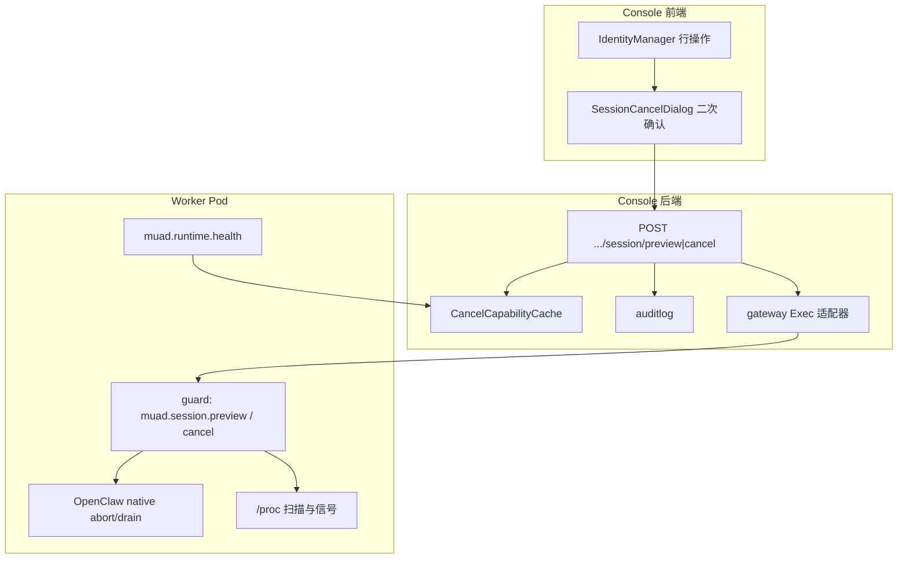
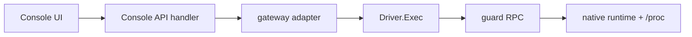
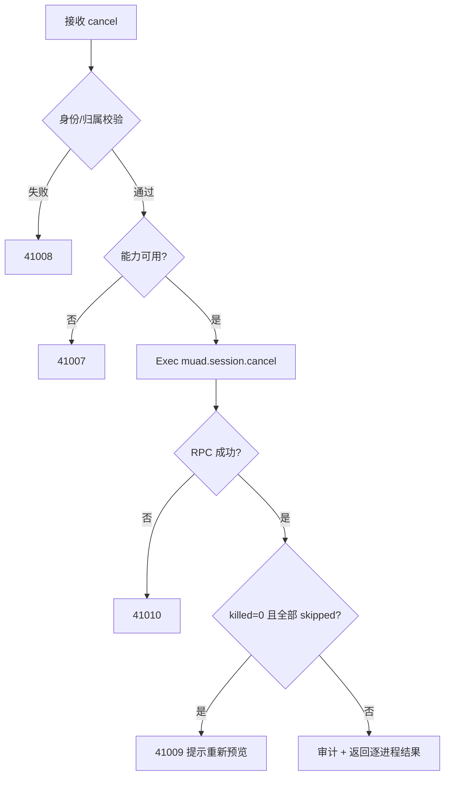

# 前台会话终止（Console 运维入口）模块需求与设计一体化文档

> **文档编号**: MOD-SESSION-CANCEL-001
> **文档版本**: v0.1
> **创建日期**: 2026-10-17
> **文档状态**: 设计评审中

**评审边界说明**:
- **需求评审**: 第 2 章（需求分析）→ 通过后锁定为需求基线 v1.0
- **设计评审**: 第 3-4 章（技术设计 + 部署运维）→ 通过后锁定设计基线 v1.x
- **交接契约**: 2.5 验收条件 — 需求定义 What，设计实现 How

**ID 体系**: US（用户故事，本文档无 PRD，来源记为"需求描述"）、FEAT（功能）、API（接口）、RULE（业务规则/系统约束）、TC（测试用例）、RISK（风险）、NFR（非功能指标）
场景编号：S-（正常）、E-（异常）、B-（边界）

---

## 1. 文档控制

### 1.1 责任人

| 角色 | 姓名 | 职责范围 |
|------|------|---------|
| 产品经理 | 待定 | 需求定义、业务验收 |
| 开发负责人 | 待定 | 技术方案、代码实现 |
| 测试负责人 | 待定 | 测试策略、质量保证 |
| 架构师 | 待定 | 架构审核、技术决策 |

### 1.2 修订历史

| 版本 | 日期 | 作者 | 变更描述 |
|------|------|------|---------|
| v0.1 | 2026-10-17 | Claude | 初始草稿 |

---

## 2. 需求分析

### 2.1 需求概述

| 项目 | 内容 |
|------|------|
| **模块名称** | 前台会话终止（Console 运维入口） |
| **模块ID** | MOD-SESSION-CANCEL |
| **所属系统/产品线** | muad Console + muad-runtime-guard |
| **需求类型** | 新功能 |
| **业务背景** | 企微通道的 `@wecom/wecom-openclaw-plugin` 对同一 chat 做强制串行排队，`/stop` 会被排到当前任务结束之后才处理；同时 OpenClaw `exec` 超过 yield 窗口（默认 10s）后转为 background session，abort 不再杀进程。结果是前台长流程任务既无法被用户中止，又会阻塞下一轮对话（实测：`/stop` 排队 67 秒、脚本跑满 180 秒）。现有 Console 只有长任务终止能力，缺少对前台会话的运维干预入口。 |
| **核心目标** | 让管理员在 Console 上对一个用户身份对应的前台会话执行"预览 → 确认 → 中止 run + 清理该会话的后台进程"，且在单 Pod 多用户共享 OS 用户的部署下绝不误杀其他用户/会话的进程。 |

### 2.2 痛点与价值

| 维度 | 内容 |
|------|------|
| **目标用户** | Console 管理员（operator）；间接受益者为被长任务卡住的业务用户 |
| **当前问题** | 用户报"卡住了、`/stop` 没用"时，管理员只能进 Pod `ps`/`kill`，无权限模型、无审计、易误操作；前台会话没有像长任务那样的终止入口 |
| **业务影响** | 单用户的失控任务会持续占用 Pod CPU/内存与模型额度，并且阻塞该用户后续对话；排障依赖人工 `kubectl exec`，平均响应时间以小时计 |
| **预期价值** | 管理员在 Console 内完成分钟级干预；终止动作可审计、可预览；跨用户隔离有可验证的保证 |

**用户故事**

| 编号 | 用户故事 | 优先级 |
|------|---------|--------|
| US-01 | 作为 Console 管理员，我希望在用户详情里看到某个 IM 身份对应会话的当前任务与后台进程，以便判断是否真的卡住 | P0 |
| US-02 | 作为 Console 管理员，我希望在真正终止前看到"将中止的 run + 将被杀掉的进程清单"并二次确认，以便避免误操作 | P0 |
| US-03 | 作为 Console 管理员，我希望终止只影响目标用户的会话，其他用户/会话/网关进程不受影响，以便在单 Pod 多用户环境安全操作 | P0 |
| US-04 | 作为 Console 管理员，我希望终止动作进入审计日志，以便事后追溯 | P1 |
| US-05 | 作为 Console 管理员，我希望旧版本 Worker 明确提示"不支持"，而不是静默失败或危险兜底 | P1 |

### 2.3 功能方案

#### 2.3.1 功能清单

| 功能ID | 功能名称 | 功能描述 | 优先级 | 来源 |
|--------|---------|---------|--------|------|
| FEAT-01 | 会话任务预览 | 按 Human User + identity 推导 session key，返回活跃 run 状态与候选进程清单（pid/pgid/启动时长/cmdline/进程组组长标记/指纹），只读无副作用 | P0 | US-01 |
| FEAT-02 | 二次确认终止 | 管理员在弹窗中确认后，中止该会话活跃 run，并只终止预览中已确认（指纹匹配）的进程；返回逐进程结果。终止成功后该会话应恢复可处理新消息（企微 per-chat 队列随 active task 结束而排空） | P0 | US-02 |
| FEAT-03 | 跨用户隔离 | 进程匹配必须同时满足：精确 `MUAD_SESSION_KEY`、同 UID、非 gateway/self、非 longtask 会话、指纹（pid+pgid+starttime+uid）一致；不满足一律跳过并上报 | P0 | US-03 |
| FEAT-04 | 能力探测与降级 | Worker 通过 health 上报 `sessionCancel.available/version`；Console 只对能力已确认的 Pod 展示可执行入口，旧 Worker 明确不可用 | P1 | US-05 |
| FEAT-05 | 审计 | 记录 actor、目标用户/agent/identity、sessionKey、aborted/drained/killed/remaining 与错误码；不记录 cmdline 原文 | P1 | US-04 |
| FEAT-06 | 过期预览保护 | 确认时校验进程指纹；预览后发生变化（退出/新建/PID 复用）只处理仍匹配的项，并返回 skipped 原因 | P0 | US-02 |

#### 2.3.2 字段约束

**FEAT-01/02 候选进程字段**

| 字段名 | 字段类型 | 必填 | 约束 | 说明 |
|--------|---------|------|------|------|
| pid | int | 是 | >1，且 ≠ gateway/self | 进程号 |
| pgid | int | 是 | >0 | 进程组号，用于组终止 |
| startTime | int | 是 | /proc/<pid>/stat 第 22 字段 | 防 PID 复用 |
| uid | int | 是 | 必须等于 gateway 运行 UID | 同用户校验 |
| leader | bool | 是 | pid == pgid | 只有组长才允许按 PGID 终止 |
| cmdline | string | 是 | 截断 ≤ 200 字符 | 供管理员识别 |
| ageSeconds | int | 是 | ≥0 | 由 /proc/uptime 与 startTime 计算 |
| fingerprint | string | 是 | 16 hex | sha256(sessionKey,pid,pgid,startTime,uid) 截断 |
| outcome | string | 确认时 | `terminated`/`killed`/`skipped` | 逐进程结果 |

### 2.4 范围与边界

| 类别 | 内容 |
|------|------|
| **范围（In Scope）** | runtime-guard 新增 `muad.session.preview` / `muad.session.cancel`（operator.write）；/proc 精确匹配与安全终止；Console 两个 API + 能力探测 + 审计；前端 identity 行操作与二次确认弹窗 |
| **非范围（Out of Scope）** | 长任务取消链路（已存在，不改）；企微插件 per-chat 串行队列补丁（独立任务）；用户自助 `/stop` 语义；模型池与 Human User 创建流程（无变更）；Webhook 通道切换；`exec` yield 窗口配置调整 |
| **前置假设** | Worker 与 gateway 同 UID 运行；exec 子进程继承 guard 注入的 `MUAD_SESSION_KEY`；Console 能通过 role 鉴权区分 operator；Pod 的 health 探活周期内能拿到最新能力 |
| **有意妥协 / 技术债** | 第一版按"会话级"终止：同一 session 下所有 guard 注入过 `MUAD_SESSION_KEY` 的进程都会被列为候选（已由二次确认展示）。run 级精细范围（`MUAD_RUN_ID`）留作后续；企微队列里的排队消息在 abort 后会自动恢复执行，不主动丢弃 |

### 2.5 验收条件

#### 2.5.1 业务规则与约束

| ID | 类型 | 描述 | 验证场景 |
|----|------|------|---------|
| RULE-01 | 安全规则 | 只终止 `/proc/<pid>/environ` 中存在完整 `MUAD_SESSION_KEY=<目标 sessionKey>` 且 UID 等于 gateway UID 的进程 | S-03/B-02 |
| RULE-02 | 安全规则 | 只对 `pid == pgid` 的进程组组长按 PGID 发信号；非组长只对该 pid 发信号 | B-03 |
| RULE-03 | 安全规则 | 确认时必须复核指纹（pid+pgid+startTime+uid）；任一不一致则跳过，不按 PID 复杀 | B-01/E-02 |
| RULE-04 | 安全规则 | 禁止终止 PID 1、gateway 自身、执行扫描的进程；`agent:*:longtask:*` 会话一律拒绝 | B-04/E-04 |
| RULE-05 | 业务规则 | 预览只读；中止必须先 TERM、等待 3s、复核后仍存活再 KILL；返回真实 remaining | S-02/E-06 |
| RULE-06 | 系统约束 | 内部 RPC 仅 `operator.write`，不注册为模型工具；能力缺失时明确不可用，不危险兜底 | E-03/E-04 |
| RULE-07 | 业务规则 | Console 只接受由 identity 推导的 session key，不接受前端传入任意 key | E-04 |
| RULE-08 | 审计规则 | 审计不记录 cmdline 原文，只记录数量、指纹前缀与稳定错误码 | B-02 |

#### 2.5.2 功能验收场景

**正常场景**

| 场景ID | 功能ID | 优先级 | 测试层级 | 关键真实边界 | 前置条件 | 操作步骤 | 预期结果 |
|--------|--------|--------|---------|-------------|---------|---------|---------|
| S-01 | FEAT-01 | P0 | E2E | Console API → Gateway Exec → 真实 /proc | Pod03 上用户 A 正在跑 `slow-foreground-smoke` | 调用 preview | 返回 `activeRun.active=true`；processes 恰好包含该会话的 `sh -c`（组长）与 `python3`；不包含 gateway/B 会话进程 |
| S-02 | FEAT-02 | P0 | E2E | API → RPC → 真实信号 → 进程退出 | 同上，拿到 preview 指纹 | 调用 cancel 并传 expected | `aborted=true`、`drained=true`；两个进程依次 `terminated`；`ps` 中消失；审计落库 |
| S-03 | FEAT-03 | P0 | E2E | 真实 /proc + 双 agent 同时运行 | 同一 Pod 上用户 A、B 同时运行慢任务 | 对 A 执行 preview+cancel | A 的进程被杀；B 的 `python3` 仍在；B 的会话随后能正常回复；gateway 进程不变 |
| S-04 | FEAT-04 | P1 | integration | health probe → capability cache → API gate | Worker 上报 `sessionCancel.available=true` | 调用 preview | 允许执行；能力过期/缺失时返回 41007 |
| S-05 | FEAT-05 | P1 | integration | handler → audit store | 完成一次取消 | 查询审计 | 存在 `session.cancel` 记录，含目标字段，无 cmdline 原文 |
| S-06 | FEAT-02 | P0 | E2E | 真实 Worker + 企微通道 + 队列 | 用户 A 的慢任务正在执行（企微 per-chat 队列中有待处理消息或为空） | 管理员 cancel 成功后 5 秒内，用户 A 在同一会话发送新消息"现在几点" | 新消息在 10 秒内得到回复；不需要等待原任务自然结束；企微日志不再出现 `Chat task queued (previous task still running)`；若 cancel 前已有排队消息，则先按序处理完再处理新消息 |

**异常场景**

| 场景ID | 功能ID | 测试层级 | 关键真实边界 | 触发条件 | 系统行为 | 用户感知 |
|--------|--------|---------|-------------|---------|---------|---------|
| E-01 | FEAT-01 | integration | RPC | 会话没有活跃 run 也没有匹配进程 | preview 返回空集合 | 弹窗空态，确认按钮禁用 |
| E-02 | FEAT-06 | integration | RPC → 真实进程 | 预览后进程退出/新建 | cancel 只处理指纹仍匹配项，返回 skipped | 展示"列表已变化"与逐项结果 |
| E-03 | FEAT-04 | integration | handler → capability | Pod 能力未知/过期 | 返回 41007，不调用 RPC | 明确"当前 Worker 不支持" |
| E-04 | FEAT-03 | integration | handler → repo | identity 不属于该 Human User，或 key 含 `longtask:` | 404/400，不发起 RPC | 错误提示 |
| E-05 | FEAT-02 | integration | gateway Exec | RPC 超时/不可解析 | 返回 41010，不伪报成功 | 提示失败并可重试 |
| E-06 | FEAT-02 | E2E | 真实信号 | 进程忽略 SIGTERM | 3s 后升级 SIGKILL，并等待真实退出 | 结果为 `killed`；未确认则 `remaining` 列出 |

**边界场景**

| 场景ID | 测试层级 | 关键真实边界 | 字段/条件 | 边界值 | 预期行为 |
|--------|---------|-------------|----------|--------|---------|
| B-01 | unit | fake procRoot | PID 复用 | 同一 pid，startTime 变化 | 跳过，不发送信号 |
| B-02 | unit | fake procRoot | UID 不匹配 / environ 不可读（EPERM） | — | 跳过并计入 skipped |
| B-03 | unit | fake procRoot | 非进程组组长匹配 | pid != pgid | 只对 pid 发信号，不 `kill -PGID` |
| B-04 | unit | RPC 校验 | longtask 会话 / PID 1 / self | — | 拒绝或跳过 |
| B-05 | E2E | 企微队列 | 排队中的下一条用户消息 | abort 后 | 队列排空并继续处理；不丢消息 |

#### 2.5.3 非功能指标

| 指标ID | 指标名称 | 目标值 | 测量方法 |
|--------|---------|-------|---------|
| NFR-PERF-01 | preview 响应（单 Pod ≤ 512 进程） | ≤ 1s（P95） | 单测/实测 |
| NFR-PERF-02 | cancel 总时长（含 TERM 等待与退出确认） | ≤ 20s，硬超时 | E2E |
| NFR-REL-01 | 终止确认不伪造 | remaining 非空时必须上报 | E-06 |
| NFR-SEC-01 | 跨用户隔离 | 任何场景下不向其他会话进程发信号 | S-03/B-02 |
| NFR-SEC-02 | 审计脱敏 | 不含 cmdline 原文、环境变量、凭证 | S-05 |

---

## 3. 技术设计

### 3.1 方案选型

#### 备选方案对比

| 对比维度 | 权重 | 方案A：guard operator RPC + Console 编排 | 得分 | 方案B：Console 直接 Exec `chat.abort` + shell kill | 得分 |
|---------|------|------------------------------------------|------|--------------------------------------------------|------|
| 功能完备性 | 30% | 可 abort + 精确进程清理 + 结果回传 | 9 | 只能 abort，进程清理需拼 shell，无法安全匹配 | 5 |
| 性能预期 | 25% | 进程内 native abort + 单次 /proc 扫描 | 9 | 多次 Exec，shell 解析有注入风险 | 5 |
| 实现复杂度 | 20% | 新增 RPC 与扫描模块 | 7 | 表面简单，但安全校验难做 | 6 |
| 维护成本 | 15% | 与长任务取消同构，易维护 | 8 | shell 片段不可测、易漂移 | 4 |
| 风险评估 | 10% | 可单测、可 dry-run | 9 | 误杀/注入风险高 | 3 |
| **最终得分** | **100%** | | **8.5** | | **4.8** |

#### 关键决策记录

| 决策点 | 选择 | 被否决项 | 理由 | 可逆性 |
|--------|------|---------|------|--------|
| 执行位置 | Guard 进程内 operator RPC | Console 直接 shell kill | 可复用 native abort/drain；/proc 扫描与信号发送在受控代码内，可测试；避免 shell 注入 | 易（保留 RPC 即可切换 Console 调用方） |
| 匹配条件 | 精确 `MUAD_SESSION_KEY` + UID + 指纹 | cmdline 关键字 / 父进程树 | cmdline 可伪造且易误伤；父进程树无法覆盖 background session | 难（契约变更需版本） |
| 终止范围 | 会话级（v1） | run 级（`MUAD_RUN_ID`） | 用户诉求是"这个会话别跑了"；run 级留作 v2 | 易（新增可选字段） |
| 二次确认 | preview 返回指纹，cancel 只处理匹配项 | 直接 cancel 全量 | 管理员看到什么就只处理什么；防预览后变化 | 易 |
| 能力探测 | health 上报 `sessionCancel` | 直接调用失败再降级 | 与长任务取消一致；旧 Worker 明确不可用 | 易 |
| 能力缓存 | 泛化 `CancelCapability`（longtask+session 两字段） | 新建重复缓存 | 避免重复实现；改动集中且可回归 | 易 |

#### 技术栈

| 类别 | 选型 | 版本 | 选型理由 |
|------|------|------|---------|
| 语言 | Node.js（guard）/ Go（Console） | 镜像内置 Node 24 / Go 1.26 | 与现有模块一致 |
| 框架 | OpenClaw plugin SDK / net/http | 2026.7.1 | 复用 `registerGatewayMethod`、`writeJSON/writeErr` |
| 数据库 | SQLite（仅审计与现有表） | 现有版本 | 无新增表、无迁移 |
| 中间件 | 无 | — | 无新增外部依赖 |

### 3.2 架构设计



#### 技术分层



#### 外部依赖清单

| 外部系统 | 依赖类型 | 协议 | 超时 | 降级策略 |
|---------|---------|------|------|---------|
| OpenClaw gateway | CLI Exec | `openclaw gateway call` | preview 10s / cancel 20s | 返回 41010，不伪报成功 |
| Linux /proc | 本地文件系统 | procfs | 扫描 ≤ 1s | 不可读的进程跳过并计入 skipped |

#### 模块落点

| 模块 | 文件 | 职责 |
|------|------|------|
| Session cancel RPC | `tools/muad-runtime-guard/src/session-cancel-rpc.mjs` | 参数校验、能力门禁、preview/cancel 编排 |
| Session run abort | `tools/muad-runtime-guard/src/session-cancel-controller.mjs` | `resolveActiveEmbeddedRunSessionId` + `abortAndDrainAgentHarnessRun` |
| Process sweeper | `tools/muad-runtime-guard/src/session-process-sweeper.mjs` | /proc 扫描、指纹、TERM→KILL、结果 |
| 注册与能力 | `tools/muad-runtime-guard/src/index.mjs`、`src/health.mjs` | 注册两个 gateway method、health 上报 |
| Console gateway | `console/backend/internal/gateway/session_cancel.go` | Exec 调用与错误映射 |
| Console handler | `console/backend/internal/api/session_cancel.go` | 归属校验、session key 推导、能力门禁、审计 |
| 能力缓存 | `console/backend/internal/gateway/long_task_capabilities.go`（泛化） | 保存 longtask + session 两类能力 |
| 前端 | `console/frontend/src/components/human-users/SessionCancelDialog.tsx` | 预览/确认/结果三态 |

### 3.3 数据设计

**无新增表、无 schema 迁移。** 复用现有 `audit_events` 存储审计；能力缓存为进程内存（TTL 1 分钟）。本功能不新增或修改任何 SQL，gateway/collector 不引入 repo 查询；`session_cancel` 适配器只调用 `Driver.Exec`。

**session key 推导规则**

```
agent:<humanUser.AgentID>:<identity.OpenClawChannel || identity.Channel>:<identity.PeerKind || "direct">:<strings.ToLower(identity.ExternalID)>
```

约束：
- 拒绝包含 `:longtask:` 的结果；
- 只接受由 `identityId` 关联出的 identity，且 identity.HumanUserID 必须等于路径中的 humanUserId；
- 推导结果必须在 E2E 中与 `openclaw sessions --all-agents --json` 的 key 完全一致（含小写化）。

**审计元数据**

| 字段 | 示例 | 说明 |
|------|------|------|
| podId | pod03 | 归属 |
| humanUserId / agentId / identityId | ... | 目标 |
| sessionKey | agent:... | 目标会话 |
| aborted / drained | true/true | run 终止结果 |
| killed / remaining | 2 / 0 | 进程结果计数 |
| errorCode | `""` / `41010` | 稳定错误码 |

不记录 cmdline 原文、环境变量、Cookie/Token。

### 3.4 接口设计

#### 形态 A：HTTP API（Console）

| 接口ID | 名称 | 方法 | 路径 | 详细 |
|--------|------|------|------|------|
| API-01 | 会话任务预览 | POST | `/api/v1/human-users/{humanUserId}/identities/{identityId}/session/preview` | 下方 |
| API-02 | 终止会话任务 | POST | `/api/v1/human-users/{humanUserId}/identities/{identityId}/session/cancel` | 下方 |

#### API-01: 会话任务预览

**请求**：空 body。

**响应 data**

| 参数 | 类型 | 说明 |
|------|------|------|
| sessionKey | string | 推导出的会话 key |
| agentId | string | 目标 agent |
| activeRun | object | `{active, sessionId?}` |
| processes | array | 候选进程（见字段约束） |
| skipped | object | `{notOwner, envMismatch, permissionDenied}` 计数 |

**响应示例**

```json
{
  "code": 0,
  "message": "success",
  "data": {
    "sessionKey": "agent:john-24c84418:wecom:direct:john-24c84418",
    "agentId": "john-24c84418",
    "activeRun": { "active": true, "sessionId": "6ddc15cc-..." },
    "processes": [
      { "pid": 4028, "pgid": 4028, "startTime": 1234567, "uid": 1000,
        "leader": true, "ageSeconds": 131,
        "cmdline": "sh -c python3 scripts/run.py --seconds 180",
        "fingerprint": "9f2c1a7b3d4e5f60" }
    ],
    "skipped": { "notOwner": 0, "envMismatch": 3, "permissionDenied": 0 }
  }
}
```

**错误码**

| 错误码 | 信息 | 场景 | HTTP 状态码 |
|--------|------|------|------------|
| 41007 | 当前 Worker 不支持会话终止 | 能力未知/过期/不可用 | 409 |
| 41008 | 会话或身份不存在 | identity 不属于用户 / 用户不在运行 Pod | 404 |
| 41010 | 会话终止失败 | Exec/RPC 超时或不可解析 | 502 |

#### API-02: 终止会话任务

**请求**

| 参数 | 类型 | 必填 | 说明 |
|------|------|------|------|
| expected | array | 是 | `{pid, fingerprint}[]`，必须非空；只处理指纹匹配的进程 |

**请求示例**

```json
{ "expected": [{ "pid": 4028, "fingerprint": "9f2c1a7b3d4e5f60" }] }
```

**响应 data**

| 参数 | 类型 | 说明 |
|------|------|------|
| aborted | bool | 是否调用到可取消句柄 |
| drained | bool | 原生清理是否完成 |
| confirmed | bool | drained 且真实退出 |
| killed | int | 成功终止的进程数 |
| remaining | array | 未确认终止的 pid |
| processes | array | `{pid, outcome, reason}` |

**错误码**

| 错误码 | 信息 | 场景 | HTTP 状态码 |
|--------|------|------|------------|
| 41007 | 当前 Worker 不支持会话终止 | 能力不可用 | 409 |
| 41008 | 会话或身份不存在 | 归属校验失败 | 404 |
| 41009 | 进程列表已变化，请重新预览 | 所有 expected 指纹均失效 | 409 |
| 41010 | 会话终止失败 | RPC 失败 | 502 |

**处理逻辑**



#### 形态 B：内部 gateway RPC

| 方法 | 参数 | 返回 | 说明 |
|------|------|------|------|
| `muad.session.preview` | `{sessionKey, requestedBy}` | 同 API-01 data | 只读；scope `operator.write` |
| `muad.session.cancel` | `{sessionKey, requestedBy, expected:[{pid,fingerprint}]}` | 同 API-02 data | 有副作用；scope `operator.write` |

**安全不变量（实现必须逐条满足）**

1. 只接受 Console 推导的 sessionKey；guard 校验 key 形如 `agent:<id>:<channel>:<peerKind>:<peer>` 且 agent 在配置中存在；含 `:longtask:` 直接拒绝。
2. 进程匹配：读取 `/proc/<pid>/environ`，按 NUL 分割后要求存在**完整等于** `MUAD_SESSION_KEY=<sessionKey>` 的项；同时要求 `/proc/<pid>/status` 的 Uid（real/effective/saved）等于 guard 进程 UID。
3. 排除 PID 1、guard 自身、gateway 进程（PID 1 即 gateway；再按 cmdline `openclaw-gateway` 二次排除）。
4. 指纹 = `sha256(sessionKey + "|" + pid + "|" + pgid + "|" + startTime + "|" + uid)` 取前 16 hex；cancel 时逐项复核 pid/pgid/startTime/uid 与 environ。
5. 终止顺序：组长 `kill(-pgid, SIGTERM)`（非组长只 `kill(pid, SIGTERM)`）→ 等待 3s → 复核 → 仍存活则 `SIGKILL` → 等待 2s → 以真实退出为准。
6. 扫描上限 512 个 pid；cmdline 截断 200 字符；跳过不可读 environ（EPERM）并计数。
7. 不写任何文件；不记录 environ 内容；日志只含 pid/pgid/outcome/稳定原因。

### 3.5 质量实现方案

#### 性能设计

| 指标ID | 热点路径 | 目标值 | 实现方案（含被放弃的较慢方案） |
|--------|---------|-------|------------------------------|
| NFR-PERF-01 | /proc 扫描 | ≤1s | 单次遍历数字目录，只读 environ/status/stat/cmdline；放弃 `ps` 子进程解析（fork 开销大且输出不可靠） |
| NFR-PERF-02 | cancel 确认 | ≤20s | TERM 后固定 3s + 退出轮询 2s；不做无限等待 |

#### 可靠性设计

| 风险ID | 失效模式 | 影响 | 应对措施 | 验证场景 |
|--------|---------|------|---------|---------|
| RISK-01 | PID 复用 | 杀错进程 | startTime 指纹复核 | B-01 |
| RISK-02 | environ 读取失败 | 漏杀 | 跳过并计入 skipped，不猜测 | B-02 |
| RISK-03 | 进程忽略 TERM | 延迟 | 3s 后 SIGKILL | E-06 |
| RISK-04 | abort/kill 后 notifyOnExit 唤醒或企微队列未及时排空 | 用户新消息仍被短暂阻塞 | cancel 返回前等待会话 lane 空闲（有界 2s）；取消后 5s 内新消息必须可处理；若唤醒产生新 run，再做一次有界 abort（最多 1 次），不抑制用户消息 | S-06 |
| RISK-05 | 能力缓存泛化回归 | 长任务取消失效 | 保留长任务测试全集；泛化只改结构不改语义 | S-04 |

#### 安全性设计

| 指标ID | 验收标准 | 实现方案 |
|--------|---------|---------|
| NFR-SEC-01 | 不跨用户/跨会话 | 精确 env + UID + 指纹三重校验；longtask 拒绝 |
| NFR-SEC-02 | 审计脱敏 | 只记录计数、指纹前缀、稳定错误码 |
| NFR-SEC-03 | 权限 | Console operator 角色 + RPC `operator.write` |

#### 可观测性设计

| 场景 | 实现方案 |
|------|---------|
| 日志 | `[muad-runtime-guard][session-cancel]` 前缀，记录 pid/pgid/outcome/reason |
| 审计 | `session.cancel` 动作，记录目标与结果计数 |
| 能力 | health `sessionCancel` 上报 |

---

## 4. 部署与运维

### 4.1 部署架构

| 环境 | 配置 | 实例数 | 用途 |
|------|------|--------|------|
| 测试 | Pod03（单 Pod 多用户） | 1 | E2E 隔离验证 |
| 生产 | 按现有 Pod | 多 | 灰度升级 Worker + Console |

### 4.2 发布与回滚

| 阶段 | 范围 | 进入条件 | 回滚条件 |
|------|------|---------|---------|
| 阶段1 | 仅升级 app 镜像（guard RPC） | 单测全绿 | 回滚镜像 |
| 阶段2 | 升级 Console（API + UI） | Pod03 E2E 通过 | 回滚 Console 镜像 |
| 阶段3 | 生产灰度 | 测试环境双用户隔离验证通过 | 关闭入口或回滚 |

**回滚步骤**：先回滚 Console（入口消失），再回滚 Worker 镜像；无数据迁移，无状态残留。

### 4.3 监控告警

| 指标 | 阈值 | 级别 | 处理 SLA |
|------|------|------|---------|
| `session.cancel` 失败率 | >5%（10 分钟） | P2 | 30min |
| cancel P95 时长 | >20s | P3 | 次日 |

### 4.4 数据迁移

无。

---

## 5. 风险与依赖

### 5.1 项目依赖

| 依赖模块/团队 | 依赖内容 | 状态 | 风险等级 |
|-------------|---------|------|---------|
| OpenClaw 2026.7.1 | `resolveActiveEmbeddedRunSessionId` / `abortAndDrainAgentHarnessRun` | 已使用（长任务取消） | 低 |
| OpenClaw exec env | `MUAD_SESSION_KEY` 注入 | 已存在（`skill-output-hooks.mjs`） | 低 |
| 企微插件 | per-chat 队列行为 | 不改 | 中（队列排空依赖 abort 生效） |

### 5.2 风险识别

| 风险ID | 类型 | 描述 | 概率 | 影响 | 应对措施 | 验证场景 |
|--------|------|------|------|------|---------|---------|
| RISK-06 | 安全 | 单 Pod 多用户共享 UID，匹配条件不严导致误杀 | 中 | 高 | RULE-01~04 + 双用户 E2E | S-03/B-02 |
| RISK-07 | 兼容 | session key 推导与 core 不一致 | 中 | 中 | E2E 对照 `openclaw sessions --json`；preview 空时提示 | S-01 |
| RISK-08 | 兼容 | 旧 Worker 无 RPC | 高 | 低 | 能力门禁 41007 | E-03 |
| RISK-09 | 行为 | kill 后完成唤醒或企微队列未排空导致新消息仍被阻塞 | 中 | 中 | 取消后等待 lane 空闲；必要时有界二次 abort；E2E 验证新消息 10s 内回复 | S-06 |
| RISK-10 | 性能 | /proc 进程很多导致扫描慢 | 低 | 低 | 上限 512 + 目标 1s | NFR-PERF-01 |

---

## 6. 需求追溯矩阵

| 用户故事 | 功能ID | 接口ID | 测试用例ID | 测试层级 | 状态 |
|---------|--------|--------|-----------|---------|------|
| US-01 | FEAT-01 | API-01 / `muad.session.preview` | S-01, E-01 | E2E / integration | 待实现 |
| US-02 | FEAT-02 / FEAT-06 | API-02 / `muad.session.cancel` | S-02, S-06, E-02, E-06, B-01 | E2E / integration / unit | 待实现 |
| US-03 | FEAT-03 | API-02 | S-03, B-02, B-03, B-04 | E2E / unit | 待实现 |
| US-04 | FEAT-05 | API-02 | S-05 | integration | 待实现 |
| US-05 | FEAT-04 | API-01 | S-04, E-03 | integration | 待实现 |

---

## Spec Compliance Matrix

| Spec/Rule | enforcement | 设计影响 | 设计落点 | 验证场景 | 状态/N/A 理由 |
|-----------|-------------|---------|---------|---------|----------------|
| `backend-code-quality-performance#RULE-backend-quality-001` | required | gateway Exec 必须有 context deadline；handler 显式错误处理 | §3.4 接口超时（preview 10s / cancel 20s）；§3.5 可靠性 | S-02, E-05 | applied |
| `backend-code-quality-performance#RULE-backend-write-err-001` | required | 统一 `writeErr`/`writeRuntimeFailure` + errcode | §3.4 错误码表；`api/session_cancel.go` | E-03, E-05 | applied |
| `backend-directory-structure#RULE-backend-directory-001` | required | 新文件放 `console/backend/internal/{api,gateway}` | §3.2 模块落点 | S-04 | applied |
| `backend-logging#RULE-backend-logging-001` | required | 审计结构化、可排障、无凭证 | §3.3 审计元数据；§3.5 可观测性 | S-05 | applied |
| `backend-logging#RULE-backend-redact-001` | required | 错误/诊断落库前脱敏 | §3.3 审计字段（无 cmdline 原文） | B-02 | applied |
| `backend-platform-rules#RULE-backend-platform-001` | required | 保持多用户隔离与密钥不进镜像 | §3.4 安全不变量；§3.5 安全性 | S-03 | applied |
| `backend-platform-rules#RULE-backend-http-envelope-001` | required | 统一 writeJSON/writeErr + code 常量 | §3.4 响应/错误码 | E-03, E-05 | applied |
| `backend-platform-rules#RULE-backend-model-pool-001` | required | 本次不触碰 Human User 创建/模型绑定 | §2.4 Out of Scope | 现有回归测试 | applied（无行为变更） |
| `backend-database#RULE-backend-database-001` | required | 本功能不新增/修改 SQL 与 schema | §3.3 数据设计（无新增表、无 SQL） | S-04, E-05 | applied（无 SQL 变更） |
| `backend-database#RULE-backend-no-select-star-001` | required | 不引入任何查询语句 | §3.3 数据设计（无 SQL） | S-04, E-05 | applied（无 SQL 变更） |
| `runtime-directory-structure#RULE-runtime-directory-001` | required | 新模块放 `tools/muad-runtime-guard/src` + 同目录测试 | §3.2 模块落点 | S-01, B-01 | applied |
| `runtime-isolation-and-security#RULE-runtime-security-001` | required | 不读取/记录凭证，不把密钥写入镜像 | §3.4 安全不变量；§3.5 安全性 | B-02 | applied |
| `runtime-isolation-and-security#RULE-runtime-secret-file-mode-001` | required | 本功能不落盘任何配置/凭证 | §3.3 数据设计（无文件写入） | S-02 | applied |
| `runtime-skill-execution#RULE-runtime-skill-001` | required | 不改变 Skill 分层/激活；取消 RPC 不是模型工具 | §2.4 Out of Scope；§3.4 RULE-06 | E-04 | applied |
| `runtime-skill-execution#RULE-runtime-skill-layering-001` | required | 不触碰 system/public/private 解析 | §2.4 Out of Scope | 现有回归测试 | applied（无行为变更） |
| `runtime-skill-execution#RULE-runtime-log-injection-001` | required | 新模块通过注入 `log` 回调 | §3.2 模块落点；§3.5 日志 | S-02 | applied |
| `runtime-skill-execution#RULE-runtime-log-prefix-001` | required | 统一 `[muad-runtime-guard][session-cancel]` 前缀 | §3.5 可观测性 | S-02 | applied |
| `runtime-skill-execution#RULE-runtime-skill-fail-loud-001` | required | 本功能不新增 Skill 脚本 | §2.4 Out of Scope | 不适用 | applied（无 Skill 脚本变更） |

---

## 附录：术语表

| 术语 | 定义 |
|------|------|
| session key | OpenClaw 会话标识，如 `agent:<agentId>:<channel>:<peerKind>:<peer>` |
| active run | 当前会话正在执行的模型/工具轮次 |
| background session | exec 超过 yield 窗口后由 `process` 工具管理的后台进程 |
| fingerprint | 由 pid/pgid/startTime/uid/sessionKey 计算的稳定摘要，用于防 PID 复用 |
| operator.write | Worker 侧控制面 RPC 权限作用域，不对模型暴露 |

---

*文档结束*
