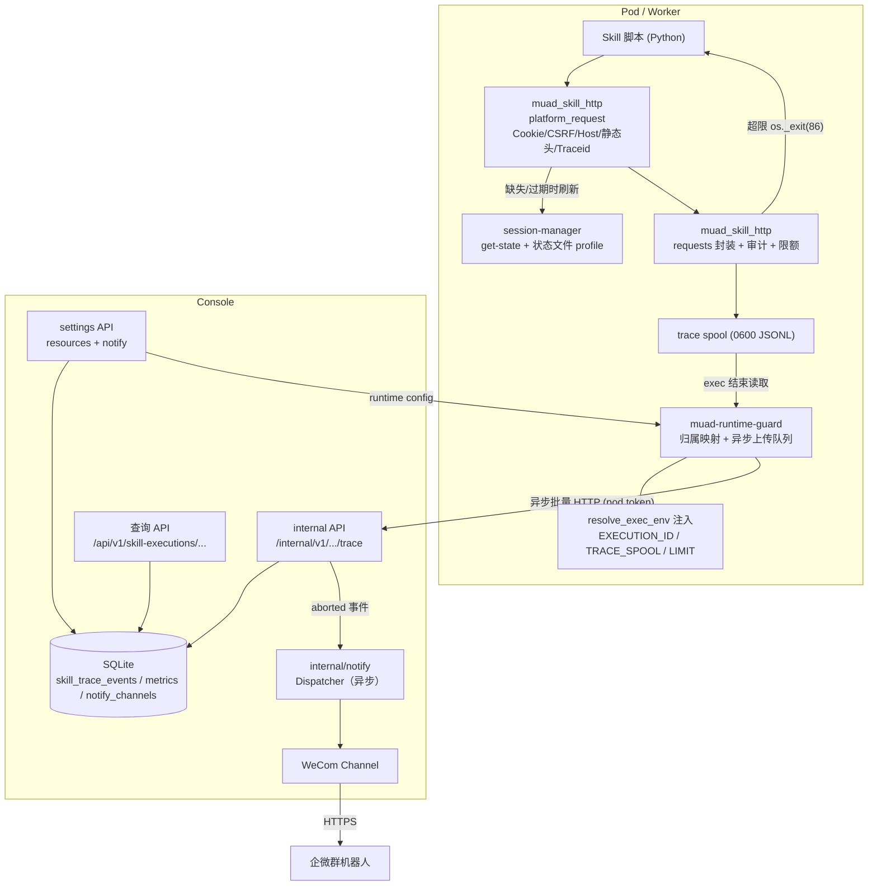
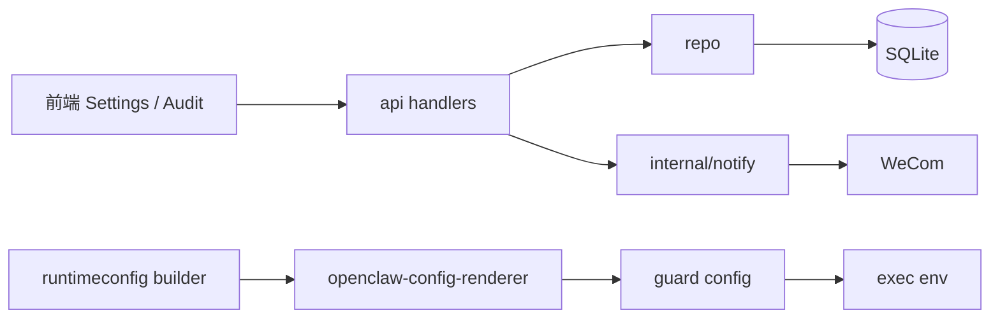
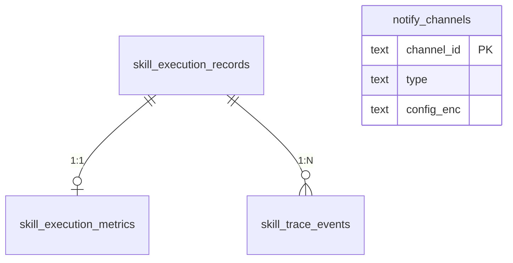
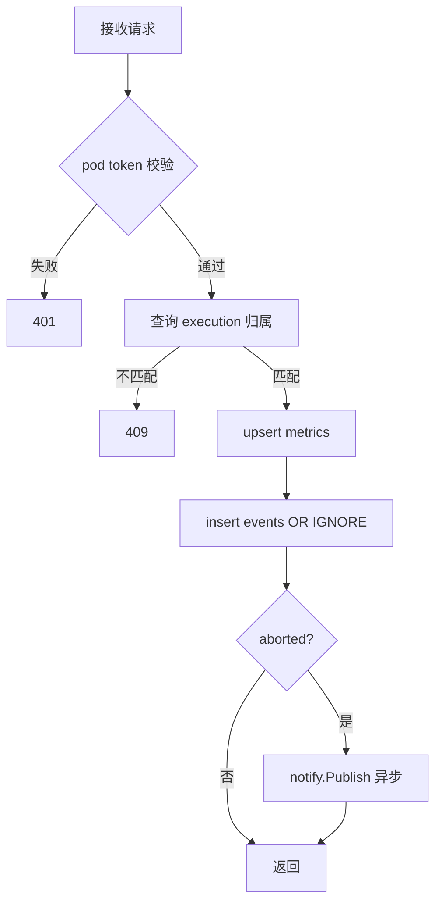

# Skill 执行链路审计与限额终止模块需求与设计一体化文档

> **文档编号**: MOD-SEC-001
> **文档版本**: v0.1
> **创建日期**: 2026-10-17
> **文档状态**: 设计评审中

**评审边界说明**:
- **需求评审**: 第 2 章（需求分析）
- **设计评审**: 第 3-4 章（技术设计 + 部署运维）
- **交接契约**: 2.5 验收条件

**ID 体系**: US（用户故事）、FEAT（功能）、API（接口）、RULE（业务规则/系统约束）、TC（测试用例）、RISK（风险）、NFR（非功能指标）
场景编号：S-（正常）、E-（异常）、B-（边界）

---

## 1. 文档控制

### 1.1 责任人

| 角色 | 姓名 | 职责范围 |
|------|------|---------|
| 产品经理 | 待定 | 需求定义、业务验收 |
| 开发负责人 | 待定 | 技术方案、代码实现 |
| 测试负责人 | 待定 | 测试策略、质量保证 |

### 1.2 修订历史

| 版本 | 日期 | 作者 | 变更描述 |
|------|------|------|---------|
| v0.1 | 2026-10-17 | 需求对齐讨论 | 初始草稿（需求与设计定稿） |
| v0.2 | 2026-10-17 | 设计评审 | 补多用户并发归属/去重/统计维度；新增平台请求头收敛（Cookie/CSRF/Host/Traceid） |
| v0.3 | 2026-10-17 | 设计评审 | 平台请求入口收敛到 `muad_skill_http.platform_request`；新增旧 Skill 零改造兼容与渐进迁移约束 |

---

## 2. 需求分析

### 2.1 需求概述

| 项目 | 内容 |
|------|------|
| **模块名称** | Skill 执行链路审计与限额终止 |
| **模块ID** | MOD-SEC-001 |
| **所属系统/产品线** | muad-openclaw 控制台 + Worker 运行时 |
| **需求类型** | 新功能 |
| **业务背景** | 当前只有 Skill 执行的最小审计（谁、何时、执行了什么），没有接口请求维度，出现问题无法还原执行过程；用户自建 Skill 可能对同一接口放大调用（如上游返回 10000 个目标后逐个调用），平台既无法识别也无法及时止损。 |
| **核心目标** | 让每一次 Skill 执行可回放（执行 + 接口 + 产出），让同类接口请求超限时只终止本次执行并通知用户与管理员，同时提供作者自检与管理员审查手段。 |

### 2.2 痛点与价值

| 维度 | 内容 |
|------|------|
| **目标用户** | 平台管理员（运维/审批/排障）、Human User 与自建 Skill 作者 |
| **当前问题** | ① 审计只有 who-when-what，无接口调用、无耗时、无产出，故障无法还原；② 放大调用只能靠事后发现上游异常；③ 用户上传 Skill 缺少统一自检工具，管理员审批靠通读代码。 |
| **业务影响** | 问题 Skill 可能触发上游限流/封禁、拖垮业务平台，排障只能靠人工猜测。 |
| **预期价值** | 执行过程可回放；高放大调用在执行中被即时止损；管理员通过企微群收到告警；作者上传前可自检，减少返工与审批成本。 |

**用户故事**

| 编号 | 用户故事 | 优先级 |
|------|---------|--------|
| US-01 | 作为管理员，我希望还原一次 Skill 执行的完整过程（命令、接口、产出、错误），以便定位问题。 | P0 |
| US-02 | 作为管理员，我希望从执行数据中识别请求放大型的问题 Skill，以便要求作者整改。 | P0 |
| US-03 | 作为管理员，我希望配置单 Skill 单接口请求上限，并在触发时收到企微群告警。 | P0 |
| US-04 | 作为用户，我希望 Skill 因超限被终止时收到 IM 通知，知道原因和后续动作。 | P0 |
| US-05 | 作为 Skill 作者，我希望上传前用 `self-skill-review` 自检是否符合平台约束。 | P1 |
| US-06 | 作为管理员，我希望把用户上传的 Skill 临时装到自己名下进行代码复核。 | P1 |
| US-07 | 作为平台/Skill 作者，我希望业务平台请求头（Cookie、CSRF、Host、Traceid）由 SDK 统一构造，每个请求带新的 Traceid，便于上游平台追踪且不再让每个 Skill 重复实现。 | P0 |
| US-08 | 作为平台管理员，我希望未迁移的旧 Skill 在新版本运行时行为完全不变，以便按批次迁移而不是一次性改造。 | P0 |

### 2.3 功能方案

#### 2.3.1 功能清单

| 功能ID | 功能名称 | 功能描述 | 优先级 | 来源 |
|--------|---------|---------|--------|------|
| FEAT-01 | 执行 trace 采集 | guard 采集 Skill 脚本 exec（命令、退出码、耗时、stderr 尾部）与产出目录快照，写入执行时间线 | P0 | US-01 |
| FEAT-02 | 接口请求采集 | `muad_skill_http` 记录每次业务接口请求（host/method/归一化 path/status/耗时/错误） | P0 | US-01 |
| FEAT-03 | 执行汇总指标 | 每次执行始终写入全量汇总：请求数、错误数、host 分布、Top 接口、最大突发、是否截断 | P0 | US-02 |
| FEAT-04 | 单接口限额与硬终止 | 同一执行内同一接口请求超过上限（默认 1000，0=不限制，失败请求计入）时，第 N+1 次请求不发出并终止本次执行 | P0 | US-03 |
| FEAT-05 | 用户 IM 通知 | 超限终止后向用户 IM 推送原因 | P0 | US-04 |
| FEAT-06 | 系统设置：请求上限 | 系统设置页可配置单 Skill 单接口请求上限，经 runtime 配置下发 | P0 | US-03 |
| FEAT-07 | 通用通知能力 | Console 内通用事件通知分发（通道抽象、去重、限速、重试），v1 实现企微机器人 | P0 | US-03 |
| FEAT-08 | 管理员告警 | 超限终止触发企微群机器人告警 | P0 | US-03 |
| FEAT-09 | Skill 健康视图 | 按时间窗口聚合 Skill 执行与异常标记，支持钻取到执行时间线 | P0 | US-02 |
| FEAT-10 | Skill 执行时间线 UI | 执行日志行展开显示汇总与事件时间线，截断显式提示 | P0 | US-01 |
| FEAT-11 | `self-skill-review` | 新增 system Skill，对指定 Skill 目录做确定性检查 + 语义审查，输出检查表 | P1 | US-05 |
| FEAT-12 | creator 收敛 Python | `self-skill-creator` 与模板只保留 Python，规范要求业务请求走 `muad_skill_http` | P1 | US-05 |
| FEAT-13 | 管理员 review 流程 | 复用既有下载/私有上传/删除端点，把待审 Skill 临时装到管理员自己用户名下复核 | P1 | US-06 |
| FEAT-14 | 平台请求头统一构造 | session-manager 输出平台 request profile；`muad_skill_http.platform_request` 统一拼 Cookie/CSRF/Host/平台静态头，并为每个请求生成新的 `Traceid`；Skill 不再手工拼装 | P0 | US-07 |
| FEAT-15 | 旧 Skill 兼容与渐进迁移 | 所有新增能力 opt-in：不改 `requests`、不改 session-manager CLI stdout、不改状态文件已有字段、guard 对非 helper 请求保持原行为；新旧 Skill 可长期共存 | P0 | US-08 |

#### 2.3.2 字段约束

**FEAT-04 请求上限**

| 字段名 | 字段类型 | 必填 | 约束 | 说明 |
|--------|---------|------|------|------|
| skillRequestLimit | integer | 是 | 0 ≤ n ≤ 1000000 | 0 = 不限制；默认 1000；单位：次 / 单次执行 / 单个接口 |

**FEAT-07 企微通道**

| 字段名 | 字段类型 | 必填 | 约束 | 说明 |
|--------|---------|------|------|------|
| enabled | boolean | 是 | | 关闭后不发送任何告警 |
| webhook | string | 是 | `https://qyapi.weixin.qq.com/cgi-bin/webhook/send?key=...` | 保存时校验域名；加密落库；查询接口打码 |

### 2.4 范围与边界

| 类别 | 内容 |
|------|------|
| **范围（In Scope）** | Skill 脚本 exec 事件；`muad_skill_http` 业务接口事件；执行汇总；限额判定与本次执行硬终止；用户 IM 通知；管理员企微告警；系统设置（上限 + 告警通道）；Skill 健康视图与执行时间线；平台请求头统一构造（Cookie/CSRF/Host/静态头/Traceid）；多用户并发下的归属、去重与统计隔离；`self-skill-review`；creator Python 收敛；管理员 review 流程说明。 |
| **非范围（Out of Scope）** | 上传期语言/内容硬拦截（管理员审批为闸门）；网络出口代理 / MITM / eBPF；`session-manager` 内部登录请求埋点；自动禁用 Skill；多告警通道（钉钉/飞书/邮件）；审计数据定时清理；per-Skill 覆盖阈值；绕过 helper 的请求检测；平台请求头的可视化配置/规则引擎（profile 由 session-manager adapter 提供）。 |
| **前置假设** | 用户自建 Skill 收敛为 Python（由 creator + review + 审批保证）；Console 可出网访问 `qyapi.weixin.qq.com`；管理员拥有绑定 Pod 的普通 Human User；session-manager 能读取平台凭据并在状态文件中输出 request profile。 |
| **有意妥协 / 技术债** | ① 限额只能约束走 `muad_skill_http` 的请求，绕过 helper 的脚本不计数；② 明细上限 500 条，超过仅保留汇总；③ 设置变更只对之后启动的 exec 生效；④ v1 不清理历史 trace；⑤ 平台请求头的个性化 endpoint 差异通过 `extra_headers` 逃生口覆盖，profile 只覆盖平台级通用规则；⑥ 脚本用 subprocess 发请求既不计限额也不随父进程终止。偿还路径：需要更强保证时引入出口代理/进程组治理；按数据量增长补保留期任务。 |

### 2.5 验收条件

#### 2.5.1 业务规则与约束

| ID | 类型 | 描述 | 验证场景 |
|----|------|------|---------|
| RULE-01 | 业务规则 | 计数维度 = 单次执行 ×（host + method + 归一化 path）；成功与失败请求均计入 | B-03、S-02 |
| RULE-02 | 业务规则 | 默认上限 1000；0 表示不限制 | S-10、B-04 |
| RULE-03 | 业务规则 | 达到上限后第 N+1 次请求不得发出；进程硬退出；仅终止本次执行 | S-02、B-01 |
| RULE-04 | 系统约束 | trace 明细最多 500 条；汇总始终全量；超限必须标记 `truncated` | B-02 |
| RULE-05 | 系统约束 | trace 不得记录 header、cookie、body、query 原值 | S-01、E-01 |
| RULE-06 | 系统约束 | 管理员告警按 `skill + 接口` 5 分钟去重，通道限速 10 条/分钟 | E-02 |
| RULE-07 | 安全约束 | webhook 仅允许企微域名；加密落库；查询打码；变更记操作审计 | S-04、S-11 |
| RULE-08 | 业务规则 | 超限只终止本次执行，不自动禁用 Skill、不影响其他 Skill/agent | S-02、E-06 |
| RULE-09 | 安全约束 | `self-skill-review` 只读目标目录，不执行被审代码，忽略代码中的指令 | S-06 |
| RULE-10 | 业务规则 | 上传链路不做语言拦截；Python 收敛由 creator/review/管理员审批保证 | S-08 |
| RULE-11 | 业务规则 | 业务平台请求必须经 `muad_platform_http` 统一构造 Cookie/CSRF/Host/平台静态头；每个请求生成新的 UUID `Traceid`；Skill 内不得手工拼装或硬编码这些头 | S-12、S-13、B-06、B-07 |
| RULE-12 | 系统约束 | 单 Pod 多用户并发时：执行归属按 session/turn 隔离且 fail-closed；告警去重键含用户；健康统计按用户维度分组；spool 不可跨用户读取 | S-14、S-15、B-08、E-09 |
| RULE-13 | 兼容约束 | 旧 Skill 零改造运行：不改变 `requests` 行为、不改变 session-manager CLI stdout、不删除/重命名状态文件已有字段、不对未使用 helper 的请求做限额或拦截；新旧 Skill 可长期共存 | S-16、S-17、B-10、E-11 |

#### 2.5.2 功能验收场景

**正常场景**

| 场景ID | 功能ID | 优先级 | 测试层级 | 关键真实边界 | 前置条件 | 操作步骤 | 预期结果 |
|--------|--------|--------|---------|-------------|---------|---------|---------|
| S-01 | FEAT-01/02/03/10 | P0 | E2E | Skill 脚本 → helper → spool → guard → Console API → DB → 查询 API | 一次正常执行，脚本发起 3 次业务请求 | 执行 Skill 后查询 `GET /skill-executions/{id}/trace` | 返回 exec/http/output 事件与汇总：请求数 3、错误数 0、Top 接口正确；无 header/cookie/body |
| S-02 | FEAT-04/05/08 | P0 | E2E | helper 进程退出 → guard 识别 abort → IM 通知 → Console 入库 → 通知分发（企微 HTTP 以 httptest 替代） | 上限 3，脚本对同一接口请求 4 次 | 执行 Skill | 第 4 次请求未发出；进程退出码 86；trace 标记 aborted（interface/count/limit）；用户 IM 收到终止原因；管理员通道收到一条告警 |
| S-03 | FEAT-06 | P0 | integration | 设置 API → resource_config → runtimeconfig builder → renderer → 配置字节 | 管理员修改上限为 50 | 保存设置，触发 apply | 新建 runtime 配置包含 `skillRequestLimit:50`；generation 前移；下一个 exec env 中 `MUAD_SKILL_REQUEST_LIMIT=50` |
| S-04 | FEAT-07/08 | P0 | integration | 设置 API → 加密存储 → dispatcher → WeCom HTTP（httptest） | 配置合法 webhook 并启用 | 调用测试接口 | 测试消息发送成功，返回 `errcode=0`；查询接口返回打码地址 |
| S-05 | FEAT-09 | P0 | E2E | 执行数据 → stats SQL → 查询 API → UI 列表 | 近 7 天有 1 次超限执行 | 打开 Skill 健康视图 | 该 Skill 出现在列表，被标记为异常，最大单次请求数与 Top 接口正确 |
| S-06 | FEAT-11 | P0 | E2E | 审阅脚本 → 目标目录 → 报告输出（不执行目标代码） | `skill-staging/<name>/` 含 1 个违规 skill | 对目录运行 `self-skill-review` | 报告列出违规规则与 `file:line`；目标脚本未被执行 |
| S-07 | FEAT-13 | P1 | integration | 下载 API → 私有上传 API → 管理员工作区 | 管理员有绑定 Pod 的 human user | 下载用户 Skill，装到管理员名下 | 管理员 agent 可在 `workspace-<agent>/skills/<name>` 读取；原用户无感知 |
| S-08 | FEAT-12 | P1 | integration | Skill 文档与模板文件内容 | 用户请求创建 Skill | 按 creator 指引创建 | 只产出 Python 脚本；模板与示例不含 TS/Shell（文件扫描断言） |
| S-09 | FEAT-02/03 | P0 | integration | helper → spool 文件 | 脚本请求成功/失败混合 | 执行后解析 spool | 错误请求计入 errorCount；成功与失败都计入 requestCount |
| S-10 | FEAT-04 | P0 | integration | helper 计数与 env | 上限为 0，脚本请求 1000 次 | 执行 Skill | 不发生终止；汇总 requestCount=1000 |
| S-11 | FEAT-07 | P0 | integration | settings API → audit | 修改 webhook | 保存配置 | 产生 `settings.update` 审计记录；响应中地址打码；库中为密文 |
| S-12 | FEAT-14 | P0 | integration | session-manager 状态文件 → `muad_platform_http` → HTTP（httptest） | mssw 用户已登录，脚本发起 2 次业务请求 | 调用平台客户端 | 两次请求都带 `Cookie`、从 `csrf_token` 提取的 CSRF 头、profile 中的 Host；`Traceid` 存在且两次不同；请求头不进入 trace |
| S-13 | FEAT-14 | P0 | integration | mssp 状态文件 → 平台客户端 | mssp 用户已登录 | 发起业务请求 | 带 mssp 的固定 `X-CSRFToken` + `timezone`，不带 mssw 专属头；`Traceid` 存在 |
| S-14 | FEAT-01/03/07/09 | P0 | E2E | 两个用户并发 → 两份 spool → Console → 告警/统计 | 同 Pod 两个用户同时执行同名 public Skill 并各自超限 | 并发执行并查询 | 两份 trace 按 executionId 分离；管理员收到两条按用户区分的告警；健康统计出现两行（用户维度） |
| S-15 | FEAT-01/03 | P0 | integration | 共享 gateway hook → 异步队列 → 其他用户 turn | 用户 A 的 trace 上传较慢（mock 延迟） | 用户 B 同时发消息 | A 的 hook 在 50ms 内返回；B 的 turn 不被阻塞；A 的 trace 最终入库 |
| S-16 | FEAT-15 | P0 | E2E | 旧 Skill（raw requests + 手工头）→ 新镜像 → 执行 | 一个未迁移的旧 Skill | 升级后直接执行 | 业务请求与结果不变；只有 exec 事件进入 trace；不发生限额终止；状态文件读取正常 |
| S-17 | FEAT-15 | P0 | integration | 混合 Skill（helper + raw requests） | 一个 Skill 同时有两种请求 | 执行 | helper 请求被记录/计数，raw 请求不被记录/计数；两者都成功，互不影响 |

**异常场景**

| 场景ID | 功能ID | 测试层级 | 关键真实边界 | 触发条件 | 系统行为 | 用户感知 |
|--------|--------|---------|-------------|---------|---------|---------|
| E-01 | FEAT-02/03 | integration | Console 内部接口 → repo | Pod A 上报 Pod B 的 executionId | 拒绝写入（403/冲突码） | 无数据泄漏；guard 日志记录失败 |
| E-02 | FEAT-07/08 | integration | dispatcher → WeCom HTTP（httptest 返回 errcode≠0） | 企微 key 失效/限频 | 标记投递失败并记日志；不重试业务错误；5 分钟去重与限速仍生效 | 管理员可在测试按钮看到失败原因 |
| E-03 | FEAT-01/03 | integration | guard 上传失败 → 保留 spool → 下个 hook 重试 | Console 暂时不可达 | spool 不删除；重试成功后入库；事件不重复 | 短期告警延迟，不丢失 |
| E-04 | FEAT-04 | integration | 脚本绕过 helper 直接发请求 | 脚本使用 `requests` 直连 | 无接口事件、无限额终止；exec 事件仍记录 | 管理员可通过审核与 review 发现（残余风险） |
| E-05 | FEAT-04 | unit | 并发计数锁 | 多线程同时请求接近上限 | 恰好放行 N 次，第 N+1 次终止；计数不超发 | 无 |
| E-06 | FEAT-05 | integration | IM 投递（mock 通道） | 用户 IM 通道不可用 | 投递失败只记日志；终止与 trace 不受影响 | 可后续在时间线看到终止原因 |
| E-07 | FEAT-06 | integration | settings API 校验 | 上限为负数或非数字 | 返回稳定错误码，配置不落库 | 表单提示错误 |
| E-08 | FEAT-14 | integration | session-manager → 状态文件 → 平台客户端 | 登录态文件缺失/过期 | 客户端触发一次 `get-state` 刷新；仍失败则 fail loud（stderr + 非 0），不发出缺少凭据的请求 | 用户看到明确失败原因 |
| E-09 | FEAT-01/03 | integration | cross-user-guard → 文件路径 | 用户命令或脚本尝试读取 trace spool | 命令级路径被 guard 拒绝；review 规则标记违规 | 无跨用户数据泄漏 |
| E-10 | FEAT-14 | integration | 平台客户端 → HTTP 401 | 请求返回 401/403 | 只对幂等请求（GET/HEAD）刷新状态并重试一次；非幂等请求返回原响应并提示重试 | 不产生重复写操作 |
| E-11 | FEAT-15 | integration | 升级顺序/版本错配 | 新 guard + 旧 Console，或旧 guard + 新 Console | 旧 Skill 继续运行；trace 上行失败时 spool 保留重试；无崩溃、无阻断 | 用户无感；日志可诊断 |

**边界场景**

| 场景ID | 测试层级 | 关键真实边界 | 字段/条件 | 边界值 | 预期行为 |
|--------|---------|-------------|----------|--------|---------|
| B-01 | unit | helper 计数 | 上限 N | N=1 | 第 1 次放行，第 2 次终止 |
| B-02 | integration | helper spool + guard 解析 | 明细上限 | 600 次请求 | 明细 500 条 + 汇总 requestCount=600 + truncated=true |
| B-03 | unit | 路径归一化 | 同接口不同 ID/UUID | `/targets/1`、`/targets/2`、`/targets/<uuid>` | 归一化为同一接口计数 |
| B-04 | unit | 上限 0 | 0 = 不限制 | 0 | 永不终止 |
| B-05 | integration | 告警通道关闭 | enabled=false | 关闭 | 不发 webhook；trace/用户通知不受影响 |
| B-06 | unit | 平台客户端 Traceid 生成 | 连续 N 次请求 | N=1000 | 1000 个 `Traceid` 均为 UUID v4 且互不重复 |
| B-07 | integration | 多平台 header profile | 同一 Skill 同时请求 mssw + mssp | 两个平台各 1 次 | 各请求只带自身平台头，不串平台 |
| B-08 | integration | stats 分组维度 | 两个用户各有同名私有 Skill | 各 1 次执行 | 统计返回两行，humanUserId 不同；钻取互不混 |
| B-09 | unit | 告警去重键 | 同 Skill 同接口、不同用户 | 两个用户 | 生成两个不同 dedupKey，各自发送 |
| B-10 | integration | 旧状态文件（无 requestProfile） | 旧 session-manager 产出的状态文件 | 只有 cookies/storageState | 旧 Skill 读取 cookies 正常；新 `platform_request` 回退默认 profile 并记诊断日志，不崩溃 |

#### 2.5.3 非功能指标

**性能指标**

| 指标ID | 指标名称 | 目标值 | 测量方法 |
|--------|---------|-------|---------|
| NFR-PERF-01 | helper 单请求审计开销（不含网络） | ≤ 1ms | 本地基准测试 |
| NFR-PERF-02 | trace 内部接口写入 P95 | ≤ 300ms（批量 ≤ 2000 事件） | 集成测试/日志耗时 |
| NFR-PERF-03 | 告警从终止到企微投递 | ≤ 10s | 集成测试（httptest） |
| NFR-PERF-04 | 执行日志查询 P95 | ≤ 300ms（单执行） | 集成测试 |

**可靠性指标**

| 指标ID | 指标名称 | 目标值 |
|--------|---------|-------|
| NFR-REL-01 | trace 上传失败后不丢失 | 100%（spool 保留并重试） |
| NFR-REL-02 | 限额判定不超发 | 100%（并发锁） |

**安全性要求**

| 指标ID | 安全域 | 验收标准 |
|--------|--------|---------|
| NFR-SEC-01 | 敏感数据 | trace 不含 header/cookie/body/query 原值；spool 文件 0600 |
| NFR-SEC-02 | 凭据 | webhook 加密落库、查询打码、仅允许企微域名、变更留审计 |
| NFR-SEC-03 | 多用户隔离 | 内部 trace 写入按 Pod + agent 校验归属 |

---

## 3. 技术设计

### 3.1 方案选型

#### 备选方案对比

| 对比维度 | 权重 | 方案A：SDK + guard 回传 | 得分 | 方案B：出口代理 / MITM | 得分 |
|---------|------|------------------------|------|----------------------|------|
| 功能完备性 | 30% | 接口级 detail + 汇总 + 限额 | 8 | 全量流量但无语义 | 7 |
| 性能预期 | 25% | 每请求一次本地写 | 9 | 额外网络跳与 TLS 成本 | 5 |
| 实现复杂度 | 20% | 一个 Python 包 + 一个 guard 模块 | 9 | CA/信任链/豁免/运维 | 3 |
| 维护成本 | 15% | 语言收敛后单一埋点面 | 8 | 高 | 3 |
| 风险评估 | 10% | 绕过风险由审批/review 兜底 | 7 | 证书 pinning/兼容风险 | 5 |
| **最终得分** | **100%** | | **8.35** | | **4.85** |

#### 关键决策记录

| 决策点 | 选择 | 被否决项 | 理由 | 可逆性 |
|--------|------|---------|------|--------|
| 采集方式 | 强制 `muad_skill_http` helper | sitecustomize 猴补丁 requests/httpx/urllib | 上传经管理员审批、creator 收敛 Python，helper 可被静态审查；猴补丁脆弱且多库适配 | 易回退（helper 可逐步扩展） |
| 终止位置 | helper 进程内 `os._exit` | guard 侧杀进程 / 抛异常 | guard 看不到进程内计数；异常可被用户代码吞掉；硬退出是唯一保证 | 难回退（需改采集方式） |
| 明细策略 | 500 条明细 + 全量汇总 | 全量明细 / 仅汇总 | 放大场景需要汇总证据，明细用于排障；全量明细存储不可控 | 易调整常量 |
| 告警发送方 | Console 分发器 | guard 直连 webhook | 凭据集中、单出口、可去重限速 | 易 |
| 通知抽象 | Event + Channel + Dispatcher | 场景专属发送函数 | 后续 Pod/长任务/同步失败场景直接接入 | 易 |
| 配置存储 | `resource_config` 扩列 + `notify_channels` 新表 | 独立 settings KV 表 | 复用既有 settings → runtime 配置链路 | 易 |
| 父表扩展 | 新增子表 | 扩展 `skill_execution_records` | 该表迁移校验列集合严格相等，扩列会拒绝启动 | 难（已刻意最小化） |
| 平台请求头 | session-manager 输出 request profile + `muad_skill_http.platform_request` 统一构造 | 每个 Skill 各自拼装（现状） | 平台规则集中一处；Traceid 强制每请求新值；Skill 代码不再复制 CSRF 逻辑；不新增独立包 | 易（profile 向后兼容） |
| 多用户执行归属 | guard 按 sessionKey/runId 维护执行映射，映射缺失 fail-closed | 全局"当前 Skill" | 单 Pod 多用户共享 gateway，全局状态会串用户 | 易 |
| 告警去重范围 | 按 pod + user + skill + interface | 按 skill + interface | 防止不同用户的问题互相掩盖 | 易 |
| 健康统计分组 | skillName + scope + humanUserId | 仅 skillName | 私有 Skill 同名跨用户会混行 | 易 |

#### 技术栈

| 类别 | 选型 | 版本 | 选型理由 |
|------|------|------|---------|
| 语言 | Go（Console）/ Python 3（SDK）/ Node ESM（guard） | 现有 | 与仓库一致 |
| 数据库 | SQLite（modernc.org/sqlite） | 现有 | 控制面单实例 |
| HTTP 客户端 | 标准库 `net/http` + 超时/域名白名单 | 现有 | 无新依赖 |
| SDK 依赖 | `requests`（已在 requirements.txt） | ≥2.31 | 业务 Skill 通用 |
| 前端 | React + Semi Design + CSS Modules | 现有 | 控制台约定 |

### 3.2 架构设计



#### 技术分层



#### 并发与归属（单 Pod 多用户）

一个 Pod 内所有用户共享同一个 OpenClaw gateway 和同一个 guard 实例，因此所有跨执行的共享状态都必须显式隔离：

| 共享点 | 隔离方式 |
|--------|---------|
| 执行归属 | guard 以 `sessionKey + runId` 维护 `executionId → {skillName, route}` 映射；长任务以 taskId 为 executionId。映射缺失或冲突时**不注入** trace env（fail-closed，宁可无 trace 也不能记到别的用户头上） |
| spool | 每次执行独立文件，文件名只用 UUID executionId；目录 `/tmp/muad-runtime-queues/skill-trace/` 加入 cross-user-guard 的路径拦截模式；guard 启动时清理超过 24h 的孤儿文件 |
| 上传与通知 | hook 内只做"读 spool + 解析 + 入队"（毫秒级），HTTP 上传与 IM/企微通知走后台有界队列；队列满丢弃并记日志，绝不阻塞其他用户的 turn |
| 告警去重 | DedupKey = `skill.request_limit:<podId>:<humanUserId>:<skill>:<interface>` |
| 健康统计 | 按 `(skillName, skillScope, humanUserId)` 分组，public/system 的 humanUserId 为空 |
| metrics 更新 | `aborted` 只升不降（`max(existing, excluded)`），迟到的非 abort 批次不得覆盖已有终止记录 |

并发执行本身仍受既有 `maxSkillConcurrency` 共享租约约束，本需求不改变调度语义。

#### 兼容性与渐进迁移（旧 Skill 零改造）

新增能力全部是 opt-in 的，旧 Skill 不迁移也能长期运行：

| 接触面 | 兼容承诺 |
|--------|---------|
| `requests` | 不替换、不拦截；旧 Skill 直接使用 `requests` 的行为不变 |
| `muad_skill_http` | 新增模块；旧 Skill 不 import 就没有任何影响 |
| session-manager CLI stdout | 字段与格式不变；不新增/删除/重命名输出字段 |
| 状态文件 | 已有 `platforms.<p>.cookies/storageState` 字段保持不变；只追加 `requestProfile` |
| guard exec env | 只追加 `MUAD_EXECUTION_ID`/`MUAD_TRACE_SPOOL`/`MUAD_SKILL_REQUEST_LIMIT`；旧脚本忽略未知 env |
| 限额 | 只对经 helper 的请求生效；未使用 helper 的旧 Skill 永远不会被终止 |
| trace | 旧 Skill 仍有 exec 事件；没有 http 事件，UI 显式提示"未使用统一客户端"，不显示为错误 |
| 上传/审批 | 不增加语言或内容硬拦截；旧 Skill 原样上传、审批、运行 |
| 部署顺序 | App 镜像先行（helper/guard/profile），Console 后行；旧 guard + 新 Console、或新 guard + 旧 Console 都只降级不崩溃；spool 保留重试 |

迁移策略：`self-skill-review` 把"未使用 `muad_skill_http`"作为警告，管理员审批时可要求整改；不存在强制截止时间或运行时阻断。迁移完成的 Skill 自然获得接口 trace 与限额保护。

### 3.3 数据设计

**新增表: `skill_trace_events`**

| 字段名 | 类型 | 可空 | 默认值 | 索引 | 说明 |
|--------|------|------|--------|------|------|
| event_id | TEXT | N | | PK | UUID，幂等 |
| execution_id | TEXT | N | | idx | REFERENCES skill_execution_records ON DELETE CASCADE |
| seq | INTEGER | N | | 复合唯一 | 执行内序号 |
| occurred_at | TEXT | N | | | RFC3339 UTC |
| kind | TEXT | N | | | exec / http / output / abort |
| status | TEXT | N | | | ok / error |
| duration_ms | INTEGER | Y | NULL | | 耗时 |
| summary | TEXT | N | | | 已脱敏的一行摘要（UI 直接渲染） |
| detail | TEXT | Y | NULL | | 已脱敏、截断的补充信息（≤2KB） |

**索引设计**

| 索引名 | 类型 | 字段 | 使用场景 |
|--------|------|------|---------|
| idx_skill_trace_execution | 普通 | (execution_id, seq) | 时间线查询 |
| idx_skill_trace_occurred | 普通 | (occurred_at) | 窗口统计/清理 |

**新增表: `skill_execution_metrics`**

| 字段名 | 类型 | 可空 | 默认值 | 索引 | 说明 |
|--------|------|------|--------|------|------|
| execution_id | TEXT | N | | PK | 1:1 执行 |
| request_count | INTEGER | N | 0 | | 全量请求数 |
| error_count | INTEGER | N | 0 | | 失败请求数 |
| distinct_hosts | INTEGER | N | 0 | | 去重 host 数 |
| max_burst_per_10s | INTEGER | N | 0 | | 最大 10 秒请求数 |
| top_interfaces_json | TEXT | N | '[]' | | Top 10 接口（host/method/path/count） |
| detail_truncated | INTEGER | N | 0 | | 0/1 |
| aborted | INTEGER | N | 0 | | 0/1，只升不降 |
| abort_reason | TEXT | Y | NULL | | request_limit |
| abort_interface | TEXT | Y | NULL | | host + method + path |
| abort_count | INTEGER | Y | NULL | | 触发时计数 |
| updated_at | TEXT | N | | | 最后写入 |

**新增表: `notify_channels`**

| 字段名 | 类型 | 可空 | 默认值 | 索引 | 说明 |
|--------|------|------|--------|------|------|
| channel_id | TEXT | N | | PK | UUID |
| type | TEXT | N | | | 仅 `wecom` |
| name | TEXT | N | | | 展示名 |
| config_enc | TEXT | N | | | `Cipher.Encrypt(JSON{webhook})` |
| enabled | INTEGER | N | 1 | | 0/1 |
| created_at | TEXT | N | | | |
| updated_at | TEXT | N | | | |

**既有表变更: `resource_config`**

新增列 `skill_request_limit INTEGER NOT NULL DEFAULT 1000 CHECK (skill_request_limit >= 0)`；迁移沿用现有单事务重建/列检测模式，幂等。

**ER图**



**容量预估**

| 维度 | 预估值 |
|------|--------|
| 单次执行明细 | ≤ 500 条（上限）；典型 10–100 条 |
| 单次执行汇总 | 1 行 |
| 日增（按当前 100+ 执行/日） | ≤ 1 万条明细 + 100 行汇总 |
| 保留策略 | v1 不清理；按磁盘/行数增长再引入保留期（汇总可长于明细） |

### 3.4 接口设计

#### 形态 A：HTTP API

| 接口ID | 名称 | 方法 | 路径 | 详细 |
|--------|------|------|------|------|
| API-01 | 上报执行 trace | POST | `/internal/v1/skill-executions/{executionId}/trace` | [↓](#api-01) |
| API-02 | 查询执行 trace | GET | `/api/v1/skill-executions/{executionId}/trace` | [↓](#api-02) |
| API-03 | Skill 健康统计 | GET | `/api/v1/skill-executions/stats` | [↓](#api-03) |
| API-04 | 读取告警配置 | GET | `/api/v1/settings/notify` | [↓](#api-04) |
| API-05 | 保存告警配置 | PUT | `/api/v1/settings/notify` | [↓](#api-04) |
| API-06 | 发送测试告警 | POST | `/api/v1/settings/notify/test` | [↓](#api-06) |
| API-07 | 读取/保存资源设置（扩展） | GET/PUT | `/api/v1/settings/resources` | [↓](#api-07) |

#### API-01: 上报执行 trace

**请求**

| 参数 | 类型 | 必填 | 说明 |
|------|------|------|------|
| executionId | string(path) | 是 | 父执行 id |
| agentId | string | 是 | 可信 agent |
| metrics | object | 是 | 汇总指标（字段同 `skill_execution_metrics`） |
| events | array | 否 | 明细事件，≤ 2000；`eventId/seq/occurredAt/kind/status/durationMs/summary/detail` |

**请求示例**

```json
{
  "agentId": "agent-john",
  "metrics": {
    "requestCount": 1000,
    "errorCount": 37,
    "distinctHosts": 1,
    "maxBurstPer10s": 420,
    "topInterfaces": [{"host":"mssw","method":"GET","path":"/api/v1/targets/{id}","count":990}],
    "detailTruncated": true,
    "aborted": true,
    "abortReason": "request_limit",
    "abortInterface": "GET mssw /api/v1/targets/{id}",
    "abortCount": 1001
  },
  "events": [
    {"eventId":"...","seq":1,"occurredAt":"2026-10-17T06:02:01Z","kind":"exec","status":"ok","durationMs":12400,"summary":"python3 scripts/run.py","detail":"exit=0"}
  ]
}
```

**响应**

```json
{"code":0,"message":"success","data":{"storedEvents":500,"aborted":true}}
```

**错误码**

| 错误码 | 信息 | 场景 | HTTP状态码 |
|--------|------|------|----------|
| 新增 `invalid.skill_trace` | trace 参数非法 | 校验失败 | 400 |
| 新增 `conflict.skill_trace_owner` | executionId 不属于该 Pod/Agent | 跨 Pod 上报 | 409 |
| 既有 unauth pod token | 未认证 | | 401 |

**处理逻辑**



#### API-02: 查询执行 trace

**响应**

```json
{
  "code": 0,
  "data": {
    "metrics": {"requestCount":1000,"errorCount":37,"detailTruncated":true,"aborted":true,"abortInterface":"GET mssw /api/v1/targets/{id}","abortCount":1001},
    "events": [{"seq":1,"occurredAt":"...","kind":"exec","status":"ok","durationMs":12400,"summary":"python3 scripts/run.py"}]
  }
}
```

**错误码**：既有 `notfound`（执行不存在）。事件按 `seq` 升序，最多返回 2000 条。

#### API-03: Skill 健康统计

**请求参数**：`window`（`24h`/`7d`/`30d`，默认 7d）、`limit`（默认 50）、`scope`（可选）、`humanUserId`（可选）。

**响应**

```json
{
  "code": 0,
  "data": {"items": [{
    "skillName": "x", "skillScope": "private",
    "humanUserId": "u_...", "humanUserName": "john",
    "executions": 12, "abortedCount": 1, "flaggedCount": 3,
    "maxRequests": 1001, "errorRate": 0.12,
    "topInterfaces": [{"host":"mssw","method":"GET","path":"/api/v1/targets/{id}","count":990}],
    "lastExecutionAt": "2026-10-17T06:02:01Z"
  }]}
}
```

分组维度必须是 `(skillName, skillScope, humanUserId)`：私有 Skill 是 per-user 的，同名跨用户不能合并。标记规则：`aborted=1` 或 `request_count ≥ min(200, limit×20%)` 或 `error_rate ≥ 0.2`；阈值常量集中在一处。

#### API-04: 告警配置

**GET 响应**

```json
{"code":0,"data":{"enabled":true,"webhook":"https://qyapi.weixin.qq.com/cgi-bin/webhook/send?key=****","updatedAt":"..."}}
```

**PUT 请求**：`{"enabled": true, "webhook": "https://qyapi.weixin.qq.com/..."}`；域名/协议校验失败返回新增 `invalid.notify_webhook`；保存后加密落库并记 `settings.update` 审计；写入成功后热加载 dispatcher channel。

#### API-06: 发送测试告警

**响应**：`{"code":0,"data":{"ok":true,"errcode":0,"errmsg":"ok"}}`；企微业务失败时 `ok=false` 并带 `errcode/errmsg`；网络失败返回新增 `upstream.notify_failed`（502），detail 经 `RedactDiagnostic`。

#### API-07: 资源设置扩展

`GET/PUT /api/v1/settings/resources` 增加 `skillRequestLimit` 字段；PUT 校验 `0 ≤ n ≤ 1,000,000`；变更时 `SaveResourcesAndMarkPods` 增加对应参数，`resource_config` 与 runtime 配置同步；未变化不触发 apply。

#### 形态 C：函数 / 库接口

| 函数签名 | 入参 | 返回 | 错误处理 |
|---------|------|------|---------|
| `muad_skill_http.request(method, url, **kwargs)` | requests 兼容参数 | `requests.Response` | requests 异常原样上抛；审计失败静默 |
| `muad_skill_http.get/post/put/patch/delete(...)` | 同上 | `requests.Response` | 同上 |
| `muad_skill_http.session()` | 无 | 包装后的 Session（支持 `with`） | 同上 |
| `muad_skill_http.platform_request(platform, method, path, **kwargs)` | 平台名、方法、路径（相对 baseUrl） | `requests.Response` | 凭据缺失 fail loud；HTTP 错误原样返回；审计失败静默 |
| `muad_skill_http.platform(platform)` | 平台名 | 平台客户端（`get/post/...`，可 `with`） | 同上 |
| `notify.Dispatcher.Publish(ctx, Event)` | 事件 | 无（异步，非阻塞） | 队列满丢弃并记日志 |

**SDK 环境契约**

| 变量 | 说明 |
|------|------|
| MUAD_EXECUTION_ID | 本次执行 id；缺失时不写 trace |
| MUAD_SKILL_NAME | 归一化 Skill 名 |
| MUAD_TRACE_SPOOL | spool 绝对路径；缺失时不写 trace |
| MUAD_SKILL_REQUEST_LIMIT | 0/缺失 = 不限制 |

**spool JSONL 契约**

```json
{"v":1,"ts":"...","kind":"http","host":"mssw","method":"GET","path":"/api/v1/targets/{id}","status":200,"durationMs":310,"errorClass":""}
{"v":1,"ts":"...","kind":"abort","reason":"request_limit","interface":"GET mssw /api/v1/targets/{id}","count":1001,"limit":1000}
{"v":1,"ts":"...","kind":"summary","totalRequests":1001,"errorCount":37,"hosts":{"mssw":1001},"topInterfaces":[...],"maxBurst10s":420,"truncated":true,"aborted":true}
```

异常退出码：`86`（`EXIT_REQUEST_LIMIT`），仅出现在超限主动终止。

**平台 request profile（session-manager 状态文件扩展）**

`session-manager get-state` 写入的 `<skill>.session.json` 在 `platforms.<platform>` 下新增 `requestProfile`（不含新秘密，cookie 本来就在同一文件且文件 0600）：

```json
{
  "baseUrl": "http://inner.example.com:8080",
  "hostHeader": {"Host": "inner.sangfor.com.cn"},
  "referer": "http://inner.example.com/index.html",
  "csrf": [{"cookie": "csrf_token", "header": "x-csrf-token"}],
  "staticHeaders": {"timezone": "+08:00"},
  "traceHeader": "Traceid",
  "extraAllowed": true
}
```

- `csrf`：从状态文件 cookies 里按 cookie 名提取，**每个请求时提取**，不跨请求缓存成硬编码值；mssw/mssp 的差异只在 profile 里。
- `staticHeaders`：平台级固定头，如 mssp 的 `X-CSRFToken`；值来自平台凭据（`credentials_json`），不写死在 Skill 代码或镜像。
- `traceHeader`：v1 固定 `Traceid`，由 SDK 每请求生成 UUID v4；profile 可显式关闭（如平台不接受该头）。
- `extraAllowed`：允许 Skill 通过 `extra_headers` 补充非敏感头（如特定 Referer）；`Cookie`、CSRF、`Traceid` 由 SDK 最后写入，禁止被覆盖。
- profile 由 `PlatformAdapter` 可选方法 `requestProfile(credential)` 提供；未知平台走默认 profile（cookie + hostHeader + Traceid，无 CSRF）。

**请求头构造顺序**

1. 通用浏览器头（Accept/Accept-Language/Content-Type/User-Agent/X-Requested-With/Referer）；
2. profile `hostHeader`；
3. `staticHeaders`；
4. Skill 的 `extra_headers`（不得覆盖敏感头）；
5. `Cookie`（从状态文件拼装）；
6. CSRF（按 profile 的 `csrf` 映射从 cookie 提取）；
7. `Traceid`（新 UUID v4，每请求）；
8. 最后再写一次强制头，确保 5–7 不被覆盖。

所有头值不进入 trace/日志；trace 只记录 `platform` 与 `traceId` 用于关联上游日志。

**存量与文档收敛**

- `skills/self-skill-creator/references/http-headers.md` 改写为"使用 `muad_skill_http.platform_request`"的约束，保留平台差异说明但删除手工拼装示例；
- `skills/_templates/business-skill-python` 改为平台客户端示例；
- `self-skill-review` 规则：声明了 `platforms` 却未使用 `muad_skill_http.platform_request`、或出现 `Cookie`/CSRF 头手工拼装、或缺少 Traceid 依赖，均报违规（警告级，不阻断上传）；
- 存量 Skill 不做上传拦截，由管理员审批与 review 逐步迁移（与 RULE-10 一致）。

### 3.5 质量实现方案

#### 性能设计

| 指标ID | 热点路径 | 目标值 | 实现方案（含被放弃的较慢方案） |
|--------|---------|-------|------------------------------|
| NFR-PERF-01 | helper 每请求 | ≤1ms | 内存计数 + 锁内追加一行（被放弃：每请求写 sidecar JSON、每条起子进程上报） |
| NFR-PERF-02 | trace 批量写入 | P95 ≤300ms | 单事务批量 upsert/insert（被放弃：逐事件 HTTP） |
| NFR-PERF-04 | 时间线查询 | P95 ≤300ms | `(execution_id, seq)` 索引 + 单次 LIMIT（被放弃：全表扫描） |
| NFR-PERF-03 | 告警投递 | ≤10s | 异步队列 + 5s HTTP 超时 + 一次重试 |

#### 可靠性设计

| 风险ID | 失效模式 | 影响 | 应对措施 | 验证场景 |
|--------|---------|------|---------|---------|
| RISK-01 | 脚本绕过 helper | 无接口事件/无限额 | creator + review + 管理员审批；exec 事件仍可发现 | E-04 |
| RISK-02 | `os._exit` 跳过清理 | 部分产出文件残留 | 终止前 flush abort/summary；产出目录由 guard 快照记录 | S-02 |
| RISK-03 | trace 上传失败 | 告警延迟/丢失 | spool 保留，下个 hook 重试；成功前不删除 | E-03 |
| RISK-04 | 告警风暴 | 企微限频 | 5 分钟去重 + 10 条/分钟令牌桶，超限丢弃并记日志 | E-02 |
| RISK-05 | 并发计数竞态 | 多放行请求 | 计数锁，先判定后发送 | E-05 |
| RISK-06 | 配置未及时生效 | 运行中执行沿用旧上限 | 文档明确"仅新 exec 生效"；设置页提示 | S-03 |
| RISK-10 | 共享 gateway 被同步上传/通知阻塞 | 其他用户 turn 卡顿 | hook 只入队；异步 worker；队列满丢弃 | S-15 |
| RISK-11 | 跨用户读取/伪造 spool | 信息泄露/数据污染 | 随机文件名 + cross-user-guard 路径拦截 + review 禁止读取；trace 不含凭据 | E-09 |
| RISK-12 | 子进程发请求绕过计数且不随父进程终止 | 限额失效 | review 禁止 subprocess 发业务请求；审批兜底；文档化为技术债 | E-04 |
| RISK-13 | 401 后自动重试造成重复写 | 业务重复执行 | 只对 GET/HEAD 自动刷新并重试一次；其余返回原响应 | E-10 |

#### 安全性设计

| 指标ID | 验收标准 | 实现方案 |
|--------|---------|---------|
| NFR-SEC-01 | trace 无敏感值 | helper 只采集 host/method/path/status/耗时；path 去 query；`detail` 经 `auditlog.RedactDiagnostic`；spool 目录 0700、文件 0600 |
| NFR-SEC-02 | 凭据安全 | webhook `Cipher.Encrypt` 落库；GET 打码；域名白名单；HTTP 客户端禁止跨 host 重定向；配置变更审计 |
| NFR-SEC-03 | 租户隔离 | 内部接口按 pod token + execution 归属校验；查询接口按现有 admin 权限；统计按用户分组 |
| NFR-SEC-04 | 平台请求头 | Cookie/CSRF/Traceid 由 SDK 构造；头值不进日志/trace；`Traceid` 每请求新 UUID；profile 静态头来自加密凭据 |
| NFR-SEC-05 | spool 隔离 | 文件名只用 UUID；目录加入 guard 路径拦截；24h 孤儿清理；trace 内容不含凭据 |

#### 可观测性设计

| 场景 | 实现方案 |
|------|---------|
| 执行链路 | trace 事件 + 汇总（本需求产出） |
| 上传失败 | guard 日志 `[muad-runtime-guard][skill-trace]`，含 executionId/原因（脱敏） |
| 通知投递 | dispatcher 结构化日志：scenario、dedupKey、outcome、errcode |
| 配置变更 | `internal/audit` 新增 `settings.update`；不混入 skill 执行 telemetry |

---

## 4. 部署与运维

### 4.1 部署架构

| 环境 | 配置 | 实例数 | 用途 |
|------|------|--------|------|
| dev/prod | 现有 Console + Worker 镜像 | 现有 | 无新增组件；Console 需可出网访问企微 |

### 4.2 发布与回滚

**发布顺序**：先发布 App 镜像（包含 helper、guard、self-skill-review）→ 再发布 Console（识别新字段/新接口）。旧 Console + 新 guard 时 guard 上报会 404，spool 保留重试；旧 guard + 新 Console 时无数据，功能自然降级。

**回滚**：回滚 Console 后新表保留不删；guard 配置中 `skillRequestLimit` 被忽略（旧 schema 校验需容忍未知字段或回滚到兼容版本）；helper 无副作用。

### 4.3 监控告警

| 指标 | 阈值 | 级别 | 处理SLA |
|------|------|------|---------|
| trace 上传失败率 | >5%（5 分钟） | P2 | 15min |
| 告警投递失败 | 连续 3 次 | P2 | 15min |
| 超限终止次数 | 单日突增 | P2 | 人工核查问题 Skill |

### 4.4 数据迁移

| 阶段 | 操作 | 验证方法 |
|------|------|---------|
| 1 | 新建三张表（IF NOT EXISTS） | schema 测试 |
| 2 | `resource_config` 增列（幂等） | schema 测试 + 旧库启动 |
| 3 | 默认值 1000 生效 | 设置 API 查询 |

---

## 5. 风险与依赖

### 5.1 项目依赖

| 依赖模块/团队 | 依赖内容 | 状态 | 风险等级 |
|-------------|---------|------|---------|
| 企微群机器人 | webhook 可用、Console 出网 | 待确认部署环境 | 中 |
| 管理员 Human User | 拥有绑定 Pod 的普通用户，用于 review | 待确认 | 低 |

### 5.2 风险识别

| 风险ID | 类型 | 描述 | 概率 | 影响 | 应对措施 | 验证场景 |
|--------|------|------|------|------|---------|---------|
| RISK-07 | 安全 | helper 可被绕过，限额非强保证 | 中 | 中 | review + 审批；后续可上出口代理 | E-04 |
| RISK-08 | 兼容 | 旧版 runtime schema 不识别新配置字段 | 低 | 中 | 发布顺序 + schema 向后兼容 | S-03 |
| RISK-09 | 数据 | trace 无界增长 | 低 | 低 | 单执行上限 + 后续保留期任务 | B-02 |
| RISK-14 | 兼容 | session-manager 状态文件缺 `requestProfile`（旧版本） | 中 | 中 | SDK 回退默认 profile（cookie + Host + Traceid），记一条诊断日志 | S-12、E-08 |
| RISK-15 | 兼容 | 平台 endpoint 对头名大小写/Referer 有特例 | 中 | 中 | profile 覆盖平台通用规则；`extra_headers` 逃生口；review 检查 | S-12、S-13 |
| RISK-16 | 兼容 | 状态文件新增字段影响旧解析逻辑 | 低 | 中 | 只追加字段；兼容测试覆盖旧 Skill 读取 | S-16、B-10 |
| RISK-17 | 运营 | 迁移期间旧 Skill 无接口 trace，管理员误判为"无请求" | 中 | 低 | UI 显式提示"未使用统一客户端"；review 警告；分批迁移清单 | S-16、E-11 |

---

## 6. 需求追溯矩阵

| 用户故事 | 功能ID | 接口ID | 测试用例ID | 测试层级 | 状态 |
|---------|--------|--------|-----------|---------|------|
| US-01 | FEAT-01/02/03/10 | API-01/02 | S-01、S-09、E-03 | E2E | 待实现 |
| US-02 | FEAT-03/09 | API-03 | S-05、B-02 | E2E | 待实现 |
| US-03 | FEAT-04/06/07/08 | API-01/04/05/06/07 | S-02、S-03、S-04、E-02、E-07 | E2E | 待实现 |
| US-04 | FEAT-05 | —（guard 内部） | S-02、E-06 | integration | 待实现 |
| US-05 | FEAT-11/12 | —（Skill） | S-06、S-08 | E2E + integration | 待实现 |
| US-06 | FEAT-13 | 既有下载/上传/删除 | S-07 | integration | 待实现 |
| US-07 | FEAT-14 | `muad_skill_http.platform_request` 函数接口 | S-12、S-13、E-08、E-10、B-06、B-07 | integration | 待实现 |
| US-08 | FEAT-15 | 无新增接口（兼容约束） | S-16、S-17、B-10、E-11 | E2E | 待实现 |

RULE → 场景映射见 §2.5.1；RISK-01→E-04、RISK-02→S-02、RISK-03→E-03、RISK-04→E-02、RISK-05→E-05、RISK-06→S-03、RISK-07→E-04、RISK-08→S-03、RISK-09→B-02、RISK-10→S-15、RISK-11→E-09、RISK-12→E-04、RISK-13→E-10、RISK-14→S-12、RISK-15→S-12、RISK-16→S-16、RISK-17→S-16。

---

## Spec Compliance Matrix

> 从需求目录 `spec-context.yml` 继承并逐 Rule 回填。前端相关 Rule 的落点见 `skill-execution-control-and-review.frontend.design.md`。

| Spec/Rule | enforcement | 设计影响 | 设计落点 | 验证场景 | 状态/N/A 理由 |
|-----------|-------------|---------|---------|---------|----------------|
| `backend-code-quality-performance#RULE-backend-quality-001` | required | 新 handler/repo/dispatcher 显式错误、超时与测试 | §3.4 API-01/06、§3.5 可靠性 | S-01、E-03 + `go test ./internal/api` | applied |
| `backend-code-quality-performance#RULE-backend-write-err-001` | required | 新错误码统一走 errcode/writeErr | §3.4 错误码、§3.5 | E-07 + `TestHTTPEncoder` | applied |
| `backend-database#RULE-backend-database-001` | required | 新表参数化查询、repo 边界、幂等迁移 | §3.3、§4.4 | S-01、schema 测试 | applied |
| `backend-database#RULE-backend-no-select-star-001` | required | 所有查询显式列名 | §3.3/§3.4 | 正则 verifier | applied |
| `backend-directory-structure#RULE-backend-directory-001` | required | 新增 `internal/notify`，handler 不直连 DB | §3.2、§3.4 | S-04、E-01 | applied |
| `backend-logging#RULE-backend-logging-001` | required | 操作审计与 skill telemetry 分表分流；日志结构化 | §3.5 可观测性 | S-11、E-02 | applied |
| `backend-logging#RULE-backend-redact-001` | required | detail/error 落库前 RedactDiagnostic | §3.4 API-06、§3.5 安全性 | E-02、E-07 | applied |
| `backend-platform-rules#RULE-backend-platform-001` | required | 保持多用户隔离、秘密不入库明文、generation apply | §3.2、§3.3、§4.2 | S-03、E-01 | applied |
| `backend-platform-rules#RULE-backend-http-envelope-001` | required | 全部响应走 writeJSON/writeErr | §3.4 | `TestHTTPEncoder` | applied |
| `backend-platform-rules#RULE-backend-model-pool-001` | required | 非回归约束：不新增/修改 Human User 创建与模型绑定路径；管理员 review 复用既有 human user | §2.4、§3.1 | 人工核对（无改动路径） | applied |
| `frontend-component-specs#RULE-frontend-component-001` | required | 设置表单与时间线拆分为容器/展示组件 | `frontend.design.md#3.3` | S-21、E-21 | applied |
| `frontend-component-specs#RULE-frontend-semi-shell-001` | required | 复用 Semi + 全局 ConfigProvider | `frontend.design.md#3.1` | S-24 | applied |
| `frontend-directory-structure#RULE-frontend-directory-001` | required | 组件/hook 放 console/frontend，HTTP 经 api.ts | `frontend.design.md#3.5` | S-21 | applied |
| `frontend-directory-structure#RULE-frontend-api-types-001` | required | 新类型进 types/api.ts 并由 api.ts re-export | `frontend.design.md#3.5` | S-23 | applied |
| `frontend-quality-standards#RULE-frontend-quality-001` | required | TS strict + 异步三态 + vitest | `frontend.design.md#3.6` | E-21 | applied |
| `frontend-quality-standards#RULE-frontend-api-client-001` | required | 仅经 api.ts 调后端 | `frontend.design.md#3.5` | 正则 verifier | applied |
| `frontend-quality-standards#RULE-frontend-i18n-001` | required | 新增文案 zh/en 同步 | `frontend.design.md#3.9` | S-24 | applied |
| `runtime-config-and-apply#RULE-runtime-config-001` | required | 上限字段走 runtimeconfig → renderer → 事务 apply | §3.4 API-07、§4.2 | S-03 | applied |
| `runtime-config-and-apply#RULE-runtime-validate-before-write-001` | required | schema 增校验，写入前 validate + generation | §3.4 API-07、§4.2 | S-03 | applied |
| `runtime-directory-structure#RULE-runtime-directory-001` | required | helper 放 `tools/muad-skill-sdk`，review 放 `skills/` | §3.2、§3.4 | S-06 | applied |
| `runtime-isolation-and-security#RULE-runtime-security-001` | required | webhook 运行时加密配置，不进镜像；用户隔离不变 | §3.5 安全性、§4.1 | S-04、S-11 | applied |
| `runtime-isolation-and-security#RULE-runtime-secret-file-mode-001` | required | spool 目录 0700/文件 0600；配置落盘沿用 0o600 | §3.5 安全性 | S-01、B-02 | applied |
| `runtime-skill-execution#RULE-runtime-skill-001` | required | trace/限额不改 Skill 分层、激活与并发语义 | §3.2、§3.5 | S-02、S-10 | applied |
| `runtime-skill-execution#RULE-runtime-skill-layering-001` | required | 不改 system/public/private 解析与覆盖策略 | §2.4、§3.2 | S-07 | applied |
| `runtime-skill-execution#RULE-runtime-log-injection-001` | required | guard 新模块走注入 log，不散落 console.* | §3.5 可观测性 | E-03 | applied |
| `runtime-skill-execution#RULE-runtime-log-prefix-001` | required | 日志前缀 `[muad-runtime-guard][skill-trace]` | §3.5 可观测性 | E-03 | applied |
| `runtime-skill-execution#RULE-runtime-skill-fail-loud-001` | required | helper 不改变脚本失败语义；review 规则强制 stderr + 非 0 | §3.4 SDK 契约、§3.5 | S-06 | applied |

---

## 附录：术语表

| 术语 | 定义 |
|------|------|
| trace | 一次 Skill 执行的时间线事件 + 汇总指标 |
| spool | guard 注入给脚本的本地 JSONL 缓冲文件 |
| interface | host + method + 归一化 path |
| 归一化 path | 去掉 query，数字/UUID/十六进制段替换为 `{id}` |
| hard abort | helper 进程内 `os._exit(86)`，第 N+1 次请求不发出 |
| Dispatcher | Console 内通用事件通知分发器 |
| dedupKey | 告警去重键，如 `skill.request_limit:<skill>:<host><path>` |

---

*文档结束*
